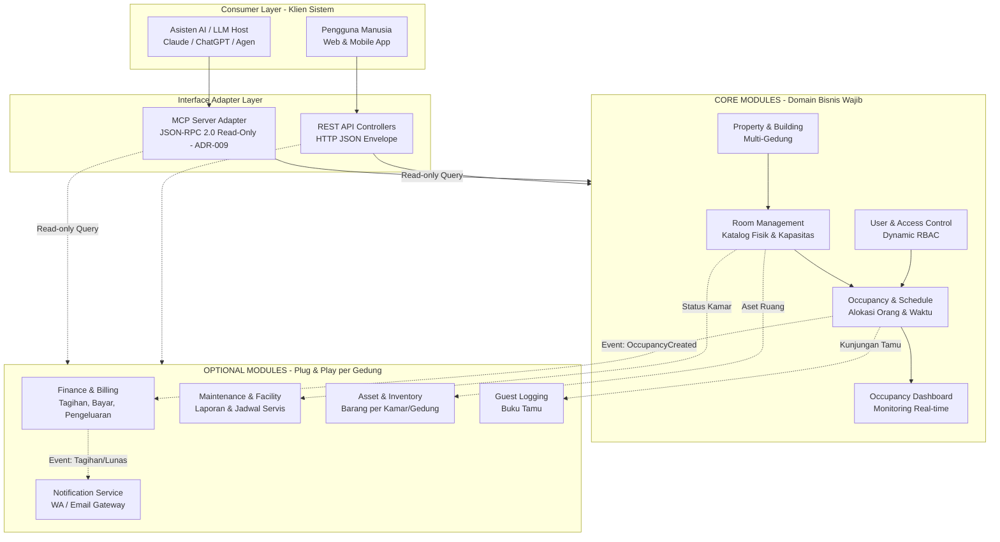

# Arsitektur Sistem — Federated Hub

**Terakhir diupdate:** 2025-09-19
**Stack aktif:** lihat `STACK.md` di folder yang sama
**Scope:** `PA-Management-kost` (PA skripsi + Project sistem)

## Overview

**Refactoring Sistem Manajemen Rumah Kost dengan Arsitektur Modular Monolithic Berbasis Kerangka Kerja Scrum** (Studi Kasus: **Wisma Amal Gorontalo**). Proyek akhir D3 Teknik Informatika PENS yang merefaktorisasi 4 proposal previous work (Juni 2025) menjadi sistem terintegrasi utuh. Mengelola hunian sementara (kost) untuk 3 peran: **Pemilik (Owner), Pengelola (Admin), Penghuni/Calon Penghuni**. Masalah inti: pencatatan manual penghuni/kamar/reservasi/keuangan/maintenance yang tidak terstruktur, rawan human error, tanpa dashboard real-time — serta previous work yang fragmentasi (4 proposal terpisah), arsitektur inkonsisten, test lemah, frontend web hilang, payment sandbox-only.

Sistem dibagi 4 domain layanan + core global, diimplementasi sebagai **Laravel Modules (nwidart/laravel-modules)** di backend dan **Flutter (BLoC + GetIt + AutoRoute)** di frontend — namun tetap terintegrasi dalam satu deployment. Dokumentasi skripsi (PA) dan kode (Project) difederasi via hub ini.

> Ringkasan 1 halaman ada di `STATE.md`. Detail per domain ada di `Project/docs/modules/*`, naskah PA aktif ada di `PA/latex/` (dengan arsip Markdown di `PA/docs/modules/*`).

## Tech Stack

| Layer | Teknologi | Catatan |
|---|---|---|
| Frontend Mobile (Penghuni) | Flutter 3.8.1, Dart 3.8.1, BLoC 9.1, GetIt 8.2, AutoRoute 11.1, Dio 5.9, flutter_secure_storage 10 | Clean Architecture (Presentation, Domain, Data) |
| Frontend Web (Semua Peran) | Flutter Web (single codebase dengan Flutter Mobile) | Clean Architecture, Multi-Tenant Switcher, Chat AI MCP |
| Backend | Laravel 11, PHP 8.2, nwidart/laravel-modules 12, Spatie Permission 6.23, Midtrans 2.6, Scramble 0.13 | Modular Monolith (3-Tier, Event-Driven, Module Gateway, MCP Server) |
| Database | MySQL (MVCC, ACID), Eloquent ORM | Skema Multi-Tenant (`buildings`, `building_id` row-level scoping) |
| Auth & Tenancy | Keycloak OIDC IAM + Laravel Sanctum + Spatie RBAC + TenantResolver | SSO terpusat, stateless JWKS verify, tenant-aware RBAC |
| AI Integration | Model Context Protocol (MCP) JSON-RPC Server | Read-only tool execution (laporan, okupansi, maintenance) |
| Payment | Midtrans Payment Gateway | Tagihan otomatis, verifikasi via callback, idempotency |
| Notifikasi | Fonnte / Open-WA (Node.js) + in-app/Email/WhatsApp | Modul Notification |
| Infra | Docker, nginx, Vite, Laravel Pail |  |

> Aturan spesifik per stack ada di `STACK.md`. Jangan duplikasi di sini.

## Struktur Folder Federated

```
PA-Management-kost/
├── Docs/                              # HUB GLOBAL (kamu di sini)
│   ├── 00_overview/
│   │   ├── ARCHITECTURE.md            # index federasi ini
│   │   ├── STATE.md                   # ringkasan 1 halaman
│   │   └── STACK.md                   # fullstack Laravel+Flutter
│   ├── 01_guides/
│   │   ├── GLOSSARY.md
│   │   ├── CONVENTIONS.md
│   │   └── WORKFLOW.md                # Scrum 4 sprint
│   ├── 02_reference/
│   │   ├── API_STYLE.md               # pointer ke backend
│   │   ├── DATABASE_SCHEMA.md         # pointer ke ERD global
│   │   └── INTEGRASI_ANTAR_MODUL.md   # aturan komunikasi modul
│   ├── 03_logs/
│   │   ├── PROGRESS_LOG.md
│   │   ├── DECISIONS.md               # ADR global
│   │   └── CHANGELOG.md
│   └── modules/                       # pointer high-level
│       ├── wisma-core.md
│       ├── room-reservation.md
│       ├── resident-guest.md
│       ├── finance-midtrans.md
│       └── operational-maintenance.md
│
├── PA/                                # SKRIPSI
│   ├── latex/                         # SOURCE OF TRUTH NASKAH AKTIF (buku-pa-pens-latex)
│   ├── master/                        # PDF Master acuan awal (Naskah Proyek Akhir 1.0.pdf)
│   ├── old-files/                     # 4 PDF proposal (sumber knowledge)
│   └── docs/                          # Docs PA komprehensif
│       ├── 00_overview/
│       ├── 01_guides/PANDUAN_PENULISAN.md
│       ├── 02_reference/DAFTAR_PUSTAKA.md, TABEL_JURNAL.md, TEMPLATE_BASELINE.md
│       ├── 03_logs/
│       ├── System design/             # PUSAT DESAIN SISTEM (Single Source of Truth)
│       │   ├── DAFTAR_FITUR.md        # Spesifikasi 17 Fitur (F01–F17)
│       │   └── BPMN/                  # Alur Proses Bisnis Terisolasi
│       └── modules/bab1..bab5/        # Arsip/referensi Markdown per BAB + full_draft.md

│
└── Project/                           # KODE
    ├── docs/                          # Hub Project (pointer backend+fe)
    ├── backend-wismaamalgorontalo/
    │   ├── KNOWLEDGE_BASE.md          # sumber, akan di-adopt
    │   ├── modules_statuses.json      # Room, Resident, Finance, Maintenance, Auth, Inventory...
    │   ├── Modules/
    │   └── docs/                      # Docs Backend
    └── fe_wisma_amal_gorontalo/
        ├── CLEAN_ARCHITECTURE_GUIDELINE.md
        ├── lib/ (core, data, domain, presentation)
        └── docs/                      # Docs Frontend
```

## Alur Data / Flow Modular Dinamis (ADR-008 & ADR-009)



## Daftar Modul (Index Federasi Dinamis — ADR-008 & ADR-009)

> **Aturan modular:** Sistem didesain *technology-agnostic* dan *as dynamic as possible*.
> - **Modul Core:** Selalu aktif di semua skenario properti (kost, asrama, mes, pondok).
> - **Modul Opsional:** Dapat diaktifkan/dinonaktifkan per gedung.
> - **Lapisan AI (MCP Adapter - ADR-009):** Hidup **di atas** modul-modul bisnis sebagai adaptor query cerdas *read-only*. MCP bukan domain bisnis inti dan tidak masuk ke dokumen data/ERD operasional.

### Modul Core (Wajib)

| Modul | Domain | Tanggung Jawab Utama | Sifat |
|---|---|---|---|
| **User & Access Control** | Core | Akun, biodata, dan **Dynamic RBAC** (permission sets bawaan + pembuatan custom role dinamis). | Wajib |
| **Property & Building** | Core | Konfigurasi properti/gedung multi-lokasi dan kebijakan dasar gedung. | Wajib |
| **Room Management** | Core | Master data fisik unit kamar (lantai, nomor, tipe, kapasitas maksimal). Terpisah dari jadwal. | Wajib |
| **Occupancy & Schedule** | Core | Alokasi dinamis orang $\leftrightarrow$ kamar $\leftrightarrow$ rentang waktu huni, validasi anti-bentrok kuota/jadwal. | Wajib |
| **Occupancy Dashboard** | Core | Monitoring status hunian dan ketersediaan unit secara real-time. | Wajib |

### Modul Opsional (Toggleable)

| Modul | Domain | Tanggung Jawab Utama | Skenario Penggunaan |
|---|---|---|---|
| **Finance & Billing** | Keuangan | Penerbitan tagihan (*invoice*), verifikasi pembayaran, denda keterlambatan, dan pencatatan pengeluaran operasional (*expenses*). | Aktif untuk kost/komersial; Nonaktif untuk asrama/mes/pondok gratis. |
| **Maintenance & Facility** | Operasional | Tiket laporan kerusakan fasilitas oleh penghuni dan jadwal perawatan rutin berkala fasilitas gedung. | Aktif jika properti membutuhkan sistem penanganan komplain & servis terjadwal. |
| **Asset & Inventory** | Operasional | Pencatatan aset barang per kamar/gedung dan kondisi kelayakannya. | Aktif jika properti mendata detail inventaris per unit. |
| **Guest Logging** | Hunian | Pencatatan buku tamu berkunjung/menginap + opsi penarikan tarif tamu jika Finance aktif. | Aktif jika properti memberlakukan pengawasan tamu ketat. |
| **Notification Service** | Komunikasi | Otomasi pengiriman pengingat tagihan/tiket ke kanal eksternal (WhatsApp/Email/SMS). | Aktif jika gateway pengiriman pesan dihubungkan. |

### Lapisan Ekstensi AI (External Adapter Layer — ADR-009)

| Komponen | Protokol | Fungsi | Posisi Arsitektur |
|---|---|---|---|
| **MCP Server Adapter** | JSON-RPC 2.0 (Model Context Protocol) | Menjawab pertanyaan analitik AI (okupansi, status kamar, komplain, keuangan) secara *read-only* dengan pembatasan hak gedung. | Di atas domain bisnis; mengonsumsi query modul internal; tidak menyimpan data bisnis mandiri. |


## Integrasi Eksternal

| Service | Fungsi | Auth | Docs |
|---|---|---|---|
| Keycloak IAM | Single Sign-On (SSO), OpenID Connect Identity Provider, Social Identity Broker | OIDC / JWKS (RS256) | `PA/docs/modules/bab2/README.md` |
| Midtrans | Payment gateway, Snap token, callback settlement | Server Key | `Project/backend/docs/02_reference/midtrans.md` |
| Open-WA / Fonnte | Notifikasi WhatsApp otomatis (tagihan, jatuh tempo) | API Key | `Project/backend/docs/02_reference/notifikasi.md` |
| Scramble | Auto API docs `/docs/api` | Sanctum | `Project/backend/docs/02_reference/api-reference.md` |

## Environment Variables Penting

| Variable | Fungsi | Wajib? |
|---|---|---|
| `APP_KEY`, `DB_*` | Laravel core + MySQL | Ya |
| `MIDTRANS_SERVER_KEY`, `MIDTRANS_CLIENT_KEY` | Payment | Ya (Finance) |
| `SANCTUM_STATEFUL_DOMAINS` | Auth SPA | Ya |
| `OPENWA_API_URL` | Notifikasi WA | Opsional |

> Cara setup env ada di `Docs/01_guides/GETTING_STARTED.md` dan `Project/backend/.env.example`.

## Catatan Penting untuk AI / Dev Baru

- **Jangan buat file docs baru tanpa L1.** Federasi sudah ada: tiap edit harus update `Docs/03_logs/PROGRESS_LOG.md` + `Docs/00_overview/STATE.md`.
- **Source-first untuk PA:** klaim di `PA/docs/modules/bab*.md` wajib jejak ke `Project/backend/Modules/*` atau `Project/fe/lib/*`. Tanpa bukti -> `[CODE EVIDENCE NEEDED]`.
- **Status sebenarnya** ada di `Project/backend/modules_statuses.json` (Room, Resident, Finance, Maintenance, Inventory aktif).
- **Istilah konsisten** lihat `Docs/01_guides/GLOSSARY.md` (Wisma Amal, Modulith, Penghuni vs Pengelola).
- **Scrum 4 sprint** Maret-Juni 2025: Login → Kamar/Reservasi → Penghuni → Keuangan/Operasional. Lihat `Docs/01_guides/WORKFLOW.md`.
