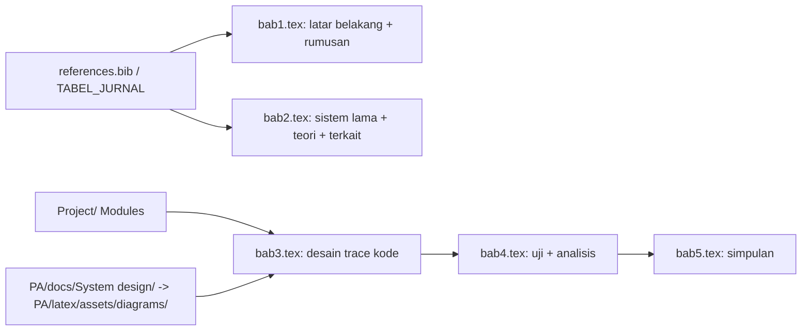

# Arsitektur Naskah — PA Manajemen Kost

**Terakhir diupdate:** 2026-11-22
**Aturan tulis:** lihat `01_guides/PANDUAN_PENULISAN.md` + `02_reference/TEMPLATE_BASELINE.md` + template resmi `PA/latex/` (`jhiven/buku-pa-pens-latex`)

## Overview

Naskah Proyek Akhir Teknik Informatika PENS — **Arsitektur Modular Monolithic Berbasis Event-Driven untuk Sistem Informasi Manajemen Rumah Kost Terintegrasi** (Studi Kasus: Wisma Amal Gorontalo). Terdiri dari 5 BAB + front matter + daftar pustaka + lampiran, menggunakan **`PA/latex/` sebagai Source of Truth naskah aktif** (`Proposal PA`, `Progres PA`, `Buku PA`, dan `Digilib`).

## Struktur Naskah (LaTeX — Source of Truth Aktif)

```
PA/latex/
├── config/                  # variables.tex, packages.tex, fonts.tex, formatting.tex, toggles.tex
├── formats/                 # Layout Proposal, Progres, Buku PA, Cover, Pengesahan
├── pages/                   # Abstrak, Abstract, Kata Pengantar, Orisinalitas, Hak Cipta, Biodata, Lampiran
├── chapters/                # bab1.tex – bab5.tex (BAB 1–3 penuh, BAB 4–5 kerangka)
├── refs/references.bib      # 28 entri BibTeX (IEEEtranN.bst)
├── assets/diagrams/         # 27 diagram PNG dari PA/docs/System design/
└── Makefile                 # make proposal-v2 | progres-v2 | buku | digilib
```

## Daftar BAB (Index — Source of Truth LaTeX & Arsip Markdown)

| BAB | Judul | Isi | Dokumen LaTeX (SoT) | Arsip Markdown | Status |
|---|---|---|---|---|---|
| 1 | Pendahuluan | Latar belakang, permasalahan, batasan, tujuan, manfaat, sistematika | [bab1.tex](./../../latex/chapters/bab1.tex) | [modules/bab1/](./../modules/bab1/) | Lengkap (Proposal/Buku) |
| 2 | Kajian Pustaka | Deskripsi sistem lama (`2.1`), teori penunjang (`2.2`), penelitian terkait (`2.3`) | [bab2.tex](./../../latex/chapters/bab2.tex) | [modules/bab2/](./../modules/bab2/) | Lengkap (10 gambar, Tabel 2.1–2.2) |
| 3 | Desain Sistem | Arsitektur terpadu, modul core/opsional, 9 BPMN, Use Case, DFD L0/L1, ERD 21 tabel, skenario uji | [bab3.tex](./../../latex/chapters/bab3.tex) + [System design/](../System%20design/) | [modules/bab3/](./../modules/bab3/) | Lengkap (17 gambar, Tabel 3.1–3.6) |
| 4 | Eksperimen & Analisis | Implementasi + pengujian + kuesioner + analisis ketercapaian | [bab4.tex](./../../latex/chapters/bab4.tex) | [modules/bab4/](./../modules/bab4/) | Kerangka siap isi |
| 5 | Penutup | Kesimpulan + saran | [bab5.tex](./../../latex/chapters/bab5.tex) | [modules/bab5/](./../modules/bab5/) | Kerangka siap isi |

## Alur Penulisan



## Catatan untuk AI

- **Single Source of Truth Desain Sistem:** Seluruh perancangan sistem tetap terpusat di `PA/docs/System design/` (Daftar Fitur F01–F17, 9 alur BPMN, Use Case, DFD L0/L1, ERD 21 tabel, Arsitektur). Diagram `.png` hasil ekspor disalin ke `PA/latex/assets/diagrams/`.
- **Source of Truth Naskah PA:** Penulisan dan pembaruan naskah selanjutnya dilakukan di `PA/latex/` (`chapters/bab*.tex`, `refs/references.bib`, `config/variables.tex`). Folder `PA/docs/modules/bab*/` dan `full_draft.md` berfungsi sebagai arsip/referensi Markdown tersinkron.
- Setiap paragraf yang mengklaim fitur/implementasi tetap wajib memiliki jejak kode `(Project/...)` atau sitasi `\cite{...}`.
- Jangan campur gaya proposal lama; ikuti satu sistem terintegrasi di `Docs/00_overview/ARCHITECTURE.md` dan aturan revisi naskah di `AGENTS.md`.
