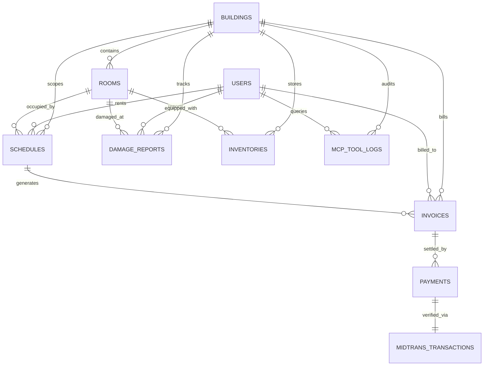

# Arsip Desain Lama — Sistem Manajemen Rumah Kost (41 Tabel, 12 Modul)

> **Status:** ARSIP. Tidak lagi menjadi bagian naskah BAB 3.
> Dipindahkan pada 2026-10-21 saat BAB 3 diselaraskan ke arsitektur final (ADR-007, ADR-011, ADR-012).
> Naskah yang berlaku adalah `PA/docs/modules/bab3/README.md` §3.6 (skema 13 tabel bulanan).
>
> **Konteks:**-era sebelum rewrite, ketika sistem masih memakai Laravel, paket modular pihak ketiga,
> basis data MySQL, 12 modul, dan 41 tabel dengan cabang durasi sewa harian/mingguan/bulanan/tahunan.
> Materi ini dipertahankan sebagai rujukan historis dan bahan audit saat regenerasi skema.

---

## 1. ERD Target Multi-Tenant (Desain Lama)

## 2. Matriks Ketertelusuran: 12 Modul Arsitektur ke 5 Domain Cluster ERD

Seluruh skema basis data relasional sistem Wisma Amal dikelompokkan ke dalam 5 *Bounded Context* / Domain Cluster yang menaungi 12 modul arsitektur. Pengelompokan ini mengikuti prinsip *Domain-Driven Design*: diagram ERD disusun berdasarkan keterkaitan domain bisnis (agar relasi antar tabel tetap utuh dan terbaca), bukan dipaksakan satu diagram per satu folder modul fisik.

| No | Domain Cluster (File ERD) | Modul yang Dinaungi | Tabel Utama |
|---|---|---|---|
| 1 | Cluster 1 — Identity & Access (`erd_1_auth_rbac`) | Auth | `users`, `user_profiles`, `roles`, `permissions` + 3 pivot Spatie, `personal_access_tokens` |
| 2 | Cluster 2 — Space & Occupancy Core (`erd_2_kamar_jadwal_tamu`) | Building\*, Room, Schedule, Guest | `rooms`, `room_images`, `room_schedules`, `guests`, `guest_bills`, `guest_active_contexts` |
| 3 | Cluster 3 — Financial Management (`erd_3_keuangan`) | Finance | `invoices`, `payments`, `fines`, `fine_invoice`, `refund_requests`, `expenses`, `fixed_expense_entries`, `finance_active_tenants` |
| 4 | Cluster 4 — Maintenance & Helpdesk (`erd_4_maintenance`) | Maintenance | `maintenance_requests` + `images`/`updates`, `maintenance_schedules` + `updates` |
| 5 | Cluster 5 — Configuration & Utilities (`erd_5_setting_pendukung`) | Setting, Inventory, Notification, Mcp\* | `app_settings`, `bank_accounts`, `feature_toggles` (+ logs), `inventories`, `notification_logs` |

Keterangan:
- Tanda `*`: `Building` (`buildings`) dan `Mcp` (`mcp_tool_logs`) sudah diimplementasikan di kode melalui *migration* aditif.
- Modul `Dashboard` tidak memiliki tabel karena murni kueri agregasi baca lintas modul melalui Module Gateway.
- Modul satu tabel (`Inventory`, `Notification`) digabung ke Cluster 5 agar tidak menjadi diagram tersendiri yang hanya berisi satu kotak tanpa relasi.

## 3. Kamus Data Basis Data (Desain Lama)

### 3.1 Tabel `users` (Entitas Pengguna & Integrasi Keycloak SSO)

| Nama Kolom | Tipe Data | Nullable | Kunci | Deskripsi Bisnis |
|---|---|---|---|---|
| `id` | BIGINT UNSIGNED | No | PK | Pengidentifikasi unik pengguna lokal |
| `keycloak_id` | VARCHAR(64) | Yes | Unique, Index | Subject ID (`sub`) dari token JWT Keycloak IAM |
| `name` | VARCHAR(150) | No | - | Nama lengkap pengguna |
| `email` | VARCHAR(150) | No | Unique, Index | Alamat email resmi pengguna |
| `password` | VARCHAR(255) | Yes | - | Hash password lokal (nullable untuk user SSO Keycloak) |
| `auth_provider` | ENUM | No | - | Provider otentikasi: `local`, `keycloak`, `google` |
| `assigned_building_id` | BIGINT UNSIGNED | Yes | FK | ID gedung penugasan khusus pengelola (Admin) |
| `created_at` | TIMESTAMP | Yes | - | Waktu pembuatan akun pengguna |

### 3.2 Tabel `buildings` (Entitas Tenant Multi-Gedung)

| Nama Kolom | Tipe Data | Nullable | Kunci | Deskripsi Bisnis |
|---|---|---|---|---|
| `id` | BIGINT UNSIGNED | No | PK | Pengidentifikasi unik gedung properti |
| `name` | VARCHAR(150) | No | - | Nama gedung (contoh: Wisma Amal Utama) |
| `address` | TEXT | No | - | Alamat fisik lengkap properti |
| `owner_id` | BIGINT UNSIGNED | No | FK | ID pengguna pemilik gedung |
| `phone_number` | VARCHAR(20) | Yes | - | Nomor kontak pengelola gedung |
| `created_at` | TIMESTAMP | Yes | - | Waktu pembuatan baris data |

### 3.3 Tabel `rooms` (Entitas Kamar Fisik)

| Nama Kolom | Tipe Data | Nullable | Kunci | Deskripsi Bisnis |
|---|---|---|---|---|
| `id` | BIGINT UNSIGNED | No | PK | Pengidentifikasi unik kamar fisik |
| `building_id` | BIGINT UNSIGNED | No | FK, Index | ID gedung pemilik kamar |
| `room_number` | VARCHAR(20) | No | Index | Nomor atau kode unit kamar (misal: A-01) |
| `type` | VARCHAR(50) | No | - | Tipe kamar (standar, VIP, eksekutif) |
| `floor` | INT | No | - | Letak lantai unit kamar |
| `base_price` | DECIMAL(12,2) | No | - | Harga sewa dasar bulanan |
| `status` | ENUM | No | Index | Status kamar: `kosong`, `dipesan`, `terisi`, `maintenance` |

### 3.4 Tabel `schedules` (Entitas Linimasa Penjadwalan Kamar Core)

| Nama Kolom | Tipe Data | Nullable | Kunci | Deskripsi Bisnis |
|---|---|---|---|---|
| `id` | BIGINT UNSIGNED | No | PK | Pengidentifikasi unik linimasa jadwal |
| `building_id` | BIGINT UNSIGNED | No | FK, Index | ID gedung konteks sewa |
| `room_id` | BIGINT UNSIGNED | No | FK, Index | ID kamar yang dijadwalkan |
| `user_id` | BIGINT UNSIGNED | Yes | FK | ID penghuni yang menempati unit |
| `type` | ENUM | No | Index | Tipe jadwal: `sewa`, `maintenance`, `kebersihan`, `blokir` |
| `start_date` | DATE | No | Index | Tanggal awal mulai penggunaan kamar |
| `end_date` | DATE | No | Index | Tanggal berakhir penggunaan kamar |
| `status` | ENUM | No | Index | Status jadwal: `reserved`, `active`, `completed`, `cancelled` |

### 3.5 Tabel `invoices` (Entitas Tagihan Finansial)

| Nama Kolom | Tipe Data | Nullable | Kunci | Deskripsi Bisnis |
|---|---|---|---|---|
| `id` | BIGINT UNSIGNED | No | PK | Pengidentifikasi unik tagihan |
| `building_id` | BIGINT UNSIGNED | No | FK, Index | ID gedung penerbit tagihan |
| `schedule_id` | BIGINT UNSIGNED | No | FK | ID jadwal sewa terkait |
| `invoice_number` | VARCHAR(50) | No | Unique | Nomor faktur resmi (INV/YYYYMM/XXXX) |
| `amount` | DECIMAL(12,2) | No | - | Jumlah nominal tagihan kotor |
| `due_date` | DATE | No | Index | Tanggal jatuh tempo pembayaran |
| `status` | ENUM | No | Index | Status tagihan: `unpaid`, `paid`, `overdue`, `cancelled` |

### 3.6 Tabel `mcp_tool_logs` (Entitas Audit Interaksi AI MCP)

| Nama Kolom | Tipe Data | Nullable | Kunci | Deskripsi Bisnis |
|---|---|---|---|---|
| `id` | BIGINT UNSIGNED | No | PK | Pengidentifikasi unik log tool-use |
| `user_id` | BIGINT UNSIGNED | No | FK | ID pengguna yang mengajukan kueri AI |
| `building_id` | BIGINT UNSIGNED | Yes | FK | ID gedung lingkup kueri yang dieksekusi |
| `tool_name` | VARCHAR(100) | No | Index | Nama tool MCP (misal: `get_financial_summary`) |
| `parameters` | JSON | No | - | Parameter JSON masukan yang diproses |
| `execution_time_ms` | INT | No | - | Durasi eksekusi kueri dalam milidetik |
| `created_at` | TIMESTAMP | No | Index | Waktu pemanggilan tool dilakukan |

## 4. Alasan Penghapusan (ringkas)

| Komponen lama | Alasan dihapus | Pengganti di desain final |
|---|---|---|
| Skema 41 tabel | Pembengkakan skema dan kolom mati | 13 tabel domain bulanan |
| Cabang durasi sewa harian/mingguan/tahunan | Nol pemakai, memicu duplikasi tabel tagihan | `leases.duration_months` + `building_settings.min_rental_months` |
| `guest_bills`, `finance_active_tenants`, `guest_active_contexts` | Duplikasi data tagihan | Biaya tamu dicatat sebagai `invoices` biasa |
| Role + pivot Spatie (`roles`, `permissions`, 3 tabel pivot) | Duplikasi fungsi Keycloak | Peran `owner`/`admin`/`resident` pada `users.role`, identitas dari Keycloak |
| `price_daily`, `resident_id`, `legacy_lease_id`, `is_highlighted` | Kolom mati / warisan | `rooms.monthly_price`, `leases.user_id` |
| Basis data MySQL | Kurang memadai untuk nilai uang dan payload event | PostgreSQL (`NUMERIC`, `JSONB`, *partial index*) |
