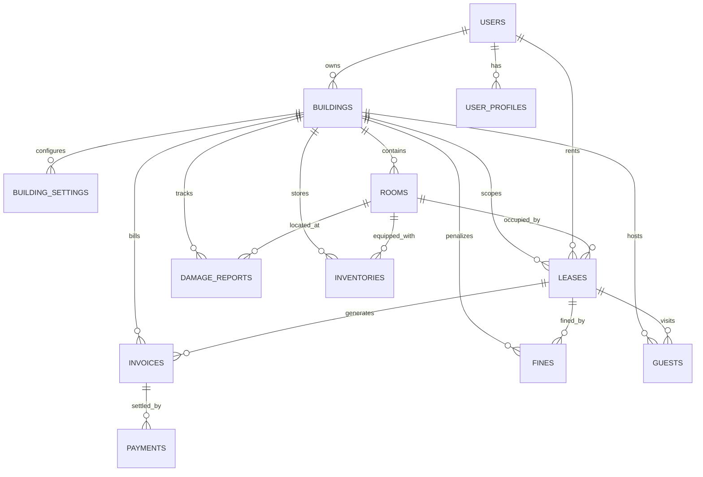
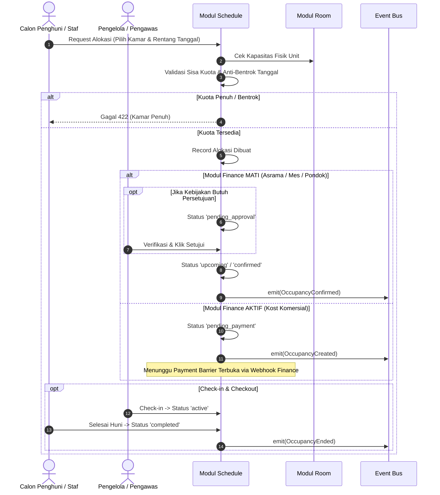
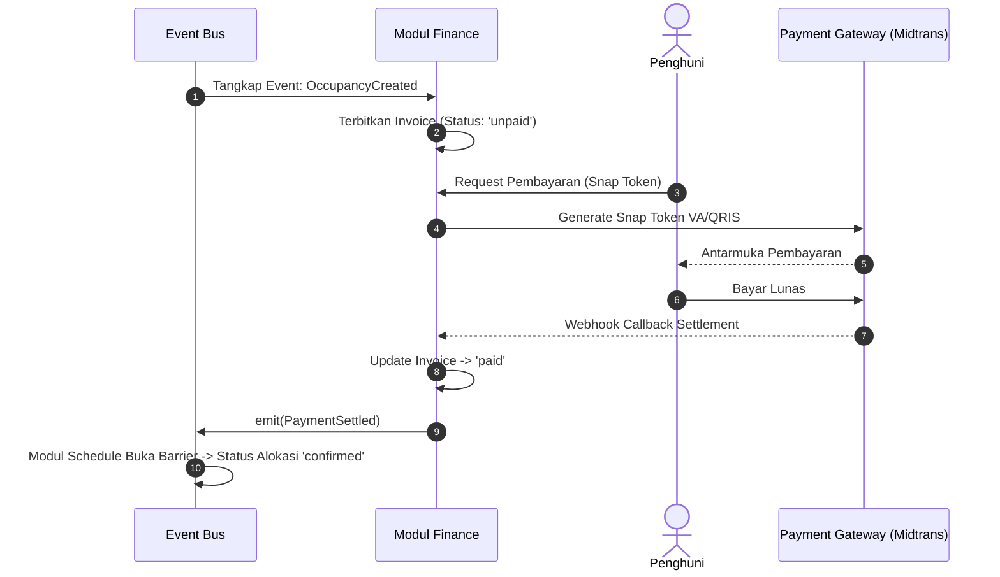
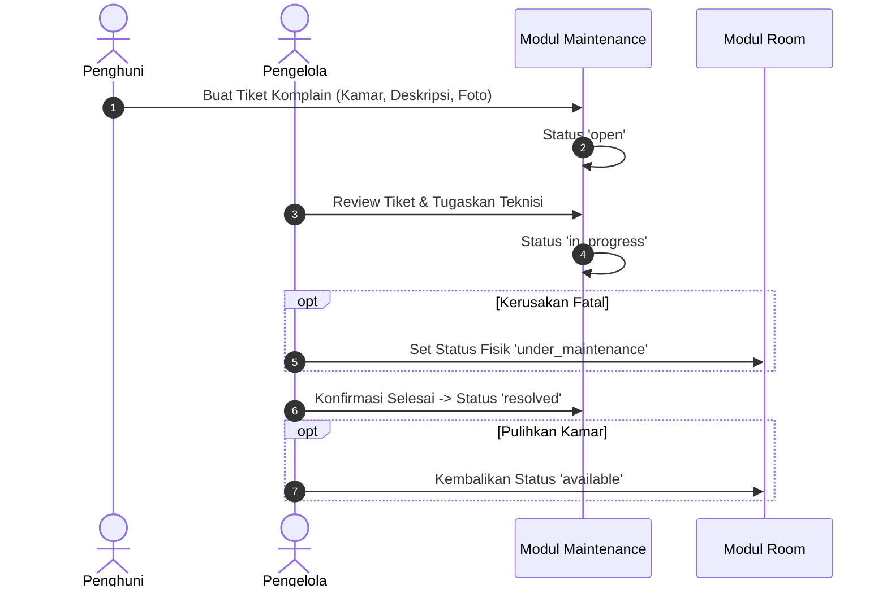
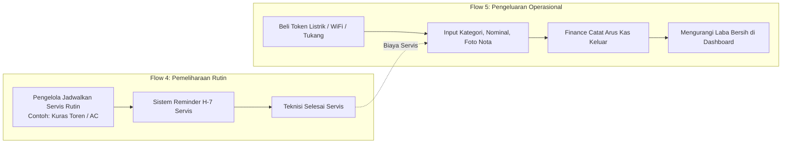
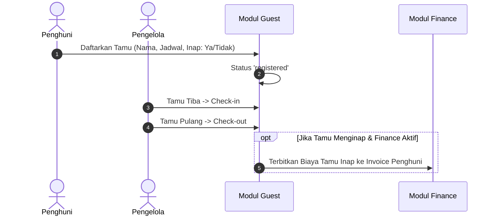
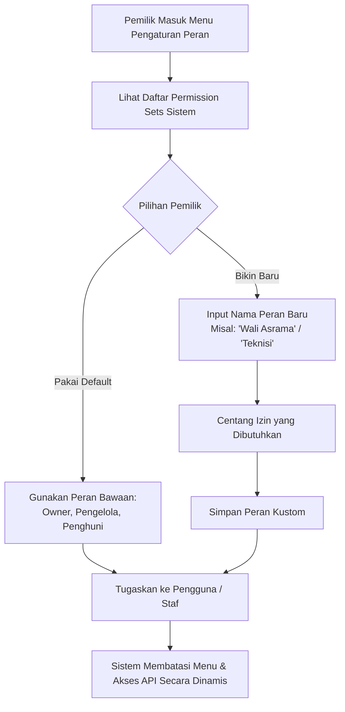

# Fase 1 Rewrite — Dokumen Kebutuhan, ERD Final & Kontrak API (ADR-007)

> Status: DRAFT Fase 1. Fondasi rewrite sistem kost bulanan (folder/repo baru).
> Referensi arsip: desain lama 41 tabel di `Docs/02_reference/DATABASE_SCHEMA.md`.

## 1. Keputusan Desain Terkunci

1. Sewa **bulanan penuh** — tanpa tarif harian (`price_daily` dihapus), tanpa cabang durasi.
2. Minimal durasi **configurable per gedung** via `building_settings.min_rental_months`.
3. **Skema 21 tabel domain** (ADR-014), nol FK fisik lintas modul (soft-reference via UUID).
4. Denda fleksibel via setting (Opsi A: flat + grace, default).
5. Biaya tamu configurable via setting, dicatat sebagai `invoices` biasa (tanpa tabel billing terpisah).
6. Notifikasi WA gateway untuk 3 event: tagihan terbit, pengingat jatuh tempo, pembayaran lunas.

## 2. Kebutuhan per Fitur (Daftar Fitur Lengkap — ADR-008 & ADR-009)

Daftar fitur sistem diklasifikasikan secara tegas menjadi **Fitur Core (Wajib)**, **Fitur Opsional (Plug & Play per Gedung)**, dan **Lapisan Ekstensi AI**:

### A. Fitur Core (Wajib Selalu Aktif)
| Kode | Nama Fitur | Modul Domain | Aturan Bisnis & Fungsionalitas | Sifat |
|---|---|---|---|---|
| **F01** | Autentikasi Pengguna & Profil | User & Access | Registrasi, autentikasi sesi token, profil identitas, kontak, dan biodata dasar. | Wajib |
| **F02** | Dynamic RBAC & Role Builder | User & Access | Permission sets granular bawaan + pembuatan peran kustom dinamis (*custom roles*) oleh pengguna. | Wajib |
| **F03** | Manajemen Multi-Gedung | Property & Building | Master data gedung/properti multi-lokasi, alamat, penanggung jawab, dan toggle modul per gedung. | Wajib |
| **F04** | Kebijakan Konfigurasi Gedung | Property & Building | Konfigurasi aturan huni: durasi minimal sewa (`min_rental_months`), kebijakan booking (`booking_policy`). | Wajib |
| **F05** | Master Kamar & Kapasitas Fisik | Room Management | Data fisik kamar (nomor, lantai, tipe, harga dasar), **kapasitas maksimal unit (orang/bed)**, status fisik (`available` / `under_maintenance`). | Wajib |
| **F06** | Alokasi & Penempatan Hunian | Occupancy & Schedule | Alokasi orang $\leftrightarrow$ kamar $\leftrightarrow$ rentang waktu huni, validasi anti-bentrok kuota/jadwal, siklus status huni. | Wajib |
| **F07** | Dashboard Monitoring Hunian | Occupancy Dashboard | Visualisasi denah kamar, status ketersediaan unit real-time, dan pemantauan daftar penghuni aktif. | Wajib |

### B. Fitur Opsional (Plug & Play per Gedung)
| Kode | Nama Fitur | Modul Domain | Aturan Bisnis & Fungsionalitas | Skenario Pemakaian |
|---|---|---|---|---|
| **F08** | Penagihan Sewa Berkala | Finance & Billing | Penerbitan invoice otomatis per siklus periode huni saat alokasi disetujui (harga x durasi). | Aktif untuk kost/komersial; nonaktif untuk asrama/mes gratis. |
| **F09** | Pembayaran Digital & Kasir | Finance & Billing | Pembayaran digital otomatis via Midtrans SNAP (VA/QRIS) + opsi pembayaran manual tunai diverifikasi admin. | Aktif jika properti memungut pembayaran sewa. |
| **F10** | Denda Keterlambatan Flat | Finance & Billing | Penambahan denda flat otomatis jika invoice melewati batas jatuh tempo + masa tenggang (*grace period*). | Opsional per gedung (bisa di on/off). |
| **F11** | Pengeluaran Operasional (*Expenses*) | Finance & Billing | Pencatatan kas keluar riil (listrik, air PAM, WiFi, gaji staf, belanja perlengkapan) + unggah foto nota/struk. | Aktif untuk transparansi arus kas dan laba bersih gedung. |
| **F12** | Tiket Kerusakan Fasilitas | Maintenance | Penghuni mengajukan komplain kerusakan + foto bukti; pengelola verifikasi & tugaskan teknisi; isolasi status kamar jika fatal. | Aktif jika properti butuh manajemen tiket aduan fasilitas. |
| **F13** | Pemeliharaan Rutin Berkala | Maintenance | Agenda perawatan preventif berkala fasilitas umum (servis AC, kuras toren, fogging) + sistem pengingat H-7 + catat biaya. | Aktif untuk perawatan aset gedung terencana. |
| **F14** | Inventarisasi & Audit Aset | Asset & Inventory | Pendataan perabotan/barang per kamar + inspeksi kondisi fisik barang (baik/rusak/hilang) saat check-in & check-out. | Aktif jika gedung memiliki fasilitas furnitur lengkap. |
| **F15** | Pengawasan Buku Tamu | Guest Logging | Pencatatan tamu berkunjung (check-in/check-out) + opsi penambahan biaya inap ke invoice penghuni jika menginap. | Aktif jika properti menerapkan aturan jam malam/tamu. |
| **F16** | Notifikasi Pesan Otomatis | Notification | Otomasi pengiriman pesan via WhatsApp/Email saat invoice terbit, jatuh tempo, bayar lunas, dan tiket selesai. | Aktif jika terhubung ke gateway pesan eksternal. |

### C. Lapisan Ekstensi AI (External Adapter)
| Kode | Nama Fitur | Komponen | Aturan Bisnis & Fungsionalitas | Posisi Arsitektur |
|---|---|---|---|---|
| **F17** | Asisten Cerdas Analitik | MCP Server Adapter | Layanan query analitik *read-only* bagi Asisten AI (tanya okupansi, ketersediaan, keuangan, tiket komplain). | Di atas modul bisnis; tidak menyimpan data bisnis mandiri. |

## 3. ERD Final 13 Tabel

## 4. Kontrak API Ringkas (REST, envelope `{status, message, data, meta, errors}`)

| Method & Path | Modul | Keterangan |
|---|---|---|
| `POST /api/auth/register`, `/login`, `GET /api/me` | Auth | Role enum di response |
| `GET/POST /api/buildings`, `GET/PUT /api/buildings/{id}/settings` | Building | Setting termasuk `min_rental_months` |
| `GET/POST /api/rooms`, `GET/PUT/DELETE /api/rooms/{id}` | Room | Filter `?building_id=&status=` |
| `POST /api/leases` `{room_id, duration_months}` | Lease | Validasi min durasi + anti-bentrok (422 bila gagal) |
| `GET /api/leases/me`, `PATCH /api/leases/{id}/cancel` | Lease | Riwayat & pembatalan penghuni |
| `GET /api/invoices`, `GET /api/invoices/{id}` | Finance | Tagihan + status |
| `POST /api/payments/snap` `{invoice_id}` | Finance | Kembalikan `snap_token` |
| `POST /api/payments/midtrans/webhook` | Finance | Settlement → invoice lunas (event) |
| `GET/POST /api/fines`, `POST /api/fines/{id}/waive` | Finance | Denda flat per aturan setting |
| `GET/POST /api/damage-reports`, `PATCH /api/damage-reports/{id}` | Maintenance | Termasuk 1 foto |
| `GET/POST /api/guests`, `POST /api/guests/{id}/checkout` | Guest | Checkout picu hitung biaya tamu |
| `GET/POST /api/inventories`, `PUT/DELETE /api/inventories/{id}` | Inventory | — |
| `GET /api/dashboard/summary` | Dashboard | Agregasi via gateway |

## 5. Event Antar Modul (tulis via Event Bus)

`LeaseCreated` → Finance buat invoice → Notification kirim WA tagihan.
`PaymentSettled` → Lease aktif + Notification kirim bukti lunas.
`InvoiceOverdue` (scheduler) → Finance buat denda (bila enabled) + Notification pengingat.
`RoomDamaged` → `rooms.status = maintenance`; `RoomRepaired` → kembali kosong.

## 6. Hal yang Dihapus dari Desain Lama (dan alasannya)

- `price_daily` + cabang durasi: kode mati, nol pemakai.
- `guest_bills`, `finance_active_tenants`, `guest_active_contexts`: duplikasi → diganti query langsung / invoice biasa.
- Kolom legacy (`lease_id`, `resident_id`, `legacy_lease_id`) dan kolom hantu (`is_highlighted`): tidak dibawa.

## 7. Pemetaan Alur Proses Bisnis Dinamis (ADR-008 & ADR-009)

### 7.1 Kebijakan Pemilihan Kamar & Penempatan (`booking_policy`)
Dukungan multi-kondisi diatur via konfigurasi gedung `building_settings.booking_policy`:
1. `ADMIN_ASSIGN_ONLY`: Penghuni tidak memilih kamar sendiri; penempatan diatur penuh oleh pengelola/staf (contoh: mes karyawan, asrama tertutup).
2. `SELF_SERVICE_APPROVAL`: Penghuni memilih kamar $\rightarrow$ masuk status `pending_approval` $\rightarrow$ diverifikasi pengelola.
3. `SELF_SERVICE_INSTANT`: Penghuni memilih kamar $\rightarrow$ langsung terkonfirmasi (jika Finance aktif, barrier konfirmasi adalah pelunasan tagihan; jika nonaktif, langsung teralokasi).

### 7.2 Peran Modul Finance sebagai Payment Barrier Gate
- **Jika Finance AKTIF:** Alokasi ditahan di status `pending_payment`. Begitu webhook settlement Midtrans / konfirmasi tunai masuk, pintu barrier terbuka $\rightarrow$ status alokasi berubah menjadi `upcoming`/`confirmed`.
- **Jika Finance NONAKTIF:** Payment barrier dilewati (*bypassed*). Alokasi langsung beralih ke `confirmed` (atau `pending_approval` jika kebijakan gedung mensyaratkan verifikasi pengelola).

### 7.3 Diagram Rinci Alur Proses Sistem (Mermaid)

#### Flow 1: Alokasi & Penempatan Hunian (Core)

#### Flow 2: Siklus Tagihan & Pembayaran (Opsional - Finance)

#### Flow 3: Penanganan Kerusakan Fasilitas (Opsional - Maintenance)

#### Flow 4 & 5: Pengeluaran Operasional & Jadwal Servis Rutin

#### Flow 6: Pengawasan Buku Tamu (Opsional - Guest)

#### Flow 7: Pengaturan Hak Akses Dinamis (Core - User)

