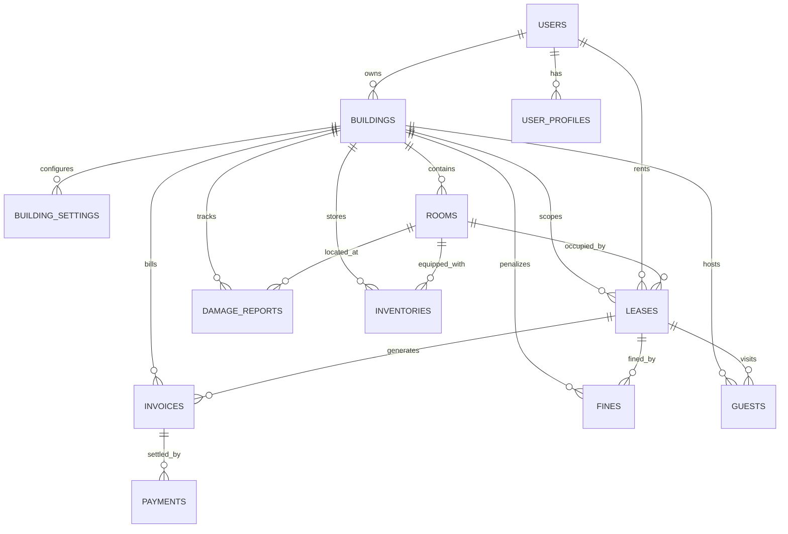

# BAB 3 — Metodologi dan Perancangan Sistem

> Dokumen Resmi Naskah Proyek Akhir — Departemen Teknik Informatika dan Komputer, PENS.
> Format sitasi mengacu pada IEEE numeric `[1]`-`[28]` terurut sesuai kemunculan pertama pada teks.

---

## 3.1 Deskripsi Solusi Terpadu

Proyek Akhir ini merancang dan merefaktorisasi sistem informasi pengelolaan hunian sewa menjadi platform enterprise yang bersifat generik untuk manajemen properti hunian sewa multi-gedung. Warisan sistem sebelumnya terdiri atas empat proposal terpisah yang masing-masing mengambil satu ranah domain, namun tidak memiliki aturan main bersama, tidak menegakkan batas modul, dan belum pernah melayani lebih dari satu gedung. Arsitektur hasil rewrite disusun atas empat lapis yang saling terpisah agar tiap lapis dapat dikembangkan dan diuji secara mandiri [1].

1. **Lapis antarmuka.** Flutter Web dengan Clean Architecture, yaitu lapisan presentasi, lapisan domain, dan lapisan data. Lapis ini hanya menyajikan masukan pengguna dan menampilkan keluaran sistem, bukan memuat aturan bisnis [15][16].
2. **Lapis backend.** Modular Monolith berbasis NestJS dengan sembilan modul terenkapsulasi, komunikasi antar modul lewat event bus untuk mutasi dan *module gateway* untuk agregasi baca [13][14].
3. **Lapis data.** PostgreSQL dengan skema 13 tabel bulanan, seluruh referensi antar tabel bersifat logis kecuali dua pengecualian yang dinyatakan eksplisit [17].
4. **Lapis integrasi eksternal.** Midtrans SNAP, WhatsApp Gateway, dan Keycloak OIDC, semuanya dijangkau lewat *adapter* sehingga logika bisnis tidak bergantung pada vendor tertentu [23][25].

> **Gambar 3.1 — Arsitektur Sistem Terpadu (Modular Monolith NestJS, 9 Modul):** `PA/docs/System design/01-Gambaran-umum/01_arsitektur_keseluruhan/arsitektur_terpadu.html` (diagram HTML).

Enam keputusan arsitektural menjadi landasan sistem ini.

**Pertama, Modular Monolith pada NestJS.** Backend dibagi ke dalam sembilan modul yang masing-masing dibungkus dekorator `@Module()`. Batas modul ditegakkan oleh kerangka kerja, bukan oleh kesepakatan tertulis: layanan yang tidak diekspor modul tidak dapat disuntik modul lain, sehingga pelanggaran batas menjadi kesalahan teknis yang tertangkap saat proses build [13][14]. Pola ketergantungan yang rapat pada sistem lama, ketika modul keuangan membaca langsung tabel milik modul kamar, hilang karena dependensi hanya boleh masuk lewat antarmuka yang diekspor.

**Kedua, skema data disederhanakan menjadi 13 tabel bulanan.** Skema lama membengkak hingga empat puluh satu tabel dengan banyak kolom mati, tabel turunan yang menggandakan data tagihan, serta cabang durasi sewa harian, mingguan, bulanan, dan tahunan sekaligus. Skema baru menyimpan satu model sewa bulanan murni, dengan aturan minimum durasi disimpan sebagai konfigurasi per gedung sehingga variability kebijakan huni tidak menuntut skema baru [11][12].

**Ketiga, model sewa dibatasi pada satuan bulan penuh.** Durasi minimum sewa ditetapkan per gedung melalui `building_settings.min_rental_months`. Nilai inilah yang dipakai modul `Lease` saat memvalidasi permintaan sewa, sehingga variability antar gedung tertangani di lapisan konfigurasi, bukan di percabangan kode.

**Keempat, isolasi data antar gedung memakai *row-level scoping*.** Seluruh tabel yang menyimpan data operasional memiliki kolom `building_id` sebagai penanda tenant, dan setiap kueri wajib menyertakan penyaring tersebut. Model ini dipilih karena biaya server tidak bertambah seiring jumlah gedung, migrasi skema cukup dijalankan satu kali untuk seluruh properti, dan laporan gabungan portofolio dapat disusun dengan satu kueri [18].

**Kelima, autentikasi ditangani terpusat oleh Keycloak.** Backend NestJS bertindak sebagai *resource server* yang memverifikasi token JWT secara *stateless* melalui JWKS, memetakan klaim token ke dalam peran `owner`, `admin`, dan `resident`, lalu mengikat peran tersebut dengan cakupan gedung [19][20].

**Keenam, asisten analitik hanya menyediakan operasi baca.** Modul MCP mengekspos beberapa *tool* yang seluruhnya bersifat *read-only*, sehingga model kecerdasan buatan dapat menjawab pertanyaan operasional tanpa pernah mengubah data. Karena modul ini tidak menyimpan data bisnis mandiri, jejak setiap pemanggilan dicatat pada log audit aplikasi, bukan pada tabel domain [21].

Tabel 3.1 memetakan tujuh belas fitur sistem ke modul pemiliknya. Fitur pada kelompok *core* selalu aktif karena menopang operasi harian, sedangkan fitur kelompok opsional dapat dinyalakan atau dimatikan per gedung sesuai kebijakan properti tersebut. Lapisan ekstensi AI berada di atas seluruh modul bisnis dan tidak menambah tabel baru pada skema.

**Tabel 3.1 — Daftar Fitur Sistem (F01–F17)**

| Kode | Nama Fitur | Modul Domain | Sifat |
|---|---|---|---|
| F01 | Autentikasi Pengguna dan Profil | Auth | Core |
| F02 | Dynamic RBAC dan Role Builder | Auth | Core |
| F03 | Manajemen Multi-Gedung | Building | Core |
| F04 | Kebijakan Konfigurasi Gedung | Building | Core |
| F05 | Master Kamar dan Kapasitas Fisik | Room | Core |
| F06 | Alokasi dan Penempatan Hunian | Lease | Core |
| F07 | Dashboard Monitoring Hunian | Lease dan Room (baca agregat) | Core |
| F08 | Penagihan Sewa Berkala | Finance | Opsional per gedung |
| F09 | Pembayaran Digital dan Kasir | Finance | Opsional per gedung |
| F10 | Denda Keterlambatan Flat | Finance | Opsional per gedung |
| F11 | Pengeluaran Operasional | Finance | Opsional per gedung |
| F12 | Tiket Kerusakan Fasilitas | Maintenance | Opsional per gedung |
| F13 | Pemeliharaan Rutin Berkala | Maintenance | Opsional per gedung |
| F14 | Inventarisasi dan Audit Aset | Inventory | Opsional per gedung |
| F15 | Pengawasan Buku Tamu | Guest | Opsional per gedung |
| F16 | Notifikasi Pesan Otomatis | Notification | Opsional per gedung |
| F17 | Asisten Cerdas Analitik | MCP (adapter di atas module gateway) | Ekstensi AI |

---

## 3.2 Metodologi Pengembangan Perangkat Lunak (Kerangka Kerja Scrum)

Pengembangan sistem dilaksanakan dengan kerangka kerja Scrum [24]. Setiap sprint ditutup dengan *increment* yang dapat dijalankan, bukan sekadar kumpulan fitur yang belum menyambung, dan_empat sprint_berdurasi dua minggu masing-masing menghasilkan satu increment terintegrasi.

Sprint pertama dipakai membangun fondasi: orkestrasi proyek, basis data, dan standar kontrak. Sprint kedua membawakan logika inti huni, yaitu manajemen gedung, kamar, dan alokasi hunian beserta penguncian baris yang mencegah bentrok sewa. Sprint ketiga menutup seluruh modul bisnis beserta integrasi pembayaran dan notifikasi. Sprint keempat berisi antarmuka Flutter Web, modul MCP, serta pengujian berlapis yang menutup seluruh siklus.

### 3.2.1 Struktur Tim dan Peran Scrum

1. **Product Owner (PO).** Bertanggung jawab atas prioritas kebutuhan bisnis, menyetujui *product backlog items*, dan memvalidasi kriteria penerimaan. Pada proyek ini peran tersebut dipegang pemilik properti yang bersumber dari kebutuhan operasional harian, dengan dosen pembimbing sebagai penjaga keselarasan tujuan penelitian.
2. **Scrum Master (SM).** Memfasilitasi upacara Scrum, menghilangkan hambatan teknis, dan menegakkan aturan main modul. Dosen pembimbing menjalankan peran ini pada tahap awal, kemudian perannya beralih menjadi tinjauan mandiri yang dilakukan penulis sendiri pada tahap akhir.
3. **Development Team.** Dijalankan oleh penulis sebagai satu orang yang memegang seluruh peran teknis: perancangan basis data, backend NestJS, antarmuka Flutter Web, integrasi Keycloak dan Midtrans, modul MCP, serta perakitan rangkaian pengujian otomatis. Pembagian peran di atas tetap dijalankan karena peran Scrum bukan pembatas orang, melainkan batas tanggung jawab yang perlu dipastikan setiap selesai satu siklus.

### 3.2.2 Pembagian Siklus Sprint dan Rincian Backlog

**Tabel 3.2 — Perencanaan Empat Sprint**

| Sprint | Durasi | Fokus Utama dan Hasil | Story Points | Definition of Done |
|---|---|---|---|---|
| 1 | Minggu 1–2 | Fondasi: orkestrasi NestJS 9 modul, Docker Compose, PostgreSQL, realm Keycloak beserta peran, envelope JSON dan Swagger | 21 | 9 modul terpasang, migrasi 13 tabel jalan, peran Keycloak aktif, endpoint kesehatan terlayani |
| 2 | Minggu 3–4 | Domain inti: Building, Room, Lease, alokasi hunian, penguncian baris anti-bentrok, penjaga tenant | 21 | Alokasi sewa tervalidasi, uji bentrok paralel lulus, seluruh kueri terfilter `building_id` |
| 3 | Minggu 5–6 | Modul bisnis: Finance (Midtrans SNAP, tanda tangan webhook, idempotensi), Maintenance, Guest, Inventory, Notification | 27 | Tagihan terbit otomatis, webhook palsu ditolak, pesan WhatsApp terkirim, notifikasi tercatat |
| 4 | Minggu 7–8 | Antarmuka Flutter Web tiga peran, modul MCP *read-only*, pengujian berlapis, UAT | 26 | Ketiga dasbor berfungsi, empat tool MCP terukur, cakupan kode minimal 80 persen, UAT selesai |
| **Total** | **8 Minggu** | **Empat increment terintegrasi** | **95** | **Siap produksi** |

**Tabel 3.3 — Sprint Backlog Empat Sprint**

| No | ID | Sprint | User Story atau Item | Task Teknis Utama | SP | Status |
|---|---|---|---|---|---|---|
| 1 | US-01 | 1 | Orkes backend 9 modul | Dekorator `@Module()`, barrel export, module gateway | 3 | Selesai |
| 2 | US-02 | 1 | Basis data 13 tabel | Migration PostgreSQL, seeder, *partial index* tagihan | 5 | Selesai |
| 3 | US-03 | 1 | Standar kontrak API | Envelope `{status, message, data, meta, errors}`, DTO `class-validator`, Swagger | 5 | Selesai |
| 4 | US-04 | 1 | Identitas terpusat | Realm Keycloak, peran, klien OIDC, verifikasi JWKS | 5 | Selesai |
| 5 | US-05 | 1 | Lingkungan pengembangan | `docker-compose.yml` untuk NestJS, PostgreSQL, Keycloak | 3 | Selesai |
| 6 | US-06 | 2 | Master gedung dan kamar | Modul Building dan Room, aturan UQ `(building_id, number)` | 5 | Selesai |
| 7 | US-07 | 2 | Konfigurasi per gedung | `building_settings`, aturan `min_rental_months` | 3 | Selesai |
| 8 | US-08 | 2 | Alokasi sewa bulanan | Modul Lease, validasi durasi minimum, `SELECT ... FOR UPDATE` | 8 | Selesai |
| 9 | US-09 | 2 | Penjaga tenant | Filter `building_id` pada seluruh repositori, uji isolasi | 5 | Selesai |
| 10 | US-10 | 3 | Penagihan otomatis | Modul Finance, penerbitan invoice per siklus sewa | 5 | Selesai |
| 11 | US-11 | 3 | Pembayaran Midtrans SNAP | Token SNAP, verifikasi tanda tangan webhook, idempotency key | 8 | Selesai |
| 12 | US-12 | 3 | Tiket kerusakan | Modul Maintenance, unggah foto, penugasan teknisi | 5 | Selesai |
| 13 | US-13 | 3 | Buku tamu dan inventaris | Modul Guest dan Inventory, pencatatan pemeriksaan aset | 4 | Selesai |
| 14 | US-14 | 3 | Notifikasi WhatsApp | Modul Notification, tiga event, adapter gateway | 5 | Selesai |
| 15 | US-15 | 4 | Dasbor pemilik | Flutter Web, ringkasan eksekutif, pemilih gedung | 5 | Selesai |
| 16 | US-16 | 4 | Dasbor pengelola | Flutter Web, linimasa penempatan, verifikasi sewa, tiket | 5 | Selesai |
| 17 | US-17 | 4 | Portal penghuni | Flutter Web, katalog kamar, tagihan, pembayaran | 4 | Selesai |
| 18 | US-18 | 4 | Modul MCP *read-only* | Empat tool analitik, verifikasi izin tenant, audit log | 8 | Selesai |
| 19 | US-19 | 4 | Rangkaian pengujian | Jest, Supertest, Flutter Test, aturan batas modul ESLint | 4 | Selesai |

### 3.2.3 Contoh Spesifikasi User Story dan Kriteria Penerimaan

Setiap kebutuhan dijabarkan dalam format formal *user story* disertai kriteria penerimaan berbasis skenario Gherkin (*Given-When-Then*).

**Tabel 3.4 — Daftar User Story**

| No | ID | User Story | Modul | Sprint | Status |
|---|---|---|---|---|---|
| 1 | US-06 | Sebagai pengelola, saya ingin menambah unit kamar pada gedung yang saya tangani, agar data kamar selalu mutakhir | Room | 2 | Selesai |
| 2 | US-08 | Sebagai penghuni, saya ingin menyewa unit kamar dengan masa sewa bulanan, agar kepastian sewa saya tercatat di sistem | Lease | 2 | Selesai |
| 3 | US-10 | Sebagai sistem, saya ingin menerbitkan tagihan otomatis tiap siklus sewa, agar pemilik tidak perlu menagih manual | Finance | 3 | Selesai |
| 4 | US-11 | Sebagai penghuni, saya ingin membayar tagihan lewat kanal digital, agar saya tidak perlu datang ke kantor | Finance | 3 | Selesai |
| 5 | US-12 | Sebagai penghuni, saya ingin melaporkan kerusakan kamar lengkap dengan foto, agar perbaikan dapat dipantau | Maintenance | 3 | Selesai |
| 6 | US-14 | Sebagai penghuni, saya ingin menerima pemberitahuan tagihan dan pembayaran, agar saya tidak melewatkan jatuh tempo | Notification | 3 | Selesai |
| 7 | US-18 | Sebagai pemilik, saya ingin bertanya kondisi portofolio lewat bahasa alami, agar laporan tidak harus dibaca satu per satu | MCP | 4 | Selesai |

**Tabel 3.5 — Elemen User Story**

| Elemen | Deskripsi |
|---|---|
| ID | Pengenal unik user story pada *product backlog* |
| Peran | Aktor yang menjalankan fitur dan aktor yang memperoleh manfaat |
| Kebutuhan | Funcionalitas yang diminta dalam bentuk satu kalimat |
| Alasan | Nilai bisnis yang diperoleh sehingga prioritasnya jelas |
| Modul | Modul backend yang menjadi pemilik implementasi |
| Estimasi | Ukuran usaha relatif dalam *story points* |
| Kriteria penerimaan | Syarat terukur yang menyatakan fitur selesai |

**Tabel 3.6 — Kriteria Penerimaan Skenario US-08 (Alokasi Sewa)**

| ID | Given | When | Then |
|---|---|---|---|
| AC-01 | Kamar A-01 pada Gedung Utama berstatus kosong dan `min_rental_months` sebesar 3 | Penghuni mengajukan sewa selama 2 bulan | Permintaan ditolak dengan HTTP 422 dan pesan bahwa durasi minimum gedung adalah 3 bulan |
| AC-02 | Kamar A-01 berstatus kosong dan durasi 3 bulan memenuhi minimum | Penghuni mengajukan sewa | Kontrak tersimpan pada `leases` dengan status aktif, invoice pertama terbit, dan pesan tagihan terkirim |
| AC-03 | Kamar A-01 sedang diproses pengguna lain pada periode yang sama | Penghuni lain mengajukan sewa pada periode yang sama | Permintaan kedua ditolak dengan HTTP 422 dan tidak terbentuk tagihan ganda |
| AC-04 | Penghuni hanya memiliki akses pada Gedung Melati | Penghuni mencoba membuka unit kamar Gedung Utama | Permintaan ditolak dengan HTTP 403 dan tidak ada data gedung lain yang terbaca |

Skenario lengkap US-08 dengan bentuk naratif:

- **User Story US-08 (Alokasi Sewa Bulanan).** Sebagai penghuni, saya ingin menyewa unit kamar dengan masa sewa bulanan, agar saya memperoleh kepastian kamar tanpa risiko bentrok jadwal.
- **Skenario Penerimaan, Sewa Berhasil.** *Given* Kamar A-01 di Gedung Utama berstatus kosong dan minimum sewa gedung adalah tiga bulan. *When* penghuni mengajukan sewa selama tiga bulan dan menyelesaikan pembayaran melalui Midtrans SNAP. *Then* sistem menerbitkan event `LeaseCreated`, modul Finance membuat tagihan, modul Notification mengirim bukti tagihan ke WhatsApp, dan status kamar berubah menjadi terisi.
- **Skenario Penerimaan, Bentrok Konkuren.** *Given* Kamar A-01 sedang dikunci transaksi oleh pengguna lain. *When* pengguna kedua mengajukan sewa pada periode yang tumpang tindih. *Then* sistem menolak transaksi kedua dengan HTTP 422 dan tidak terbentuk tagihan ganda.

---

## 3.3 Perancangan Arsitektur Sistem

Sistem dirancang dengan arsitektur *clean modulith* yang memisahkan concerns antar modul secara tegas, ditambah satu lapisan ekstensi AI di atasnya [10]. Prinsip yang dipegang: mutasi antar modul selalu melalui event, sedangkan pembacaan data yang discipleship lintas modul selalu melalui *module gateway*. Kedua jalur dibedakan karena event bersifat asinkron dan dapat dipulihkan, sedangkan pembacaan harus dapat relied upon dan selalu memakai data terkini.

> **Gambar 3.2 — Dekomposisi Modulith 3-Tier (Sembilan Modul):** `PA/docs/System design/01-Gambaran-umum/02_arsitektur_backend/arsitektur_backend_modulith.html` (diagram HTML).

### 3.3.1 Arsitektur Rewrite: Sembilan Modul, 13 Tabel, Nol FK Lintas Modul

Desain rewrite mempertahankan hirarki tiga tingkat, namun dengan modul yang ramping dan kepemilikan data yang tegas sejak hari pertama.

**Tabel 3.7 — Sembilan Modul dan Tabel yang Dimiliki**

| Tier | Modul | Tabel Miliknya | Tanggung Jawab Inti |
|---|---|---|---|
| Infrastructure | Auth | `users`, `user_profiles` | Identitas, peran, dan profil pengguna |
| Core | Building | `buildings`, `building_settings` | Data gedung dan konfigurasi kebijakan huni |
| Core | Room | `rooms` | Data fisik kamar dan status ketersediaannya |
| Core | Lease | `leases` | Kontrak sewa bulanan dan alokasi hunian |
| Business | Finance | `invoices`, `payments`, `fines` | Tagihan, pembayaran digital, dan denda |
| Business | Maintenance | `damage_reports` | Tiket kerusakan fasilitas |
| Business | Guest | `guests` | Catatan kunjungan tamu |
| Business | Inventory | `inventories` | Inventaris aset per kamar |
| Business | Notification | `notification_logs` | Riwayat pesan otomatis yang terkirim |

Sembilan event antar modul berikut dipakai pada seluruh diagram alur proses. Seluruh event bersifat asinkron dan ditangani melalui event bus, bukan pemanggilan langsung antar modul.

| Event | Diterbitkan oleh | Ditangani oleh | Arti |
|---|---|---|---|
| `LeaseCreated` | Lease | Finance, Notification | Kontrak sewa tersimpan, tagihan pertama terbit dan pesan tagihan dikirim |
| `InvoiceIssued` | Finance | Notification | Tagihan siap dibayar oleh penghuni |
| `PaymentSettled` | Finance | Lease, Notification | Pembayaran terverifikasi, sewa diaktifkan dan bukti lunas dikirim |
| `InvoiceOverdue` | Finance | Finance, Notification | Tagihan lewat jatuh tempo, denda dibentuk dan pengingat dikirim |
| `RoomDamaged` | Maintenance | Room, Maintenance | Kerusakan dilaporkan, kamar dapat diisolasi dari sewa baru |
| `RoomRepaired` | Maintenance | Room, Notification | Perbaikan selesai, kamar dikembalikan dan penghuni diberi tahu |
| `GuestCheckedOut` | Guest | Finance, Notification | Tamu keluar, biaya inap ditambahkan ke tagihan penghuni |
| `AssetDamagedOrLost` | Inventory | Maintenance, Finance | Aset rusak atau hilang, ditangani sebagai tiket perbaikan atau penggantian rugi |
| `MaintenanceServiceCompleted` | Maintenance | Finance | Perawatan rutin selesai, biaya servis dapat dicatat sebagai pengeluaran |

Aturan yang ditegakkan pada desain ini: (1) satu-satunya *foreign key* fisik adalah `payments.invoice_id` menuju `invoices` di dalam modul Finance, serta `buildings.owner_id` menuju `users` yang menghubungkan dua modul infrastruktur; (2) seluruh referensi lainnya bersifat *soft reference* tanpa batasan referensial, hanya diperkuat indeks; (3) mutasi antar modul selalu melalui event bus, misalnya `LeaseCreated` membuat Finance menerbitkan tagihan dan Notification mengirim pesan, sedangkan agregasi baca dilakukan melalui *module gateway*.

### 3.3.2 Struktur Proyek Backend

Pemilihan struktur direktori mengikuti pedoman resmi NestJS agar batas modul tidak hanya berlaku pada kode, tetapi juga pada tata letak berkas. Setiap modul memiliki empat subdirektori: `domain` menyimpan entitas dan aturan, `application` menyimpan kasus penggunaan dan port antarmuka, `infrastructure` menyimpan implementasi teknis termasuk repository dan adapter, serta `presentation` menyimpan controller dan DTO.

**Tabel 3.8 — Struktur Direktori Backend**

| Direktori | Isi | Aturan Pemakaian |
|---|---|---|
| `src/modules/<nama-modul>/domain` | Entitas, nilai objek, aturan validasi | Tidak boleh mengimpor apa pun dari modul lain |
| `src/modules/<nama-modul>/application` | Kasus penggunaan, port repository dan port layanan eksternal | Hanya boleh bergantung pada `domain` |
| `src/modules/<nama-modul>/infrastructure` | Repository, adapter, entity ORM, mapper | Menerjemahkan kontrak domain ke teknologi |
| `src/modules/<nama-modul>/presentation` | Controller, DTO, pagar validasi | Tip validasi lapisan presentasi |
| `src/common` | Filter, interceptor, guard, envelope respons | Dipakai seluruh modul tanpa logika domain |
| `src/config` | Konfigurasi lingkungan dan pemuatan konfigurasi | Dijaga agar tidak menyimpan rahasia di repositori |
| `test` | Uji unit, uji kontrak, uji isolasi tenant | Meniru struktur modul saat menguji |
| `docker-compose.yml` | Orkestrasi layanan: backend, PostgreSQL, Keycloak | Satu perintah menjalankan seluruh lingkungan |

### 3.3.3 Alur Autentikasi, Otorisasi, dan Pembatasan Tenant

Autentikasi ditangani sepenuhnya oleh Keycloak, sedangkan backend NestJS hanya memverifikasi. Alurnya dimulai ketika pengguna masuk melalui *login form* Keycloak. Keycloak memvalidasi kredensial, memeriksa apakah alamat surel sudah pernah diverifikasi, lalu menerbitkan token akses (*access token*) berbentuk JWT beserta token muat (*refresh token*). Klaim pada token akses memuat peran pengguna, cakupan gedung, dan masa berlaku token.

Setiap permintaan yang mencapai backend diverifikasi tanpa satu pun panggilan jaringan. Backend mengambil kunci publik dari endpoint JWKS milik Keycloak dan mencocokkan tanda tangan token. Setelah tanda tangan valid, klaim `realm_access.roles` dipetakan menjadi peran aplikasi `owner`, `admin`, atau `resident`, sedangkan klaim `building_id` dipakai sebagai batas data yang boleh diakses. Setiap lapisan pengarah yang memeriksa cakupan gedung memakai klaim tersebut, sehingga pengelola gedung tidak dapat membaca data gedung lain.

**Tabel 3.9 — Pemetaan Peran, Cakupan Gedung, dan Hak Akses**

| Peran Keycloak | Cakupan Gedung | Endpoint yang Dapat Diakses | Catatan |
|---|---|---|---|
| `owner` | Seluruh gedung milik pengguna | Modul Building, Room, Lease, Finance, Maintenance, Inventory, Guest, Notification, Dashboard, MCP | Laporan gabungan portofolio memakai satu kueri |
| `admin` | Satu gedung melalui klaim `building_id` | Modul Room, Lease, Finance, Maintenance, Inventory, Guest, Notification pada gedung tersebut | Percobaan akses lintas gedung menghasilkan HTTP 403 |
| `resident` | Satu kamar melalui `leases` | Modul Lease, Finance, Notification, Maintenance untuk data miliknya | Tidak dapat memanggil endpoint MCP |

---

## 3.4 Pemodelan Proses Bisnis

Proses bisnis utama dimodelkan dengan notasi *Business Process Model and Notation* (BPMN 2.0) dalam bentuk diagram interaksi berurutan. Notasi ini dipilih karena sebagian besar alur pada sistem ini berupa pertukaran pesan antara pengguna, modul backend, dan layanan eksternal, bukan rangkaian keputusan tunggal di dalam satu modul.

**Tabel 3.10 — Daftar Diagram BPMN per Fitur**

| No | Diagram (notasi Mermaid) | Fitur yang Dicakup | Alur Utama |
|---|---|---|---|
| 1 | `alur_alokasi_penempatan.mmd` | F06 Alokasi dan Penempatan Hunian | Alokasi kamar, validasi durasi minimum, penguncian baris, penerbitan kontrak |
| 2 | `alur_penagihan_pembayaran.mmd` | F08 Penagihan Sewa Berkala, F09 Pembayaran Digital | Penerbitan tagihan otomatis, permintaan token SNAP, penyelesaian pembayaran |
| 3 | `alur_laporan_kerusakan_fasilitas.mmd` | F12 Tiket Kerusakan Fasilitas | Pengajuan komplain berlampiran foto, verifikasi, penugasan teknisi |
| 4 | `alur_pemeliharaan_rutin_berkala.mmd` | F13 Pemeliharaan Rutin Berkala | Jadwal perawatan preventif, pengingat H-7, pencatatan biaya |
| 5 | `alur_pengeluaran_operasional.mmd` | F11 Pengeluaran Operasional | Pencatatan kas keluar, bukti nota, rekap laba bersih gedung |
| 6 | `alur_pengawasan_buku_tamu.mmd` | F15 Pengawasan Buku Tamu | Catatan check-in dan check-out tamu, hitung biaya inap |
| 7 | `alur_hak_akses_dinamis.mmd` | F02 Dynamic RBAC dan Role Builder | Pemilih peran standar, pembuatan peran kustom, penetapan izin |
| 8 | `alur_inventaris_aset.mmd` | F14 Inventarisasi dan Audit Aset | Pendataan barang per kamar, pemeriksaan kondisi saat serah terima |
| 9 | `bpmn_konsultasi_ai_mcp.mmd` | F17 Asisten Cerdas Analitik | Pemilihan tool, pemeriksaan cakupan gedung, sintesis jawaban |

Seluruh diagram di atas disimpan dalam format Mermaid pada folder `PA/docs/System design/02-BPMN/`, dan dirender menjadi gambar saat dokumen akhir disusun.

### 3.4.1 BPMN Alur Reservasi Kamar dan Pembayaran Otomatis Midtrans

> **Gambar 3.3 — BPMN Alokasi Penempatan Hunian:** `PA/docs/System design/02-BPMN/01_alokasi_penempatan_hunian/alur_alokasi_penempatan.mmd` (sumber notasi Mermaid, hasil render `.png`).
>
> **Gambar 3.4 — BPMN Penagihan dan Pembayaran Midtrans:** `PA/docs/System design/02-BPMN/02_penagihan_pembayaran/alur_penagihan_pembayaran.mmd` (sumber notasi Mermaid, hasil render `.png`).

1. **Pemilihan kamar.** Penghuni memilih gedung dan kamar kosong melalui antarmuka web. Modul Building menyediakan daftar kamar beserta status ketersediaannya, dan seluruh kueri tersebut sudah difilter menurut cakupan gedung pengguna.
2. **Penguncian jadwal.** Modul Lease membuka transaksi basis data, mengunci baris kamar dengan `SELECT ... FOR UPDATE`, memeriksa apakah ada kontrak aktif yang tumpang tindih, lalu menyimpan kontrak baru bila tidak ada. Urutan kunci dan pemeriksaan berada di dalam satu transaksi, sehingga dua permintaan yang datang bersamaan tidak dapat lolos.
3. **Penerbitan tagihan.** Modul Finance menangkap event `LeaseCreated`, membuat tagihan untuk periode pertama, lalu meminta token SNAP ke Midtrans. Modul Notification mengirim pesan tagihan ke WhatsApp penghuni.
4. **Pembayaran dan penyelesaian.** Penghuni menyelesaikan pembayaran melalui kanal Virtual Account atau QRIS pada halaman SNAP. Callback dari Midtrans diterima pada endpoint khusus yang memverifikasi tanda tangan kriptografis, lalu menerbitkan event `PaymentSettled`.
5. **Aktivasi sewa dan notifikasi.** Status kontrak berubah menjadi aktif, status kamar menjadi terisi, dan bukti pembayaran dikirimkan ke WhatsApp penghuni.

### 3.4.2 BPMN Alur Penanganan Tiket Komplain Kerusakan

> **Gambar 3.5 — BPMN Alur Penanganan Tiket Komplain Kerusakan:** `PA/docs/System design/02-BPMN/03_laporan_kerusakan_fasilitas/alur_laporan_kerusakan.mmd` (sumber notasi Mermaid, hasil render `.png`).

Penghuni membuka formulir komplain, mengunggah foto kerusakan, dan mengisi deskripsi. Modul Maintenance membuat nomor tiket, menyimpan laporan pada `damage_reports`, lalu menerbitkan event `RoomDamaged` bila kerusakan dinilai perlu unit tersebut diisolasi. Pengelola menerima daftar tiket terbuka, memverifikasi laporan, dan menugaskan teknisi. Setelah perbaikan selesai, teknisi menutup tiket dan mencatat kondisi akhir, sedangkan sistem mengirim pembaruan status kepada penghuni.

### 3.4.3 BPMN Alur Konsultasi AI melalui Model Context Protocol

> **Gambar 3.6 — BPMN Alur Konsultasi AI dan Wawasan Bisnis:** `PA/docs/System design/02-BPMN/09_konsultasi_ai_mcp/bpmn_konsultasi_ai_mcp.mmd` (sumber notasi Mermaid, hasil render `.png`).

Pemilik atau pengelola menulis pertanyaan bahasa alami pada kolom tanya jawab. Klien meneruskan pertanyaan kepada model kecerdasan buatan, yang kemudian memilih *tool* yang sesuai, misalnya `get_building_occupancy`. Modul MCP memeriksa token dan cakupan gedung sebelum menjalankan kueri, mengembalikan data agregat dalam bentuk JSON, lalu model menyusun jawaban naratif yang ditampilkan pada antarmuka. Karena seluruh *tool* bersifat baca, keputusan penting tetap diambil oleh manusia.

### 3.4.4 Alur Penagihan Sewa Bulanan Otomatis

Aktivitas penagihan berjalan pada awal periode sewa. Penjadwal memeriksa seluruh kontrak aktif, lalu untuk setiap kontrak memeriksa apakah periode berjalan sudah memiliki tagihan. Bila belum, sistem menghitung nominal dari harga tersimpan pada `leases` ditambah komponen biaya yang ditetapkan pada `building_settings`, menyimpan tagihan pada `invoices`, dan mengirim pesan pengingat. Tagihan yang sudah melewati jatuh tempo tanpa pembayaran memicu pembuatan denda sesuai aturan gedung, yang tercatat sebagai tagihan biasa.

### 3.4.5 Alur Penyelesaian Tiket Kerusakan

Penghuni mengirim laporan lengkap dengan foto. Modul Maintenance memeriksa apakah unit kamar perlu diisolasi dari penyewaan, dan bila ya, status kamar diubah menjadi maintenance sehingga tidak dapat dipilih penghuni lain. Pengelola memverifikasi tiket, menugaskan teknisi, dan teknisi memperbarui progres. Tiket yang selesai menutup alur dan mengembalikan status kamar ke kondisi semula.

---

## 3.5 Pemodelan Fungsional Sistem (Use Case dan DFD)

### 3.5.1 Aktor dan Cakupan Use Case

Sistem melayani tiga kategori aktor. Pemilik mengelola seluruh gedung dan memperoleh akses ke laporan gabungan, sedangkan pengelola hanya melayani gedung yang ditugaskan kepadanya, sedangkan penghuni berinteraksi dengan kamar, tagihan, dan tiket miliknya sendiri. Sistem luar yang berinteraksi dengan sistem adalah gerbang pembayaran Midtrans, layanan pesan WhatsApp, dan Keycloak sebagai penyedia identitas.

### 3.5.2 Spesifikasi Use Case

**Tabel 3.11 — Ringkasan Use Case**

| ID | Nama Use Case | Aktor Utama | Modul | Endpoint Utama |
|---|---|---|---|---|
| UC-01 | Pengelolaan Gedung dan Kamar | Pemilik, Pengelola | Building, Room | `GET/POST /api/buildings`, `GET/POST /api/rooms` |
| UC-02 | Reservasi Kamar dan Pembayaran Digital | Penghuni | Lease, Finance | `POST /api/leases`, `POST /api/payments/snap` |
| UC-03 | Pengajuan dan Penyelesaian Tiket Kerusakan | Penghuni, Pengelola | Maintenance | `GET/POST /api/damage-reports` |
| UC-04 | Konsultasi Wawasan Bisnis | Pemilik, Pengelola | MCP | `POST /mcp/tools/call` |
| UC-05 | Inventaris Aset dan Buku Tamu | Pengelola | Inventory, Guest | `GET/POST /api/inventories`, `GET/POST /api/guests` |

#### 1. UC-01: Pengelolaan Gedung dan Kamar

- **Aktor utama:** Pemilik dan Pengelola.
- **Prakondisi:** Pengguna telah masuk dan memiliki token akses yang sah dengan peran `owner` atau `admin`.
- **Postkondisi:** Data gedung dan kamar tersimpan dengan penanda `building_id` yang sesuai, dan seluruh perubahan tercatat pada log audit.
- **Alur utama:**
  1. Pengguna membuka menu Kelola Gedung atau Kamar pada dasbor web.
  2. Sistem menampilkan daftar gedung dan kamar sesuai cakupan tenant pengguna; untuk peran `admin` daftar hanya berisi gedung penugasannya.
  3. Pengguna mengisi formulir unit kamar, meliputi nomor, tipe, harga bulanan, dan kapasitas.
  4. Sistem memvalidasi masukan melalui DTO dan `class-validator`, termasuk keunikan nomor kamar dalam satu gedung.
  5. Sistem menyimpan entitas dan mengembalikan amplop respons dengan kode HTTP 201.
- **Alur alternatif:**
  4a. Nomor kamar sudah terdaftar pada gedung yang sama. Sistem membatalkan penyimpanan dan mengembalikan HTTP 422 beserta rincian galat.
  4b. Pengguna tidak berhak mengakses gedung tersebut. Sistem mengembalikan HTTP 403 tanpa membocorkan data gedung lain.

#### 2. UC-02: Reservasi Kamar dan Pembayaran Digital

- **Aktor utama:** Penghuni.
- **Prakondisi:** Kamar berstatus kosong pada periode yang dipilih, dan durasi yang diminta memenuhi `min_rental_months` gedung tersebut.
- **Postkondisi:** Kontrak sewa aktif tercatat pada `leases`, tagihan terbit, dan bukti pembayaran terkirim ke WhatsApp penghuni.
- **Alur utama:**
  1. Penghuni memilih gedung, kamar, dan durasi sewa dalam satuan bulan penuh.
  2. Penghuni menekan tombol lanjutkan pembayaran.
  3. Modul Lease mengunci baris kamar dengan `SELECT ... FOR UPDATE`, memeriksa kontrak aktif yang tumpang tindih, lalu menyimpan kontrak baru.
  4. Event `LeaseCreated` membuat tagihan pada modul Finance dan permintaan token SNAP ke Midtrans.
  5. Penghuni menyelesaikan transaksi melalui halaman pembayaran SNAP.
  6. Callback settlement Midtrans diterima, tanda tangan diverifikasi, dan event `PaymentSettled` diterbitkan.
  7. Status kontrak berubah menjadi aktif, status kamar menjadi terisi, dan bukti pembayaran dikirimkan ke penghuni.
- **Alur alternatif:**
  3a. Ada kontrak aktif pada periode yang sama. Sistem mengembalikan HTTP 422 tanpa menyimpan kontrak baru.
  3b. Durasi di bawah minimum gedung. Sistem mengembalikan HTTP 422 dengan sisa durasi minimum yang dapat dipilih.
  6a. Tanda tangan callback tidak valid. Sistem menolak permintaan dan tidak mengubah status tagihan.

#### 3. UC-03: Pengajuan Tiket Kerusakan

- **Aktor utama:** Penghuni sebagai pengaju, Pengelola sebagai verifikator.
- **Prakondisi:** Penghuni memiliki kontrak aktif pada kamar yang dilaporkan.
- **Postkondisi:** Tiket tersimpan pada `damage_reports` dengan status terbuka, foto bukti terlampir, dan pengelola telah menerima daftar tiket.
- **Alur utama:**
  1. Penghuni mengambil foto kerusakan dan mengisi deskripsi pada formulir komplain.
  2. Modul Maintenance menyimpan laporan dan menerbitkan event `RoomDamaged` bila unit perlu diisolasi.
  3. Pengelola membuka daftar tiket terbuka, memverifikasi laporan, dan menetapkan teknisi.
  4. Teknisi memperbarui progres sampai tiket selesai.
  5. Modul Notification mengirim pembaruan status kepada penghuni pada setiap perubahan tahap.
- **Alur alternatif:**
  2a. Kerusakan dinilai tidak menuntut isolasi kamar. Event `RoomDamaged` tidak diterbitkan dan kamar tetap dapat disewakan.
  4a. Tiket tidak dapat diselesaikan pada kesempatan pertama. Tiket tetap terbuka dengan catatan penundaan.

#### 4. UC-04: Konsultasi Wawasan Bisnis

- **Aktor utama:** Pemilik dan Pengelola.
- **Prakondisi:** Pengguna telah masuk dan berada pada tab asisten analitik.
- **Postkondisi:** Jawaban naratif beserta tabel ringkasan ditampilkan, dan pemanggilan tercatat pada log audit aplikasi.
- **Alur utama:**
  1. Pengguna menulis pertanyaan bisnis, misalnya berapa total tagihan yang belum dibayar pada gedung tertentu.
  2. Klien meneruskan pertanyaan kepada model kecerdasan buatan.
  3. Model memilih tool yang sesuai, misalnya `get_financial_summary` dengan parameter gedung dan rentang periode.
  4. Modul MCP memverifikasi apakah pengguna berhak atas gedung tersebut.
  5. Modul menjalankan kueri agregasi melalui *module gateway* dan mengembalikan data mentah dalam bentuk JSON.
  6. Model menyusun penjelasan terstruktur berdasarkan data tersebut.
  7. Antarmuka menampilkan jawaban lengkap beserta rincian tabel.
- **Alur alternatif:**
  4a. Pengguna tidak berhak atas gedung yang ditanyakan. Modul menolak pemanggilan dan mencatat percobaan tersebut.
  5a. Data di luar cakupan operasional ditanyakan. Modul mengembalikan jawaban nihil, sehingga model menyatakan bahwa data tersebut tidak tersedia.

#### 5. UC-05: Inventaris Aset dan Buku Tamu

- **Aktor utama:** Pengelola.
- **Prakondisi:** Pengguna memiliki peran `admin` atau `owner`.
- **Postkondisi:** Data inventaris dan catatan tamu tersimpan, dan biaya inap tamu yang muncul tercermin pada tagihan penghuni.
- **Alur utama:**
  1. Pengelola mencatat barang dan jumlah unit per kamar pada modul Inventory, beserta kondisi barang.
  2. Pengelola mencatat tamu yang menghuni pada modul Guest, meliputi waktu masuk dan waktu keluar.
  3. Saat tamu keluar, sistem menghitung biaya inap memakai aturan `guest_*` pada `building_settings` dan menambahkannya sebagai tagihan biasa.
  4. Daftar aset per kamar dapat ditinjau pada saat serah terima kamar.
- **Alur alternatif:**
  3a. Aturan biaya inap tidak dikonfigurasi pada gedung tersebut. Sistem mencatatZH checkout tanpa menambah biaya.

### 3.5.3 Data Flow Diagram Level 0

Diagram konteks menggambarkan pertukaran data antara sistem dengan dunia luar. Data yang mengalir dari aktor ke sistem meliputi registrasi dan data reservasi dari penghuni, konfigurasi gedung dan permintaan insight dari pengelola, serta token pembayaran dan tanda tangan notifikasi dari Midtrans. Data yang mengalir keluar berupa status kamar, tagihan, dan bukti pembayaran, dashboard KPI dan jawaban analitik, serta konfirmasi ke layanan pesan.

> **Gambar 3.7 — DFD Level 0 (Context Diagram):** `PA/docs/System design/03-DFD/dfd_level_0_context.html` (diagram HTML).

### 3.5.4 Data Flow Diagram Level 1

Dekomposisi level 1 membagi sistem ke dalam sepuluh proses utama, masing-masing dengan data store yang dimilikinya sendiri. Tiga belas tabel domain dibagi berdasarkan modul pemiliknya, sehingga tidak ada proses yang membaca langsung tabel milik proses lain. Pembacaan lintas proses dilayani oleh *module gateway*, sedangkan proses kesepuluh, yaitu Layani Asisten Analitik, hanya membaca data tanpa pernah mengubahnya.

**Tabel 3.12 — Proses dan Data Store pada DFD Level 1**

| Proses | Nama Proses | Fitur | Data Store Milik |
|---|---|---|---|
| 1.0 | Kelola Akun dan Hak Akses | F01, F02 | D1 `users`, D2 `user_profiles` |
| 2.0 | Kelola Gedung dan Kebijakan | F03, F04 | D3 `buildings`, D4 `building_settings` |
| 3.0 | Kelola Kamar dan Kapasitas | F05 | D5 `rooms` |
| 4.0 | Kelola Alokasi Hunian | F06, F07 | D6 `leases` |
| 5.0 | Kelola Keuangan dan Transaksi | F08, F09, F10, F11 | D7 `invoices`, D8 `payments`, D9 `fines` |
| 6.0 | Kelola Pemeliharaan dan Tiket | F12, F13 | D10 `damage_reports` |
| 7.0 | Kelola Inventaris Aset | F14 | D11 `inventories` |
| 8.0 | Kelola Buku Tamu | F15 | D12 `guests` |
| 9.0 | Kirim Notifikasi Otomatis | F16 | D13 `notification_logs` |
| 10.0 | Layani Asisten Analitik | F17 | Baca saja dari D5, D6, D7, D10 |

> **Gambar 3.8 — DFD Level 1 (Dekomposisi Fungsional):** `PA/docs/System design/03-DFD/dfd_level_1_dekomposisi.html` (diagram HTML).

---

## 3.6 Perancangan Basis Data Relasional

Basis data menggunakan PostgreSQL, menyimpan tiga belas tabel domain. Seluruh tabel berada dalam satu basis data bersama dengan penanda tenant pada setiap baris, bukan basis data terpisah per gedung. Pilihan ini membuat biaya operasional tetap datar, migrasi cukup dijalankan satu kali, dan laporan portofolio dapat disusun dalam satu kueri [17][18].

### 3.6.1 Entity Relationship Diagram



> **Gambar 3.9 — Entity Relationship Diagram 13 Tabel (ADR-007):** `PA/docs/System design/04-ERD/erd_13_tabel.html` (diagram HTML).

### 3.6.2 Kamus Data 13 Tabel

**Tabel 3.13 — Ringkasan Tabel, Kolom Kunci, dan Aturan**

| Tabel | Kolom Kunci | Aturan Penting |
|---|---|---|
| `buildings` | `id`, `name`, `address`, `owner_id`, `phone` | `owner_id` menuju `users`; satu-satunya FK menuju modul infrastruktur |
| `building_settings` | `building_id`, `key`, `value` | Unik pada pasangan gedung dan kunci; memuat `min_rental_months`, `fine_*`, `guest_*` |
| `users` | `id`, `name`, `email`, `role`, `assigned_building_id` | Surel unik; `role` berupa `owner`, `admin`, atau `resident` |
| `user_profiles` | `user_id`, `id_card`, `phone`, `address` | Satu profil per pengguna; `user_id` menuju `users` |
| `rooms` | `building_id`, `number`, `type`, `monthly_price`, `status` | Unik pada pasangan gedung dan nomor; `status` berupa `kosong`, `terisi`, `maintenance` |
| `leases` | `building_id`, `room_id`, `user_id`, `start_month`, `duration_months`, `monthly_price_snapshot`, `status` | Durasi minimal mengikuti minimum gedung; tidak boleh ada dua kontrak aktif pada kamar dan periode yang sama |
| `invoices` | `building_id`, `lease_id`, `invoice_number`, `amount`, `due_date`, `status` | Satu tagihan untuk satu periode sewa; nomor tagihan unik |
| `payments` | `invoice_id`, `method`, `snap_token`, `status`, `paid_at` | FK `invoice_id` menuju `invoices`; menyimpan token idempotensi pembayaran |
| `fines` | `building_id`, `lease_id`, `amount`, `reason`, `status` | Denda dibaca dari aturan gedung dan tercatat sebagai tagihan biasa |
| `damage_reports` | `building_id`, `room_id`, `reporter`, `description`, `photo`, `status` | Satu tabel untuk seluruh jenis tiket kerusakan |
| `guests` | `lease_id`, `name`, `check_in`, `check_out` | Biaya inap tamu menjadi baris tagihan, bukan tabel tersendiri |
| `inventories` | `building_id`, `room_id`, `name`, `qty`, `condition` | Menyimpan kondisi barang untuk audit aset |
| `notification_logs` | `type`, `target_phone`, `message`, `status` | Mencatat tiga event: tagihan terbit, pengingat jatuh tempo, pembayaran lunas |

### 3.6.3 Aturan Validasi dan Integritas Data

> **Catatan cakupan fitur:** tiga fitur pada Tabel 3.1 belum memiliki tabel tersendiri pada skema 13 tabel, yaitu F02 Dynamic RBAC (peran kustom), F11 Pengeluaran Operasional, dan F13 Pemeliharaan Rutin Berkala. Ketiganya memerlukan tabel di luar skema inti dan akan ditangani pada tahap perluasan skema.

**Tabel 3.14 — Aturan Validasi dan Kode Kesalahan**

| No | Aturan | Penerapan | Kode Kesalahan |
|---|---|---|---|
| 1 | Durasi sewa tidak boleh di bawah minimum gedung | Validasi pada modul Lease sebelum menyimpan kontrak | 422 |
| 2 | Tidak boleh ada dua kontrak aktif pada kamar dan periode yang sama | Penguncian baris `SELECT ... FOR UPDATE` di dalam satu transaksi | 422 |
| 3 | Nomor kamar unik dalam satu gedung | Batasan unik pada `rooms` | 422 |
| 4 | Nomor tagihan unik | Batasan unik pada `invoices` | 409 |
| 5 | Pembayaran ganda pada tagihan yang sama ditolak | Penyimpanan token idempotensi pada `payments` | 409 |
| 6 | Callback pembayaran wajib bertanda tangan sah | Perhitungan ulang tanda tangan pada endpoint webhook | 403 |
| 7 | Setiap kueri wajib memfilter `building_id` | Penjaga tenant pada lapisan repositori | 403 |
| 8 | Nilai uang tidak boleh kehilangan presisi desimal | Tipe `NUMERIC` pada kolom nominal | 422 |
| 9 | Data payload event dan parameter tool harus dapat disimpan utuh | Tipe `JSONB` pada kolom payload | 422 |

### 3.6.4 Catatan Desain Lama

Skema lama dengan empat puluh satu tabel, matriks keterlacakan dua belas modul, dan kamus data versi awal dipindahkan ke `PA/docs/modules/bab3/ARSIP_DESAIN_LAMA.md`. Materi tersebut dipertahankan sebagai rujukan audit, bukan sebagai bagian naskah yang berlaku.

---

## 3.7 Perancangan Antarmuka Pengguna

Antarmuka dibangun dengan Flutter Web dan menerapkan Clean Architecture, sehingga lapisan domain tetap murni Dart dan tidak bergantung pada peramban. Prinsip yang dipakai: satu dasbor untuk setiap peran, penampakan yang memperjelas status operasional dan bukan sekadar angka, serta satu bahasa visual yang sama di seluruh halaman.

**Tabel 3.15 — Daftar Halaman menurut Peran**

| Peran | Halaman Utama | Kemampuan Unggulan |
|---|---|---|
| Pemilik | Dasbor portofolio | Pemilih gedung, ringkasan okupansi dan pendapatan lintas gedung, tab asisten analitik |
| Pengelola | Dasbor operasional | Linimasa penempatan kamar, verifikasi sewa, tiket kerusakan, inventaris aset |
| Penghuni | Portal huni | Katalog kamar per gedung, riwayat tagihan, pembayaran digital, formulir komplain |

Tiga dasbor berbagi beberapa komponen yang sama, yaitu pemilih gedung, tabel data dengan penyaring, dan panel notifikasi. Komponen tersebut ditulis sekali pada lapisan presentasi bersama sehingga perbedaan antar peran hanya pada susunan halaman, bukan pada implementasi ulang.


### 3.8 Spesifikasi Teknis Server MCP dan Kontrak API RESTful

#### 3.8.1 Tool Server MCP

Modul MCP berjalan sebagai *adapter* di atas *module gateway*, bukan sebagai modul yang menyimpan data. Pesan ditukar memakai JSON-RPC 2.0, dan seluruh *tool* yang diekspos bersifat baca. Sebelum kueri dijalankan, modul memeriksa token pemanggil dan cakupan gedung; *tool* yang melampaui cakupan tersebut ditolak dan penolakannya dicatat.

**Tabel 3.16 — Empat Tool Analitik pada Modul MCP**

| Tool | Parameter | Keluaran | Sumber Data |
|---|---|---|---|
| `get_building_occupancy` | `building_id`, `period` | Jumlah unit terisi, kosong, dan maintenance beserta persentasenya | `rooms`, `leases` |
| `get_financial_summary` | `building_id`, `start_date`, `end_date` | Total tagihan, total lunas, total tunggak, dan daftar kamar bermasalah | `invoices`, `payments`, `leases` |
| `get_damage_reports` | `building_id`, `status` | Jumlah tiket per status dan daftar tiket terbuka | `damage_reports` |
| `get_room_inventory` | `building_id`, `room_number` | Daftar barang, jumlah, dan kondisi aset pada satu kamar | `inventories` |

Contoh spesifikasi satu tool dalam bentuk JSON Schema:

```json
{
  "name": "get_financial_summary",
  "description": "Mengambil rekapitulasi keuangan pendapatan dan piutang per gedung pada rentang periode tertentu.",
  "parameters": {
    "type": "object",
    "properties": {
      "building_id": {
        "type": "integer",
        "description": "ID gedung properti yang ingin dianalisis."
      },
      "start_date": {
        "type": "string",
        "format": "date",
        "description": "Tanggal awal periode analisis (format: YYYY-MM-DD)."
      },
      "end_date": {
        "type": "string",
        "format": "date",
        "description": "Tanggal akhir periode analisis (format: YYYY-MM-DD)."
      }
    },
    "required": ["building_id", "start_date", "end_date"]
  }
}
```

#### 3.8.2 Standar Kontrak Endpoint REST API

Setiap endpoint mengembalikan amplop dengan lima kunci yang selalu sama. Kunci `status` menyatakan berhasil atau gagal, `message` memuat keterangan yang dapat dibaca manusia, `data` memuat isi jawaban, `meta` memuat informasi tambahan seperti penomoran halaman, dan `errors` memuat rincian kesalahan validasi. Bentuk amplop yang seragam memungkinkan sisi antarmuka menulis satu fungsi penanganan untuk seluruh endpoint.

Contoh permintaan dan jawaban pada penambahan unit kamar:

- **Endpoint:** `POST /api/rooms`
- **Header:** `Authorization: Bearer <token>`, `Content-Type: application/json`
- **Body permintaan:**

```json
{
  "room_number": "B-05",
  "type": "VIP",
  "floor": 2,
  "monthly_price": 1750000,
  "capacity": 2
}
```

- **Jawaban berhasil (HTTP 201):**

```json
{
  "status": true,
  "message": "Unit kamar baru berhasil didaftarkan.",
  "data": {
    "id": 205,
    "building_id": 1,
    "room_number": "B-05",
    "type": "VIP",
    "monthly_price": 1750000,
    "status": "kosong"
  },
  "meta": {},
  "errors": null
}
```

**Tabel 3.17 — Daftar Endpoint Utama**

| Metode dan Path | Modul | Aturan Utama | Kode Status |
|---|---|---|---|
| `POST /api/auth/register`, `POST /api/auth/login`, `GET /api/me` | Auth | Token diterbitkan Keycloak, peran diteruskan pada klaim | 200, 201 |
| `GET/POST /api/buildings` | Building | Cakupan gedung mengikuti peran pengguna | 200, 201 |
| `GET/PUT /api/buildings/{id}/settings` | Building | Hanya peran `owner` yang boleh mengubah kebijakan | 200, 403 |
| `GET/POST /api/rooms` | Room | Nomor kamar unik per gedung | 200, 201, 422 |
| `GET/PUT/DELETE /api/rooms/{id}` | Room | Ubah status kamar, misalnya menjadi maintenance | 200, 404 |
| `POST /api/leases` | Lease | Durasi minimal dan anti-bentrok | 201, 422 |
| `GET /api/leases/me` | Lease | Kontrak milik pengguna yang sedang masuk | 200 |
| `GET /api/leases/availability` | Lease | Status ketersediaan kamar pada periode berjalan | 200 |
| `GET /api/invoices`, `GET /api/invoices/{id}` | Finance | Tagihan sesuai cakupan gedung | 200 |
| `GET/POST /api/fines`, `POST /api/fines/{id}/waive` | Finance | Denda flat mengikuti aturan gedung, dapat dihapus oleh pengelola | 200, 201 |
| `POST /api/invoices/{id}/pay-manual` | Finance | Verifikasi pembayaran tunai oleh pengelola | 200, 422 |
| `POST /api/expenses` | Finance | Pencatatan pengeluaran operasional, perlu tabel di luar skema 13 tabel | 201 |
| `POST /api/payments/snap` | Finance | Mengembalikan token SNAP | 200, 422 |
| `POST /api/payments/midtrans/webhook` | Finance | Wajib tanda tangan sah, tahan permintaan ganda | 200, 403, 409 |
| `GET/POST /api/damage-reports` | Maintenance | Menyertakan satu foto bukti | 200, 201 |
| `GET/POST /api/guests` | Guest | Catatan kunjungan tamu | 200, 201 |
| `POST /api/guests/{id}/check-in`, `POST /api/guests/{id}/checkout` | Guest | Kehadiran dan kepulangan tamu, biaya inap masuk tagihan | 200, 201 |
| `GET/POST /api/inventories` | Inventory | Kondisi aset dicatat | 200, 201 |
| `GET /api/dashboard/summary` | Dashboard | Agregasi baca lintas modul | 200 |
| `POST /mcp/tools/call` | MCP | Hanya tool baca, cakupan gedung wajib sesuai | 200, 403 |

#### 3.8.3 Pembatasan Tenant pada Lapis Kontrak

Batas gedung tidak pernah ditentukan dariparameter pada permintaan. Sumber kebenaran adalah klaim `building_id` di dalam token akses, sehingga pengguna tidak dapat menunjuk gedung lain dengan mengubah header. Aturan tambahan: seluruh respons daftar menyertakan `meta` berisi penomoran halaman; permintaan pembuatan sumber daya yang rawan duplikasi, seperti pembuatan tagihan dan permintaan pembayaran, menerima header `Idempotency-Key`; dan setiap penolakan lintas gedung dicatat pada log audit untuk keperluan pemeriksaan.

---

## 3.9 Rancangan Deployment dengan Docker Compose

Seluruh komponen sistem dibungkus menjadi citra kontainer agar lingkungan pengembangan, pengujian, dan presentasi dapat dijalankan dengan perintah yang sama, sehingga ketergantungan pada konfigurasi mesin lokal berkurang.

**Tabel 3.18 — Layanan pada Docker Compose**

| Layanan | Citra | Port | Peran |
|---|---|---|---|
| `api` | Citra NestJS dibangun sendiri | 3000 | Backend Modular Monolith |
| `db` | `postgres:16` | 5432 | Basis data 13 tabel domain |
| `keycloak` | `quay.io/keycloak/keycloak` | 8080 | Penyedia identitas OIDC |
| `mcp` | Citra NestJS Mode MCP | 3100 | Layanan tool baca untuk model AI |

Rancangan berkas `docker-compose.yml` secara ringkas:

```yaml
services:
  db:
    image: postgres:16
    environment:
      POSTGRES_DB: wisma_app
      POSTGRES_USER: wisma
      POSTGRES_PASSWORD: ${DB_PASSWORD}
    volumes:
      - db_data:/var/lib/postgresql/data
    healthcheck:
      test: ["CMD-SHELL", "pg_isready -U wisma"]
      interval: 10s
      retries: 5
  keycloak:
    image: quay.io/keycloak/keycloak:26
    command: ["start-dev"]
    environment:
      KC_BOOTSTRAP_ADMIN_USERNAME: ${KEYCLOAK_ADMIN}
      KC_BOOTSTRAP_ADMIN_PASSWORD: ${KEYCLOAK_ADMIN_PASSWORD}
    ports:
      - "8080:8080"
  api:
    build: ./backend
    depends_on:
      db:
        condition: service_healthy
      keycloak:
        condition: service_started
    environment:
      DATABASE_URL: postgresql://wisma:${DB_PASSWORD}@db:5432/wisma_app
      KEYCLOAK_ISSUER: http://keycloak:8080/realms/wisma
    ports:
      - "3000:3000"
  mcp:
    build: ./backend
    command: ["node", "dist/mcp/main.js"]
    depends_on:
      - api
    ports:
      - "3100:3100"
volumes:
  db_data:
```

---

## 3.10 Perancangan Skenario Pengujian Sistem

Pengujian disusun mengikuti piramida pengujian: pengujian unit di dasar, pengujian kontrak di tengah, dan pengujian integrasi di puncak [22]. Pengujian unit otomatis berada di lapisan domain dan aplikasi, pengujian kontrak memeriksa bentuk jawaban setiap endpoint, sedangkan pengujian integrasi menyalakan beberapa bagian sekaligus. Ditambahkannya pengujian isolasi tenant karena itu adalah risiko utama pada sistem multi-gedung.

**Tabel 3.19 — Matriks Skenario Pengujian Sistem**

| No | Kategori | Skenario Pengujian | Hasil yang Diharapkan | Level dan Alat |
|---|---|---|---|---|
| 1 | Multi-Tenancy | Pengelola gedung 1 mencoba membaca kamar gedung 2 | HTTP 403 Forbidden | Feature, Supertest |
| 2 | Multi-Tenancy | Pemilik berpindah konteks ke gedung 2 | Data kueri terisolasi per gedung | Feature, Supertest |
| 3 | Kontrak API | POST body tidak lengkap tanpa harga bulanan | HTTP 422 dengan rincian galat | Feature, Supertest |
| 4 | Kontrak API | Bentuk jawaban seluruh endpoint | Amplop `{status, message, data, meta, errors}` | Unit, Jest |
| 5 | Konkurensi | Dua pengguna menyewa kamar sama pada milidetik sama | Satu berhasil, satu HTTP 422 | Feature, Supertest |
| 6 | Validasi Sewa | Durasi 2 bulan pada gedung dengan minimum 3 bulan | HTTP 422 dengan sisa durasi minimum | Unit, Jest |
| 7 | Event-Driven | Kontrak terbit memicu penerbitan tagihan | Tagihan otomatis terbentuk | Integrasi, Supertest |
| 8 | Integrasi Eksternal | Webhook settlement dengan tanda tangan sah | Status tagihan menjadi lunas | Feature, Supertest |
| 9 | Keamanan Pembayaran | Webhook dengan tanda tangan palsu | HTTP 403, status tagihan tidak berubah | Feature, Supertest |
| 10 | Idempotensi Pembayaran | Permintaan pembayaran ganda dengan kunci sama | Hanya satu transaksi tercatat | Feature, Supertest |
| 11 | Aturan Modul | Modul Maintenance dinonaktifkan lewat konfigurasi | Endpoint lain tetap terlayani | Integrasi, Jest |
| 12 | Frontend | Kasus pemuatan daftar kamar menghasilkan data | State BLoC berubah menjadi Loaded | Flutter Test |
| 13 | Frontend | Interceptor gagal menemukan token 401 | Pemengguna diarahkan keluar | Flutter Test |
| 14 | Modul MCP | Pemanggilan `get_building_occupancy` pada gedung yang sah | JSON statistik kamar | Unit, Jest |
| 15 | Keamanan MCP | Kueri terhadap gedung di luar cakupan | Permintaan ditolak dan dicatat | Unit, Jest |
| 16 | Grounding MCP | Pertanyaan di luar data operasional | Jawaban menyatakan data tidak tersedia | Evaluasi manual |
| 17 | Tiket Komplain | Penghuni mengunggah komplain beserta foto | Tiket masuk ke daftar pengelola | Feature, Supertest |
| 18 | Inventaris | Serah terima kamar mencatat kelengkapan barang | Status aset tersimpan | Feature, Supertest |
| 19 | Notifikasi | Pembayaran sukses memicu pesan WhatsApp | Pesan terkirim dan tercatat di log | Mock |
| 20 | Mutu Kode | Analisis keterataan dependensi antar modul | Tidak ada pelanggaran batas modul | ESLint, aturan boundary |

### 3.10.1 Timeline Pelaksanaan Proyek

**Tabel 3.20 — Timeline Pelaksanaan Delapan Minggu**

| Minggu | Aktivitas | Hasil yang Dihasilkan | Milestone |
|---|---|---|---|
| 1 | Perancangan, pembagian peran, setup lingkungan | Orkestrasi proyek, docker compose,realm Keycloak | Fondasi siap |
| 2 | Skema 13 tabel dan kontrak API | Migration, seeder, Swagger | Kontrak terkunci |
| 3 | Modul Building, Room, dan pengaturan gedung | Master gedung dan kamar | Data master siap |
| 4 | Modul Lease, penguncian baris, penjaga tenant | Alokasi sewa tervalidasi | Domain inti selesai |
| 5 | Modul Finance dan integrasi Midtrans | Tagihan dan pembayaran digital | Modul bisnis utama |
| 6 | Modul Maintenance, Guest, Inventory, Notification | Fitur operasional | Modul bisnis selesai |
| 7 | Antarmuka Flutter Web dan modul MCP | Tiga dasbor dan empat tool AI | Aplikasi utuh |
| 8 | Pengujian berlapis, perbaikan, dan UAT | Ringkasan hasil uji | Siap untuk demonstrasi |

### 3.10.2 Instrumen Kuesioner Uji Pengguna

Uji pengguna dilakukan pada akhir proyek terhadap tiga kelompok pengguna, yaitu pemilik, pengelola, dan penghuni. Instrumen memakai skala Likert lima poin dengan pengelompokan sebagai berikut: skor 5 sangat sesuai, 4 sesuai, 3 cukup sesuai, 2 tidak sesuai, dan 1 sangat tidak sesuai. Instrumen berikut disusun untuk mengukur tiga aspek yang paling menentukan usefulness sistem bagi pengelola harian.

**Tabel 3.21 — Instrumen Kuesioner Uji Pengguna**

| No | Aspek | Pernyataan yang Diukur |
|---|---|---|
| 1 | Kemudahan penggunaan | "Antarmuka dasbor memudahkan saya memantau kondisi gedung tanpa membuka banyak menu." |
| 2 | Kecepatan transaksi | "Pencatatan pembayaran dan penerbitan tagihan terasa lebih cepat dibandingkan cara manual." |
| 3 | Keter-filteran data | "Data yang saya lihat hanya berasal dari gedung yang saya tangani." |
| 4 | Kualitas jawaban asisten AI | "Jawaban asisten analitik sesuai dengan data yang saya periksa langsung." |
| 5 | Keandalan notifikasi | "Saya menerima pemberitahuan tagihan dan status perbaikan tepat waktu." |
| 6 | Kesesuaian kebutuhan | "Fitur yang tersedia sudah mencukupi kebutuhan operasional harian saya." |

---
