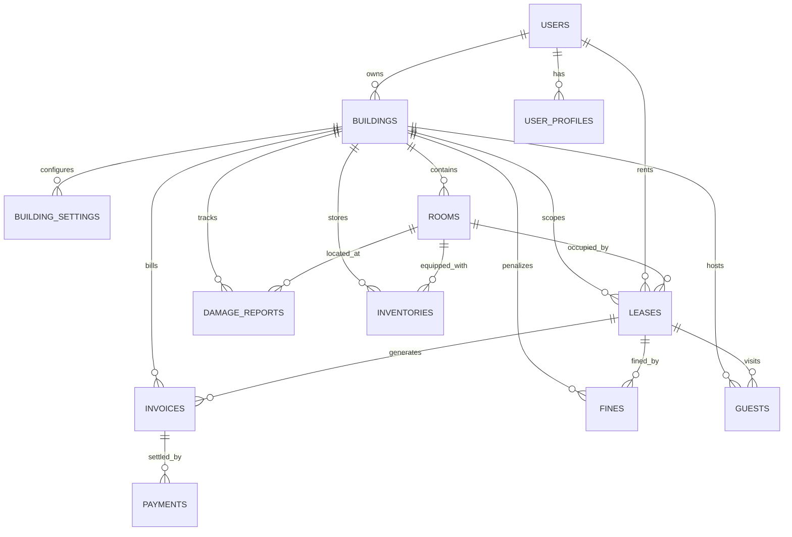

# BAB 1 — Pendahuluan

> Dokumen Resmi Naskah Proyek Akhir — Departemen Teknik Informatika dan Komputer, PENS.
> Format sitasi mengacu pada IEEE numeric `[1]`-`[28]` terurut sesuai kemunculan pertama pada teks.

**Judul Proyek Akhir:**
*Refactoring Sistem Manajemen Rumah Kost dengan Arsitektur Modular Monolithic Berbasis Kerangka Kerja Scrum*

---

## 1.1 Latar Belakang Masalah

### 1.1.1 Urgensi Transformasi Digital Manajemen Rumah Kost Multi-Gedung

Kebutuhan hunian sewa sementara di kawasan perkotaan terus meningkat seiring pertambahan mahasiswa dan pekerja perantau [2]. Bisnis rumah kost berkembang dari sekadar usaha sampingan perseorangan menjadi sektor properti sewa mikro yang menuntut pengelolaan profesional [1]. Sebagian pemilik kini mengelola lebih dari satu gedung kost (*multi-building properties*) di lokasi yang berbeda untuk memperluas jangkauan pasar.

Pengelolaan properti multi-gedung tanpa sistem informasi terpusat memicu kendala operasional harian:
1. **Pencatatan Tercecer:** Data kamar, penghuni, dan riwayat pembayaran dicatat terpisah pada buku atau lembar sebar (*spreadsheet*). Pengelola kesulitan mengetahui unit mana yang kosong, siapa penghuni aktif, atau siapa yang menunggak pembayaran [1].
2. **Pemesanan Ganda (*Double Booking*):** Kesepakatan sewa yang dibuat lewat pesan instan sering memicu bentrok jadwal karena tidak ada mekanisme penguncian kamar terpusat saat transaksi berlangsung [3].
3. **Penagihan dan Rekonsiliasi Manual:** Bukti transfer bank diperiksa satu per satu secara manual. Proses ini memakan waktu, rawan terlewat, dan membuat pemilik kesulitan memantau arus kas nyata (*cash flow*) lintas properti [4].
4. **Penanganan Kerusakan Fasilitas Tidak Terpantau:** Keluhan kerusakan fasilitas disampaikan lewat obrolan lisan atau chat yang mudah tertimbun, sehingga perbaikan terlambat ditangani dan aset fisik cepat rusak [4].

Kondisi tersebut menuntut adanya Sistem Informasi Manajemen (SIM) berbasis web yang mampu memisahkan data tiap gedung secara aman, mengotomatiskan penerbitan tagihan dan verifikasi pembayaran digital, serta menampilkan ringkasan performa seluruh properti secara langsung kepada pemilik [1][4].

---

### 1.1.2 Telaah Kritis Empat Proposal *Previous Work*

Upaya awal digitalisasi pengelolaan rumah kost telah diinisiasi pada Juni 2025 melalui empat proposal proyek akhir yang terpisah [5][6][7][8]:

| No | Proposal / Domain | Peneliti & NRP | Fokus Awal |
|---|---|---|---|
| 1 | Manajemen Penghuni & Tamu | Rasyidatur (3123500039) | Profil penghuni, buku tamu, dan riwayat sewa [5]. |
| 2 | Kamar & Reservasi | Roihanah (3123500005) | Master kamar, ketersediaan unit, dan validasi bentrok [6]. |
| 3 | Keuangan & Transaksi | Rizal (3123500060) | Tagihan berkala, pembayaran Midtrans, dan rekap keuangan [7]. |
| 4 | Operasional & Pemeliharaan | Bagus (3123500031) | Tiket komplain kerusakan, inventaris kamar, dan jadwal servis [8]. |

Meskipun keempat proposal di atas mengusulkan penggunaan arsitektur modular, penelusuran mendalam terhadap kode sistem tersebut mengungkap sembilan kelemahan struktural yang nyata:

1. **Ketiadaan Dukungan Multi-Gedung (*Multi-Tenancy*):** Kode dan skema basis data lama hanya dirancang untuk satu gedung tunggal. Pemilik tidak bisa mengelola cabang properti baru tanpa memasang instalasi server dan basis data terpisah.
2. **Modularitas Semu (*Tight Coupling*):** Pembagian folder di backend Laravel mengandalkan pustaka pihak ketiga, namun pemisahan antar modul tidak benar-benar diterapkan. Service pada modul keuangan memanggil langsung model dari modul kamar, dan relasi *Foreign Key* fisik dipasang melintasi batas domain. Akibatnya modul tidak bisa dipisahkan atau diuji secara mandiri [9].
3. **Format Respons API Tidak Baku:** Struktur respons JSON antar-endpoint berbeda-beda. Inkonsistensi format status, data paginasi, dan pesan kesalahan validasi HTTP 422 menimbulkan kendala pada sisi antarmuka web.
4. **Struktur Frontend Tidak Terisolasi:** Lapisan penampil (BLoC) pada aplikasi Flutter mengakses repository secara langsung tanpa perantara *UseCase*. Logika bisnis bercampur dengan komponen antarmuka, sehingga kode sulit diuji lewat *unit test* [16].
5. **Ketiadaan Antarmuka Kueri Cepat Berbasis AI:** Pemilik dan pengelola harus memeriksa beberapa menu satu per satu secara manual untuk mengetahui tingkat keterisian kamar atau total tunggakan sewa. Belum ada antarmuka kueri berbasis *Model Context Protocol* (MCP) yang menghubungkan model kecerdasan buatan (*Large Language Model* / LLM) dengan basis data operasional secara terstandarisasi dan aman [21].
6. **Pengujian Terotomasi Belum Diterapkan:** Pengujian hanya mengandalkan pengecekan manual fungsional dasar tanpa adanya *unit test*, pengujian kontrak API, maupun pengujian integrasi terotomasi [22].
7. **Integrasi Pembayaran Belum Memenuhi Standar Produksi:** Pembayaran digital via Midtrans baru sebatas lingkungan uji coba (*sandbox*) tanpa mekanisme pencegah transaksi ganda (*idempotency key*) dan tanpa validasi tanda tangan kriptografis pada webhook [25].
8. **Mekanisme Autentikasi Masih Primitif:** Pengelolaan akun pada sistem lama hanya mengandalkan autentikasi dasar tanpa fitur keamanan standar industri. Sistem belum memiliki validasi email pengguna, mekanisme pemulihan akun atau lupa kata sandi (*forgot password*), serta alur manajemen sesi yang terstandarisasi, sehingga akun rentan dan pengembang terbebani membuat fitur autentikasi secara manual dari nol [19].
9. **Model Bisnis Bercabang dan Pembengkakan Basis Data:** Sistem lama mencoba melayani sewa harian, mingguan, bulanan, dan tahunan sekaligus, lengkap dengan skema uang muka (*down payment*) dan pengembalian dana (*refund*). Akibatnya, skema basis data membengkak hingga 41 tabel dengan banyak kolom mati, duplikasi data tagihan, dan tabel penampung sementara yang tidak diperlukan.

---


## 1.2 Rumusan Masalah

Berdasarkan latar belakang tersebut, rumusan masalah dalam Proyek Akhir ini adalah:
1. Bagaimana merancang dan menerapkan arsitektur **Modular Monolith pada NestJS** dengan sembilan modul terenkapsulasi, dan nol *Foreign Key* lintas modul?
2. Bagaimana membangun sistem **Multi-Tenant Row-Level Scoping** berbasis `building_id` agar data antar gedung terisolasi secara aman?
3. Bagaimana menerapkan **Clean Architecture pada Flutter** yang memisahkan logika bisnis dari antarmuka pengguna?
4. Bagaimana menyusun **standarisasi kontrak input-output API** dan dokumentasi interaktif berbasis Swagger?
5. Bagaimana merancang modul MCP Server yang hanya dapat membaca data, agar model *Artificial Intelligence* memperoleh jawaban operasional secara cepat tanpa melanggar batas hak akses gedung?
6. Bagaimana mengintegrasikan **Single Sign-On (SSO) berbasis Keycloak OpenID Connect (OIDC)** dengan verifikasi stateless JWKS pada backend NestJS dan pemetaan hak akses berbasis gedung?
7. Bagaimana menyederhanakan **proses bisnis sewa menjadi bulanan murni** dengan aturan minimal durasi sewa yang dapat diatur per gedung?
8. Bagaimana mengimplementasikan **pembayaran digital Midtrans siap produksi** dan memverifikasi keandalan sistem melalui pengujian perangkat lunak berlapis?
---

## 1.3 Tujuan Penelitian

Tujuan yang ingin dicapai melalui Proyek Akhir ini adalah:
1. Menghasilkan backend **Modular Monolith berbasis NestJS** yang memisahkan domain sistem ke dalam sembilan modul mandiri tanpa ketergantungan relasi fisik basis data.
2. Mewujudkan mekanisme **Multi-Tenancy** yang menjamin isolasi data antar gedung kost pada basis data bersama (*shared database*).
3. Mengembangkan antarmuka sistem berbasis **Flutter Web** dengan penerapan Clean Architecture yang terstruktur dan mudah dipelihara.
4. Menerapkan **kontrak API yang seragam dan type-safe** yang tersinkronisasi otomatis dengan dokumentasi OpenAPI.
5. Menyediakan modul *MCP Server* yang terhubung dengan model *Artificial Intelligence* agar pemilik dan pengelola memperoleh jawaban operasional secara instan.
6. Menerapkan sistem **Single Sign-On (SSO) berbasis Keycloak OpenID Connect** guna menyediakan autentikasi terpusat yang aman, menangani verifikasi email dan reset kata sandi secara otomatis, serta terintegrasi dengan pembatasan hak akses per gedung.
7. Menerapkan **skema basis data 21 tabel** untuk mengakomodasi sewa bulanan dan aturan fleksibel per gedung tanpa duplikasi data.
8. Membangun integrasi **Midtrans yang aman dan idempoten** serta membuktikan stabilitas sistem melalui pengujian berlapis dengan tingkat kelulusan yang terukur.

---

## 1.4 Batasan Masalah

Ruang lingkup dan batasan dalam penelitian Proyek Akhir ini mencakup:
1. **Lingkup Domain Sistem:** Sistem mencakup modul Pengguna (`Auth`), Gedung (`Building`), Kamar (`Room`), Kontrak Sewa (`Lease`), Keuangan (`Finance`), Komplain Kerusakan (`Maintenance`), Buku Tamu (`Guest`), Inventaris (`Inventory`), dan Notifikasi WhatsApp (`Notification`).
2. **Satuan dan Skema Sewa:** Sistem hanya melayani masa sewa dalam satuan **bulan penuh**. Batas minimal durasi sewa ditentukan per gedung melalui pengaturan sistem (`min_rental_months`). Skema sewa harian, mingguan, dan tahunan tidak didukung.
3. **Peran Pengguna (*Roles*):** Hak akses dibatasi untuk tiga kategori pengguna: Pemilik (*Owner* seluruh gedung), Pengelola (*Admin* yang ditugaskan pada gedung tertentu), dan Penghuni (*Resident* kamar aktif).
4. **Platform Antarmuka:** Pengujian fungsionalitas dan antarmuka difokuskan pada platform **Web (Flutter Web)** untuk peramban desktop dan tablet. Kode antarmuka dirancang dengan Clean Architecture agar siap dikompilasi ke aplikasi mobile pada masa mendatang, namun evaluasi kinerja aplikasi mobile fisik berada di luar ruang lingkup pengujian proyek akhir ini.
5. **Model Multi-Tenancy:** Pemisahan data multi-gedung menggunakan pendekatan *Shared Database with Row-Level Scoping* (`building_id`), bukan pemisahan basis data per gedung.
6. **Autentikasi dan Manajemen Identitas Pengguna:** Otentikasi terpusat dikelola oleh server Keycloak berbasis protokol OpenID Connect (OIDC). Backend NestJS bertindak sebagai *Resource Server* yang memvalidasi token JWT secara *stateless* melalui JWKS dan memetakan klaim token ke dalam peran sistem (*Owner*, *Admin*, *Resident*) beserta batas gedung (`building_id`).
7. **Batasan Asisten *Artificial Intelligence* (MCP):** Modul *MCP Server* hanya melakukan operasi baca (*read-only tool calls*) untuk menyuplai data faktual bagi model *Artificial Intelligence*. Model tersebut tidak diberi wewenang mengubah data operasional secara otomatis tanpa persetujuan pengguna (*human-in-the-loop*).
8. **Integrasi Eksternal:** Layanan pihak ketiga mencakup gerbang pembayaran Midtrans SNAP (Virtual Account dan QRIS) serta pengiriman notifikasi transaksi melalui WhatsApp Gateway (Fonnte/Open-WA).
9. **Metodologi Pengembangan:** Sistem dikembangkan menggunakan kerangka kerja Scrum dalam 4 siklus *sprint*.

---

## 1.5 Manfaat Penelitian

### 1.5.1 Manfaat Bagi Pemilik dan Pengelola Properti
- **Kemudahan Pemantauan Terpusat:** Mempermudah pemantauan operasional banyak gedung kost secara terpusat melalui satu portal dashboard web.
- **Akselerasi Pengambilan Keputusan via MCP dan LLM:** Integrasi *Model Context Protocol* (MCP) dengan model kecerdasan buatan (*Large Language Model* / LLM) mempercepat penarikan informasi operasional. Pemilik dan pengelola dapat menanyakan ringkasan okupansi, tagihan tertunggak, atau status komplain secara instan lewat percakapan bahasa alami tanpa harus membuka menu dan halaman sistem satu per satu.
- **Otomasi Finansial dan Rekonsiliasi:** Mengeliminasi pencatatan manual dan meminimalkan kesalahan verifikasi pembayaran melalui otomasi penagihan berkala dan verifikasi Midtrans.

### 1.5.2 Manfaat Bagi Penghuni
- Mempermudah pemilihan kamar, reservasi unit tanpa risiko pemesanan ganda, serta pembayaran tagihan resmi melalui saluran pembayaran digital.
- Memberikan transparansi penanganan komplain fasilitas melalui tiket laporan kerusakan berlampiran foto.

### 1.5.3 Manfaat Bagi Penulis dan Akademisi
- Memberikan studi empiris mengenai tahapan refaktorisasi arsitektur perangkat lunak dari sistem lama yang terfragmentasi menjadi Modular Monolith berbasis NestJS.
- Memberikan rujukan teknis mengenai reduksi kompleksitas basis data dari 41 tabel menjadi skema 21 tabel domain tanpa mengorbankan fungsionalitas bisnis utama.

---

## 1.6 Sistematika Penulisan

Laporan Proyek Akhir ini disusun dalam lima bab:
- **BAB 1 PENDAHULUAN:** Berisi latar belakang masalah operasional kost multi-gedung, telaah kritis atas kelemahan sistem lama, rasionalisasi penulisan ulang ke NestJS skema 21 tabel, rumusan masalah, tujuan, batasan, manfaat, serta sistematika penulisan.
- **BAB 2 KAJIAN PUSTAKA:** Membahas landasan teori mengenai Sistem Informasi Manajemen Properti, arsitektur Modular Monolith pada ekosistem Node.js/NestJS, manajemen identitas Keycloak OIDC, protokol integrasi kecerdasan buatan Model Context Protocol (MCP), Clean Architecture pada Flutter Web, isolasi data Multi-Tenancy, integritas basis data relasional MySQL, integrasi gerbang pembayaran Midtrans, dan piramida pengujian perangkat lunak.
- **BAB 3 METODOLOGI DAN PERANCANGAN SISTEM:** Menguraikan metodologi Scrum (peran, siklus 4 sprint, backlog), perancangan arsitektur Modular Monolith 9 modul NestJS, pemodelan proses bisnis (BPMN), use case, Data Flow Diagram (DFD), perancangan skema 21 tabel basis data beserta kamus data lengkap, alur otentikasi Keycloak OIDC via JWKS, spesifikasi teknis tool server MCP, rancangan antarmuka Flutter Web, spesifikasi kontrak REST API, dan skenario pengujian.
- **BAB 4 IMPLEMENTASI DAN EVALUASI:** Mendokumentasikan implementasi backend NestJS, integrasi Keycloak OIDC, integrasi modul server MCP, frontend Flutter Web, integrasi Midtrans dan WhatsApp, serta menyajikan hasil pengujian sistem (*unit test*, *contract test*, *tenant isolation test*, dan *integration test*).
- **BAB 5 PENUTUP:** Menyajikan kesimpulan atas hasil refaktorisasi sistem dan pencapaian tujuan penelitian, serta memaparkan saran pengembangan untuk penambahan fitur pada masa mendatang.


# BAB 2 — Kajian Pustaka

> Dokumen Resmi Naskah Proyek Akhir — Departemen Teknik Informatika dan Komputer, PENS.
> Format sitasi mengacu pada IEEE numeric `[1]`-`[22]` terurut sesuai kemunculan pertama pada teks.

---

## 2.1 Deskripsi Permasalahan Empiris dan Teknis

Penelitian ini berfokus pada **refactoring** sistem informasi manajemen rumah kost yang sebelumnya telah dikembangkan sebagai *previous work* oleh empat mahasiswa [5][6][7][8]. Sebelum merancang ulang, sistem lama dianalisis lebih dahulu untuk menemukan hambatan teknis yang menjadi dasar rewrite ini. Lima masalah berikut merupakan temuan utama yang menjadi dasar pemetaan kelemahan pada BAB 1 dan pemetaan solusi pada BAB 3:

1. **Modularitas Semu dan *Tight Coupling* Antar-Domain:**
   Sistem lama memisahkan domain Penghuni, Kamar, Keuangan, dan Operasional ke dalam folder-modul terpisah, tetapi pemanggilan dari satu modul masih diakses langsung oleh modul lain tanpa adanya lapisan penengah (*layer*) yang memisahkan keduanya [9]. Service pada modul keuangan, misalnya, memanggil langsung model milik modul kamar, dan relasi *Foreign Key* fisik dipasang melintasi batas domain. Akibatnya, perubahan pada satu modul berisiko merusak modul lain, dan tidak ada modul yang dapat diuji secara independen [9].

2. **Basis Data yang Bercabang dan Menggandakan Data:**
   Skema basis data dari sistem lama mendukung varian sewa harian, bulanan, dan tahunan sekaligus, lengkap dengan mekanisme uang muka (*down payment*) dan pengembalian dana (*refund*). Model ini menyebabkan basis data membengkak menjadi 41 tabel, dengan banyak tabel turunan yang saling menggandakan (dua mekanisme penerbitan tagihan, dua cache penghuni aktif, dan dua tabel penguncian kamar) serta kolom-kolom yang sudah tidak lagi dipakai pemanya [6][7]. Struktur seperti ini membuat pemeliharaan skema dan pelacakan riwayat transaksi semakin sulit dilakukan [7][8].

3. **Kontrak Data dan Hak Akses yang Tidak Seragam:**
   Setiap endpoint REST mengembalikan struktur JSON yang tidak konsisten, perbedaan muncul pada format `status`, struktur paginasi, dan pesan kesalahan validasi. Akibatnya, sisi antarmuka web harus menangani setiap kasus secara berbeda [18]. Selain itu, meskipun pembagian peran sudah ada, belum ada pembatasan akses berbasis gedung, sehingga pengelola pada satu gedung dapat melihat atau mengubah data gedung lain [5][6][16].

4. **Mekanisme Autentikasi yang Belum Matang:**
   Sistem lama hanya mengandalkan autentikasi sederhana berupa kombinasi email dan kata sandi. Belum ada verifikasi email saat pendaftaran, belum ada mekanisme pemulihan kata sandi ketika pengguna lupa (*forgot password*), belum ada pengaturan masa berlaku sesi, dan belum ada lapisan keamanan tambahan seperti autentikasi dua faktor (*multi-factor authentication*). Akibatnya, risiko kebocoran dan penyalahgunaan akun cukup tinggi, dan Sebagian besar anggaran pengembangan pun teralokasikan untuk membangun fitur autentikasi dari nol [5][6][19].

5. **Keterbatasan Dukungan Multi-Gedung (*Multi-Tenancy*):**
   Rancangan awal mengasumsikan hanya satu gedung fisik. Ketika bisnis berkembang ke beberapa properti, pendekatan tanpa pemisahan data penyewa (*tenant isolation*) memaksa pengembang memasang instalasi server dan basis data terpisah untuk setiap gedung baru. Pendekatan ini melipatgandakan biaya pemeliharaan dan menyulitkan pemilik untuk melihat laporan keuangan gabungan seluruh portofolio [18].

---

## 2.2 Teori Penunjang

### 2.2.1 Sistem Informasi Manajemen

Sistem Informasi Manajemen (SIM) adalah sistem berbasis komputer yang mengumpulkan, menyimpan, mengolah, dan menyajikan data agar dapat dipakai sebagai dasar pengambilan keputusan dalam sebuah organisasi [1]. Secara sederhana, SIM mengubah data mentah menjadi informasi yang berguna, lalu informasi itu dipakai untuk perencanaan, pengendalian, dan evaluasi kinerja.

Pada industri properti sewa, SIM menjalankan tiga fungsi yang saling terkait. Pertama, mencatat kondisi fisik properti seperti unit kamar, fasilitas, dan barang di dalamnya. Kedua, merekam seluruh transaksi sewa dari awal kontrak sampai pembayaran terakhir. Ketiga, menyusun laporan keuangan yang bisa dipercaya pemilik sebagai dasar mengambil keputusan.

PA ini memakai konsep SIM sebagai kerangka dasar karena ketiga fungsi tersebut tercakup di dalam sistem yang dibangun. Yang membedakan sistem ini dari sistem lama adalah letak otomasi. Pada sistem lama, laporan okupansi dan tunggakan harus dihimpun manual dengan membuka beberapa menu satu per satu. Pada sistem yang dirancang, data sudah tersusun begitu masuk sehingga laporan terbentuk otomatis dan tidak perlu diketik ulang.

> **Gambar 2.1 — Dimensi Fungsional SIM pada Sistem Manajemen Rumah Kost:** belum tersedia. Diagram ini masih perlu dibuat.

---

### 2.2.2 Arsitektur Modular Monolithic

Arsitektur modular monolithic membangun aplikasi sebagai satu kesatuan utuh, tetapi membaginya ke dalam modul-modul yang masing-masing punya tanggung jawab dan tidak saling bergantung langsung [9]. Bedanya dengan monolitik konvensional terletak pada pemisahan antar modul. Pada monolitik biasa, pemisahan hanya berupa struktur folder, sehingga service di satu bagian tetap bisa memanggil bagian lain tanpa batasan. Pada modular monolithic, pemisahan antar modul ditegakkan dan komunikasi antar modul harus lewat kontrak yang disepakati.

Prinsip batas tersebut diambil dari konsep *bounded context* dalam Domain-Driven Design, yang dipakai untuk menentukan di mana sebuah modul harus berakhir [10]. Setiap modul diperlakukan sebagai satu bagian bisnis dengan aturan main sendiri. Modul keuangan misalnya punya aturan penghitungannya sendiri, dan modul kamar punya aturan tentang ketersediaan unit. Keduanya tidak boleh saling membaca data secara langsung, melainkan berkomunikasi lewat kontrak yang telah ditentukan.

PA ini memakai pendekatan ini karena alasan utamanya adalah kemudahan waktu depan. Ketika bisnis berkembang dan muncul kebutuhan baru, misalnya perlu menambah modul laporan keuangan atau modul pengarsipan dokumen, penambahan tersebut cukup dilakukan dengan membuat modul terpisah dan mendaftarkannya, tanpa mengubah modul yang sudah berjalan. Sebaliknya, ketika ada modul yang tidak lagi dibutuhkan, modul itu bisa dihapus beserta seluruh isinya tanpa meninggalkan jejak di modul lain.

Kemudahan inilah yang tidak dimiliki sistem lama. Folder modulnya memang ada, tetapi karena batasnya tidak ditegakkan, modul keuangan tetap bisa membaca tabel modul kamar. Akibatnya tidak ada satu pun bagian yang bisa dilepas atau diuji sendiri tanpa menarik bagian lain ikutcampur. Batas yang benar-benar dipaksakan oleh kerangka kerja membuat penambahan dan penghapusan modul menjadi pekerjaan yang biasa, bukan proses yang perlu dikhawatirkan.

> **Gambar 2.2 — Hirarki Modul 3-Tier pada Modular Monolithic:** `PA/docs/System design/01-Gambaran-umum/02_arsitektur_backend/hierarki_3_tier_modulith.mmd` / `.png`

---

### 2.2.3 NestJS

NestJS adalah kerangka kerja backend berbasis Node.js dan TypeScript yang dirancang untuk membangun aplikasi server dengan struktur modular [13]. Berbeda dari framework konvensional yang mengharuskan pengembang membuat struktur folder sendiri, NestJS menyediakan pemisahan antar modul sebagai bagian dari kerangka kerjanya. Setiap unit kerja dibungkus dekorator `@Module()` yang menentukan layanan mana yang boleh diekspor ke modul lain dan mana yang disembunyikan di dalam modul tersebut.

Dua mekanisme membuat hal itu bekerja. Pertama, *encapsulation*. Layanan yang tidak didaftarkan pada daftar `exports` tidak akan pernah bisa disuntik oleh modul lain, meskipun keduanya berada di repositori yang sama. Kedua, *dependency injection*. Setiap kelas menerima dependensinya dari wadah aplikasi, bukan membuatnya sendiri, sehingga mudah diganti dengan tiruan saat pengujian. Selain itu, NestJS dibangun di atas Node.js yang bekerja dengan model I/O non-blocking, sehingga permintaan yang menunggu jawaban dari layanan luar tidak menahan proses lain.

PA ini memilih NestJS karena pemisahan antar modul ditegakkan oleh kerangka kerjanya sendiri, bukan oleh disiplin tim. Ketika modul keuangan mencoba menulis kueri ke tabel milik modul kamar, kode itu akan gagal sejak tahap build, bukan baru ketahuan saat pengujian. Pengalaman sistem lama menunjukkan bahwa pemisahan yang hanya dijaga lewat aturan tertulis akan cepat dilanggar ketika waktu pengembangan sedang menekan. Dengan NestJS, pelanggaran aturan menjadi kesalahan teknis, bukan pilihan penyusun kode.

> **Gambar 2.3 — Pemisahan Antar Modul dan Mekanisme Dependency Injection pada NestJS:** belum tersedia. Diagram ini masih perlu dibuat.

---

### 2.2.4 Flutter

Flutter adalah kerangka kerja antarmuka lintas platform yang dikembangkan oleh Google dengan bahasa pemrograman Dart [15]. Semua tampilan pada aplikasi disusun dari komponen yang namanya *widget*. Satu basis kode yang sama dapat dikompilasi menjadi aplikasi web, aplikasi Android, maupun aplikasi iOS, tanpa menulis ulang lapisan tampilannya. Karena itu Flutter disebut multi-platform, sebab satu proyek dapat dipakai untuk beberapa perangkat sekaligus.

PA ini memakai Flutter dengan target utama berupa aplikasi web. Alasan memilih lingkungan web adalah lingkup penggunaan sistem: pengoperasian harian dilakukan dari komputer atau tablet di ruang pengelola, sehingga tampilan lebar lebih sesuai. Arsitektur yang dipakai juga memperjelas alasan itu. Karena logika bisnis disimpan di lapisan domain yang murni Dart tanpa bergantung pada sistem operasi maupun peramban, lapisan tersebut tetap bisa dipakai ulang ketika aplikasi dikompilasi untuk perangkat mobile di kemudian hari. Jadi kesiapan ekspansi ke mobile muncul sebagai hasil dari struktur kode, bukan sebagai target tambahan yang harus dirancang terpisah.

> **Gambar 2.4 — Lapisan Clean Architecture pada Flutter:** `PA/docs/System design/01-Gambaran-umum/03_arsitektur_frontend/clean_architecture_frontend.mmd` / `.png`

---

### 2.2.5 Clean Architecture

Clean Architecture adalah pola arsitektur yang memisahkan program menjadi lapisan-lapisan dengan aturan ketergantungan satu arah [16]. Lapisan paling dalam berisi entitas dan aturan bisnis yang murni, lapisan tengah berisi use case, dan lapisan luar menangani presentasi serta akses data. Aturan utamanya sederhana: lapisan dalam tidak boleh mengenal keberadaan lapisan luar.

Pada aplikasi Flutter, pemisahan ini menjawab satu masalah yang sering muncul. Kode pada lapisan tampilan biasanya mengambil data langsung dari repository, sehingga logika bisnis ikut bercampur dengan komponen antarmuka. Akibatnya, menguji sebuah aturan bisnis berarti menyalakan seluruh tampilan beserta koneksi jaringan. Dengan Clean Architecture, aturan bisnis berdiri sendiri tanpa framework apa pun, sehingga bisa diuji dalam hitungan milidetik.

PA ini memakai Clean Architecture pada sisi antarmuka karena pemisahan tersebut memudahkan dua hal. Pertama, pengujian: setiap lapisan punya fokus yang jelas, sehingga aturan bisnis dapat diuji tanpa lapisan lain, dan pengujian antarmuka cukup memeriksa pemetaan state ke tampilan. Kedua, perubahan pada bagian tertentu tidak menimpa bagian lain. Contohnya, apabila format jawaban API berubah, cukup ubah lapisan data; lapisan domain dan lapisan presentasi tidak perlu disentuh karena keduanya tidak tahu bentuk data mentah.

> **Gambar 2.5 — Pembagian Lapisan pada Clean Architecture:** `PA/docs/System design/01-Gambaran-umum/03_arsitektur_frontend/clean_architecture_frontend.mmd` / `.png`

---

### 2.2.6 BLoC (Business Logic Component)

BLoC adalah pola pengelolaan *state* pada Flutter yang memisahkan pemicu perubahan state dari proses perubahannya [15]. Alurnya sederhana: widget mengirim *event*, *bloc* yang menerima event itu memanggil use case, lalu *bloc* memancarkan *state* baru dalam bentuk objek yang tidak bisa diubah setelah dibuat.

Pola ini membuat aliran data pada antarmuka berjalan satu arah dan mudah dilacak.urutannya bisa dibaca langsung dari kode: dari widget, ke event, ke use case, ke state, lalu kembali ke widget. Berbeda dengan pemanggilan `setState` yang menyatukan pemicu dan perubahan di dalam satu widget, BLoC memisahkannya sehingga transisi state bisa diuji tanpa menampilkan antarmuka sama sekali.

PA ini memakai BLoC karena pola ini sebenarnya memaksa struktur kode menjadi tertata. BLoC hanya bekerja jika logika bisnis berada di use case terpisah dari widget yang memunculkannya. Umumnya, pengembang yang langsung memuat data dan memprosesnya di dalam widget akan membuat pola ini mustahil diterapkan. Dengan BLoC, pemisahan antara logika bisnis dan tampilan bukan lagi pilihan disiplin, melainkan syarat agar pola tersebut berjalan.

> **Gambar 2.6 — Alur Data pada Pola BLoC:** belum tersedia. Diagram ini masih perlu dibuat.

---

### 2.2.7 PostgreSQL

PostgreSQL adalah sistem manajemen basis data relasional *open-source* yang dikenal konsisten dengan standar SQL, mendukung transaksi dengan integritas tinggi, dan menyediakan penanganan konkurensi yang matang [17]. Yang membedakannya dari basis data relasional lain terletak pada tiga hal yang dipakai langsung pada sistem ini.

Pertama, tipe numerik `NUMERIC` dipakai untuk seluruh nilai uang. Tipe ini menyimpan angka desimal secara tepat, sehingga penjumlahan tagihan tidak pernah menghasilkan selisih satu rupiah akibat pembulatan. Kedua, tipe `JSONB` dipakai untuk menyimpan payload *event* dan parameter *tool* MCP, sekaligus memudahkan pencarian di dalam struktur tersebut. Ketiga, PostgreSQL menyediakan penguncian baris dengan `SELECT ... FOR UPDATE`, yaitu mengunci baris yang sedang dibaca selama transaksi masih berjalan.

Mekanisme penguncian itulah yang dipakai untuk mencegah dua orang memesan kamar yang sama pada saat bersamaan. Saat permintaan sewa masuk, baris kamar dikunci lebih dulu, lalu diperiksa apakah sudah ada kontrak aktif di periode tersebut. Kalau belum ada, kontrak disimpan di dalam transaksi yang sama; kalau sudah ada, transaksi dibatalkan dan permintaan kedua ditolak. Selama penguncian masih aktif, permintaan lain untuk kamar yang sama harus mengantre. Inilah yang membuat pemesanan ganda tidak mungkin terjadi meski beberapa orang menekan tombol sewa pada milidetik yang sama.

> **Gambar 2.7 — Mekanisme Penguncian Baris untuk Pencegahan Pemesanan Ganda:** belum tersedia. Diagram ini masih perlu dibuat.

---

### 2.2.8 Multi-Tenancy dengan Row-Level Scoping

Multi-tenancy adalah pola arsitektur yang membuat satu instalasi aplikasi melayani banyak unit bisnis independen dengan jaminan pemisahan data [18]. Pada sistem properti sewa, unit bisnisnya adalah gedung. Artinya, data kamar gedung A tidak boleh bisa dibaca atau diubah oleh pengelola gedung B.

Tiga model yang lazim adalah *database per tenant*, *schema per tenant*, dan *shared database dengan row-level scoping*. Model pertama memberi isolasi paling kuat tetapi membutuhkan server khusus untuk setiap gedung. Model kedua mengurangi jumlah server, tetapi pemeliharaan strukturnya menambah pekerjaan setiap kali ada gedung baru. Model ketiga menyimpan seluruh data di satu basis data dan menambahkan kolom `building_id` pada setiap tabel sebagai penanda.

PA ini memilih model ketiga karena tiga alasannya. Migrasi skema cukup dijalankan satu kali untuk seluruh gedung, bukan diulang tiap kali ada properti baru. Biaya server tidak bertambah seiring jumlah gedung. Dan yang paling penting, laporan gabungan seluruh portofolio bisa disusun dengan satu kueri, sedangkan pada model terpisah data harus digabungkan lebih dahulu. Keterbatasan model ini juga diketahui: pemisahan data harus dijaga di lapisan aplikasi, bukan oleh basis data, sehingga setiap kueri wajib menyertakan `building_id`.

> **Gambar 2.8 — Isolasi Data Antar Gedung pada Row-Level Scoping:** belum tersedia. Diagram ini masih perlu dibuat.

---

### 2.2.9 Single Sign-On, OpenID Connect, dan Keycloak

Single Sign-On (SSO) adalah mekanisme yang memungkinkan pengguna cukup sekali masuk untuk mengakses beberapa aplikasi sekaligus, tanpa mengulang kredensial di setiap aplikasi [19]. Pada sistem yang punya banyak modul atau banyak aplikasi terpisah, mekanisme ini menghemat waktu pengguna sekaligus mengurangi jumlah kata sandi yang harus dikelola.

OpenID Connect (OIDC) adalah standar yang mengatur lapisan identitas di atas OAuth 2.0. Bedanya, OAuth 2.0 hanya mengatur pendelegasian hak akses, sedangkan OIDC menambahkan identitas: setelah pengguna berhasil masuk, aplikasi menerima *token* berisi informasi siapa penggunanya. Token tersebut berbentuk JWT dan ditandatangani secara digital, sehingga pihak lain bisa memastikan token itu benar berasal dari penyedia identitas dan belum kedaluwarsa. Karena tanda tangannya dapat diperiksa tanpa menghubungi server pengeluar token, proses verifikasi bisa dijalankan secara lokal dan cepat.

Keycloak adalah *identity and access management* open-source yang mendukung OIDC, SSO, dan pengelolaan peran [20]. Yang sering tidak dikerjakan sendiri oleh aplikasi adalah justru hal-hal standar ini: verifikasi email saat pendaftaran, pemulihan kata sandi ketika pengguna lupa, masa berlaku sesi, dan pencatatan aktivitas login. Pada sistem lama seluruh itu harus dibuat satu per satu, dan bagian yang paling sering tertinggal justru yang paling penting, yaitu pemulihan akun.

PA ini memakai Keycloak karena tiga alasan. Pertama, fitur keamanan yang dibutuhkan sudah tersedia sehingga waktu pengembangan bisa dipakai untuk aturan bisnis sewa. Kedua, peran pengguna seperti pemilik, pengelola, dan penghuni cukup diatur di satu tempat, lalu diteruskan ke backend lewat isi token. Ketiga, backend cukup memverifikasi tanda tangan token tanpa perlu menghubungi Keycloak pada setiap permintaan, sehingga waktu tanggap tidak bertambah. Perlu dicatat bahwa Keycloak menambah satu layanan yang harus dijalankan dan dipelihara, dan pembagian peran harus disusun di Keycloak dengan cermat supaya tetap sinkron dengan aturan pada sistem.

> **Gambar 2.9 — Alur Verifikasi Token OIDC dengan JWKS:** belum tersedia. Diagram ini masih perlu dibuat.

---

### 2.2.10 Docker dan Docker Compose

Docker adalah platform *containerization* yang membungkus aplikasi beserta seluruh dependensinya ke dalam satu unit bernama *image* [23]. Image ini berisi semua yang diperlukan untuk menjalankan aplikasi: kode, pustaka, konfigurasi, sampai sistem operasi dasar. Karena isinya lengkap dan tidak bergantung pada isi mesin, aplikasi yang berjalan di laptop pengembang akan berjalan sama persis di server.

Perbedaan utama Docker dengan cara lama adalah pemisahan antara apa yang ada di kode dan apa yang ada di komputer. Pada pendekatan lama, setiap orang memasang PostgreSQL dan Keycloak dengan versi masing-masing, dan versi yang berbeda sering menyebabkan program berjalan di satu komputer tetapi gagal di komputer lain. Dengan Docker, versi PostgreSQL dan Keycloak dituliskan di satu berkas konfigurasi, lalu dijalankan apa adanya di mana saja.

Docker Compose adalah kelanjutannya. Compose membaca satu berkas yang menjelaskan beberapa container sekaligus, lalu menjalankan semuanya dengan satu perintah. PA ini punya tiga komponen yang harus jalan bersamaan: backend NestJS, basis data PostgreSQL, dan Keycloak. Compose dipakai agar ketiganya bisa dijalankan, dihentikan, dan dibuild ulang tanpa langkah manual yang berbeda-beda [41].

> **Gambar 2.10 — Komposisi Container pada Sistem Manajemen Rumah Kost:** belum tersedia. Diagram ini masih perlu dibuat.

---

### 2.2.11 Midtrans SNAP

Midtrans adalah penyedia layanan gerbang pembayaran yang menghubungkan aplikasi dengan jaringan pembayaran bank dan dompet digital. Midtrans SNAP merupakan layanan andalannya: SNAP menyediakan antarmuka pembayaran siap pakai dalam bentuk *pop-up*, sehingga penghuni tidak perlu meninggalkan aplikasi untuk menyelesaikan transaksi [25]. SNAP mendukung kanal Virtual Account, QRIS, dan dompet digital.

Integrasi berjalan dua arah. Dari sisi sistem, backend meminta token pembayaran lalu meneruskannya ke antarmuka SNAP, dan penghuni menyelesaikan pembayaran di sana. Dari sisi Midtrans, setiap kali status pembayaran berubah, Midtrans mengirim *webhook* ke alamat yang didaftarkan. Di sinilah bagian yang perlu diperhatikan berada: *webhook* adalah permintaan yang masuk dari luar, sehingga harus diperiksa sebelum dipercayai.

Ada dua perlindungan yang dipakai pada sistem ini. Yang pertama, penomoran pesanan. Setiap permintaan pembayaran diberi nomor unik, sehingga ketika jaringan membuatkan permintaan terkirim ulang, Midtrans mengenali bahwa itu transaksi yang sama dan tidak membuat tagihan ganda. Yang kedua, verifikasi tanda tangan. Setiap *webhook* disertai tanda tangan yang dihitung dari nomor pesanan, kode status, jumlah pembayaran, dan kunci rahasia. Backend menghitung ulang tanda tangan itu; kalau tidak cocok, permintaan ditolak dan status tagihan tidak diubah. Tanpa dua perlindungan ini, siapa pun yang mengetahui alamat *webhook* bisa memalsukan pembayaran.

> **Gambar 2.11 — Alur Pembayaran dan Verifikasi Webhook:** belum tersedia. Diagram ini masih perlu dibuat.

---

### 2.2.12 Standar Kontrak Input-Output REST API

REST API adalah gaya komunikasi yang paling umum dipakai antar aplikasi web. Yang dikirim berupa permintaan HTTP, dan jawabannya berupa *response* dengan kode status yang menyatakan berhasil atau gagal. Kelemahannya, setiap pengembang bebas membuat format jawabannya sendiri, sehingga satu endpoint bisa berbeda dengan endpoint lain. Pengembang yang membuat program harusnya mengelola semua kemungkinan format itu.

Standar yang dipakai pada sistem ini mengatasi masalah tersebut: setiap *endpoint* mengembalikan *response* dengan lima kunci yang selalu sama. Kunci `status` menyatakan berhasil atau gagal, `message` berisi keterangan yang bisa dibaca manusia, `data` berisi isi jawaban, `meta` berisi informasi tambahan seperti penomoran halaman, dan `errors` berisi rincian kesalahan validasi. Format kesalahan mengikuti kebiasaan *Problem Details* [36]. Contoh jawaban berhasil:

```json
{
  "status": true,
  "message": "Kontrak sewa berhasil dibuat",
  "data": {
    "lease_id": 12,
    "room_number": "A-02",
    "duration_months": 3,
    "total_amount": 2550000,
    "status": "pending"
  }
}
```

Contoh jawaban gagal karena masukan tidak sesuai:

```json
{
  "status": false,
  "message": "Validasi masukan gagal",
  "errors": {
    "duration_months": ["Durasi sewa minimal untuk gedung ini adalah 3 bulan."],
    "room_id": ["Kamar sudah sedang disewa pada periode tersebut."]
  }
}
```

Kode status yang dipakai mengikuti ketetapan umum HTTP. Kode 200 dan 201 berarti permintaan berhasil diproses atau data baru dibuat. Kode 400 berarti permintaan tidak sesuai format. Kode 401 berarti token tidak ada atau sudah kedaluwarsa. Kode 403 berarti pengguna tidak berhak mengakses data gedung tersebut. Kode 404 berarti data tidak ditemukan. Kode 422 berarti masukan melanggar aturan bisnis, misalnya durasi sewa di bawah minimal. Dengan seluruh kemungkinan kesalahan mengikuti pola yang sama, sisi antarmuka cukup menulis satu fungsi untuk menangani semuanya.

> **Gambar 2.12 — Bentuk Standar Respons API:** belum tersedia. Diagram ini masih perlu dibuat.

---

### 2.2.13 Pengujian Perangkat Lunak Otomatis

Pengujian program adalah proses menjalankan program dengan masukan khusus untuk memeriksa apakah hasilnya sesuai dengan yang diharapkan [22]. Dalam metode *black-box*, pengujian hanya melihat hasil dari luar, sehingga program bisa menghasilkan jawaban yang benar tetapi salah cara.

Pola pengujian yang umum adalah *testing pyramid* [22]. Di bagian paling bawah ada pengujian unit, yaitu menguji satu aturan bisnis tanpa jaringan, tanpa basis data, dan tanpa antarmuka. Di atasnya ada pengujian kontrak, yang memeriksa apakah setiap endpoint mengembalikan bentuk jawaban sesuai kesepakatan. Di bagian paling atas ada pengujian integrasi, yang menyalakan beberapa bagian sekaligus untuk memeriksa alur keseluruhan.

Jumlah pengujian berbanding terbalik dengan tingginya. Makin ke atas, makin sedikit pengujiannya, makin lama waktunya, dan makin sulit melacak kesalahan. Inilah alasan pengujian unit ditulis paling banyak: cepat dijalankan dan kesalahannya mudah ditemukan.

PA ini memakai susunan itu dengan target cakupan kode minimal 80 persen. Ada satu jenis pengujian yang khas untuk sistem ini, yaitu uji isolasi gedung. Tujuannya membuktikan bahwa pengelola gedung satu tidak dapat membaca data gedung lain, termasuk ketika keduanya mencoba mengakses pada saat bersamaan.

> **Gambar 2.13 — Piramida Pengujian beserta Komposisinya:** belum tersedia. Diagram ini masih perlu dibuat.

---

### 2.2.14 Model Context Protocol

Model Context Protocol (MCP) adalah standar terbuka yang menghubungkan model kecerdasan buatan dengan sumber data dan fungsi di luar model tersebut [21]. Sebagian besar pertanyaan operasional membutuhkan data nyata yang tidak ada di dalam model, sehingga tanpa akses ke data itu model hanya bisa menebak.

MCP menjawab dengan memisahkan tiga peran. *Host* adalah aplikasi yang berinteraksi dengan pengguna, misalnya kolom tanya-jawab pada dasbor. *Client* adalah konektor di dalam host yang meneruskan permintaan ke server. *Server* adalah layanan yang menyediakan data dan fungsi. Ketiganya berkomunikasi memakai pesan JSON-RPC 2.0, yaitu format pertukaran pesan yang sudah disepakati dan tersedia di banyak bahasa pemrograman.

Server MCP mengekspos tiga jenis kemampuan. *Resources* berisi data yang bisa dibaca, misalnya data gedung. *Prompts* berisi templat instruksi, misalnya cara menulis jawaban sebagai analis properti. *Tools* berisi fungsi yang dijalankan model ketika dibutuhkan, misalnya menghitung tingkat keterisian kamar. Karena sebuah *tool* adalah kode yang benar-benar dijalankan, komponen ini harus diperlakukan dengan hati-hati.

Oleh karena itu, pada sistem ini semua *tools* yang diekspos hanya berfungsi membaca. Tidak ada satu pun fungsi yang mengubah data. Dengan begitu, jawaban yang muncul di kolom tanya-jawab pasti berdasarkan angka yang benar-benar ada di basis data, dan keputusan penting tetap diambil manusia.

{width=15cm}

---

## 2.3 Penelitian Terkait

Beberapa penelitian terdahulu membahas sistem informasi manajemen rumah kost. Penelitian tersebut ditinjau untuk melihat apa yang sudah dikerjakan, apa yang masih menjadi masalah, serta posisi penelitian ini di antaranya.

Penelitian pertama dilakukan oleh Wahyuni pada tahun 2025 dengan judul "Pengembangan Sistem Informasi Pengelolaan Kos Berbasis Website Dengan Menggunakan Framework Codeigniter" [2]. Penelitian ini membangun aplikasi web pencatatan data kost. Metode yang digunakan adalah prototyping dengan Codeigniter dan MySQL. Hasilnya berupa aplikasi pencatatan kamar dan penghuni, tetapi hanya mampu mengelola satu gedung dan belum memisahkan hak akses per peran.

Penelitian kedua diterbitkan pada tahun 2025 dengan judul "Pengembangan Sistem Manajemen Kos Berbasis Aplikasi Mobile pada Kos SidoRame12" [3]. Metode yang digunakan adalah prototyping dengan Flutter dan Laravel. Hasilnya berupa aplikasi mobile dengan pencatatan status kamar dan pengingat pembayaran, tetapi belum mendukung beberapa gedung dan belum ada pengujian otomatis.

Penelitian ketiga dilakukan oleh Ayyubi pada tahun 2024 dengan judul "Rancang Bangun Sistem Informasi Pembayaran Kost Berbasis Mobile pada Kost WS Barokah Selokaton" [4]. Penelitian ini membangun layanan pembayaran sewa secara daring. Metode yang digunakan adalah waterfall dengan Flutter dan Midtrans SNAP. Hasilnya berupa pembayaran digital, tetapi integrasi Midtrans masih berjalan di lingkungan uji coba tanpa perlindungan terhadap transaksi ganda.

Penelitian keempat diterbitkan pada tahun 2025 dengan judul "Kelola Kosku" [26]. Penelitian ini membangun sistem akuntansi sewa lengkap. Metode yang digunakan adalah MVVM dengan Flutter dan Supabase. Hasilnya mencakup tagihan bulanan otomatis, denda keterlambatan, dan uang jaminan, tetapi memakai basis data non-relasional sehingga integritas transaksi lemah.

Penelitian kelima dilakukan oleh Bintang, Purnamasari, dan Maulana pada tahun 2026 dengan judul "Transformasi Digital Pengelolaan Kos" [27]. Penelitian ini bertujuan mengubah operasional kost menjadi berbasis digital. Metode yang digunakan adalah Scrum dengan Laravel dan Midtrans. Hasilnya berupa penagihan otomatis dan notifikasi WhatsApp, tetapi struktur modul pada backend masih belum tegas.

Penelitian keenam dilakukan oleh Nurfaqih, Budihartono, dan Syefudin pada tahun 2026 dengan judul "Rancang Bangun Sistem Informasi Manajemen Kost Berbasis Web Menggunakan Framework Laravel" [28]. Metode yang digunakan adalah waterfall dengan Laravel 12 dan MySQL. Hasilnya berupa aplikasi web dengan ketersediaan kamar langsung, pengingat tagihan, dan tiket komplain, tetapi hanya untuk satu gedung.

Empat proposal previous work juga ditinjau sebagai pembanding [5] sampai [8]. Keempatnya memakai Scrum dengan pembagian modul sesuai domain, tetapi pemisahan antar modul tidak ditegakkan.

Berdasarkan telaah tersebut, terlihat pola yang berulang. Sebagian besar sistem hanya mampu melayani satu gedung. Sebagian sudah mengotomasi tagihan tetapi belum menguji tiap modul secara terpisah. Autentikasi masih berupa email dan kata sandi tanpa pemulihan akun.

*Sumber: Tabel 2.1 Penelitian terkait*

| Judul Penelitian | Tahun | Penulis | Tujuan | Metode | Hasil |
|---|---|---|---|---|---|
| Prototype Sistem Informasi Reservasi Kos (Studi Kasus: Kos Wisma Cirebon Bandung) | 2019 | Abdussamad, N. dan Hasugian, L. P. | Membangun sistem prototype reservasi kos | Deskriptif, OOP, UML, Prototyping | Sistem hanya mendukung proses reservasi tanpa fitur maintenance |
| Perancangan Aplikasi Manajemen Indekos Berbasis Mobile dengan Metode Microservice | 2021 | Nofianto, R. | Merancang aplikasi manajemen indekos mobile | Microservice | Berbasis mobile saja, belum mendukung pengelolaan operasional |
| Aplikasi AturKost Berbasis Web untuk Pengelola dan Penghuni Kost (Studi Kasus: Kost Jura) | 2021 | Steven dan Christianto | Membantu pengelolaan dan interaksi penghuni | SDLC Waterfall | Menyediakan fitur pengelolaan umum, belum fokus pada maintenance operasional |
| Sistem Informasi Pengelolaan Data Kos Annisa Menggunakan Framework Codeigniter 4 | 2022 | Azizah, dkk. | Membangun sistem informasi kos berbasis web untuk pemasaran, pembayaran, ketersediaan kamar | CodeIgniter 4, Waterfall | Fokus pemasaran dan ketersediaan kamar, belum mengelola maintenance dan inventaris |
| e-Kos sebagai Sistem Informasi Pengelolaan Kos pada Mazaki's House | 2022 | Rahmatya, M. D., dkk. | Membangun e-kos untuk booking kamar, pembayaran bulanan, dan pencatatan pengeluaran pemeliharaan | OOP, Waterfall | e-Kos untuk booking, pembayaran, dan pencatatan biaya pemeliharaan |
| Sistem Informasi Manajemen Kost Putra Trisula Berbasis Web (Studi Kasus: Asrama Putra Trisula) | 2023 | Darlin, W., dkk. | Mengatasi pencatatan manual penyewa, pembayaran, dan keluhan fasilitas rusak | Prototyping, MVC, Codeigniter | Menangani keluhan, belum fokus pada penjadwalan dan manajemen inventaris |
| Sistem Informasi Manajemen Rumah Kos Damara Putri Jember Berbasis Web | 2024 | Diana, W. N. | Mengembangkan sistem informasi manajemen rumah kos berbasis web | Tidak dijelaskan | Hanya mencakup manajemen umum, belum mencakup fitur maintenance mendalam |
| Perancangan Aplikasi Manajemen Proyek Sistem Informasi dalam Pengelolaan Kosan D2 Berbasis Web | 2024 | Andini, N. R. dan Yahfizham | Manajemen penyewaan dan pemeliharaan inventaris | Kualitatif, Waterfall, UML | Belum secara eksplisit menangani penjadwalan perawatan atau pelacakan detail inventaris |
| Implementasi Sistem Informasi Pengelolaan Kos-Kosan untuk Peningkatan Efisiensi Operasional di Sekitar UNS | 2024 | Ramadhan, A. A. | Meningkatkan efisiensi pengelolaan data penyewa, kamar, dan fasilitas | Waterfall | Belum memiliki modul khusus untuk operasional proaktif seperti penjadwalan perawatan rutin serta absensinya integrasi antara pelaporan kerusakan fasilitas dengan pelacakan inventaris |
| Pengembangan Sistem Manajemen Penghuni dan Tamu | 2025 | Rasyidatur | Mencatat data penghuni, tamu, dan riwayat sewa | Scrum, modular semu | Modul tersusun atas domain Penghuni dan Tamu, tetapi pemisahan antar modul tidak ditegakkan |
| Pengembangan Sistem Manajemen Kamar dan Reservasi | 2025 | Roihanah | Mengelola kamar dan reservasi | Scrum, modular semu | Modul tersusun atas domain Kamar dan Reservasi, tetapi pemanggilan antar modul tanpa perantara |
| Pengembangan Sistem Keuangan dan Transaksi | 2025 | Rizal | Mengelola tagihan dan transaksi sewa | Scrum, modular semu | Modul keuangan membaca tabel modul kamar secara langsung, pembayaran masih di lingkungan uji coba |
| Pengembangan Sistem Operasional dan Pemeliharaan | 2025 | Bagus | Mengelola keluhan kerusakan dan inventaris | Scrum, modular semu | Modul operasional terpisah tetapi tidak terhubung dengan modul lain |
| Pengembangan Sistem Informasi Manajemen Rumah Kost (Penelitian Ini) | 2026 | Peneliti | Menyatukan operasional sewa multi-gedung dalam satu sistem | Scrum, Modular Monolithic NestJS, Flutter Web, PostgreSQL, Docker | Pemisahan antar modul ditegakkan kerangka kerja, autentikasi standar Keycloak OIDC, asisten Artificial Intelligence lewat MCP read-only |

---

## 2.4 Sintesis dan Gap Statement

Berdasarkan telaah atas penelitian terkait pada §2.3 dan evaluasi terhadap empat proposal *previous work*, ditemukan lima kesenjangan yang belum diselesaikan oleh penelitian terdahulu.

**1. Modular Monolithic yang Belum Diterapkan dengan Benar**

Hampir semua penelitian yang memakai istilah *modular monolithic* pada tabel §2.3 membaginya hanya pada level struktur folder. Modul keuangan tetap bisa membaca tabel modul kamar secara langsung. Relasi *Foreign Key* juga dipasang melintasi batas domain. Akibatnya, tidak ada bagian yang bisa diuji atau dilepas tanpa menarik bagian lain. Empat *previous work* mengalami hal yang sama [5] sampai [8].

Masalahnya bukan pada istilah yang dipakai, melainkan pada cara penerapannya. Pemisahan antar modul yang hanya berupa kesepakatan tertulis akan dilanggar ketika waktu pengembangan sedang menekan. Pada penelitian kost, pemisahan yang dipaksakan oleh kerangka kerja belum pernah dipakai.

**2. Hanya Mendukung Satu Gedung**

Tiga dari enam penelitian eksternal pada tabel §2.3 menghasilkan sistem untuk satu gedung fisik. Ketika pemilik menambah properti, satu-satunya pilihan adalah memasang instalasi dan basis data terpisah untuk setiap gedung [2] [3] [28]. Akibatnya, laporan gabungan seluruh portofolio tidak bisa disusun tanpa menggabungkan data dari beberapa tempat.

**3. Autentikasi Masih Bersifat Primitif**

Semua penelitian pada tabel §2.3 mengelola kredensial pengguna secara mandiri di dalam basis data. Tidak satu pun menyediakan verifikasi email, pemulihan kata sandi, dan manajemen sesi yang terstandarisasi. Akibatnya, risiko kebocoran akun tinggi, dan waktu pengembangan tersedot untuk membangun fitur keamanan yang seharusnya tersedia siap pakai [5] sampai [8].

**4. Model Sewa Terlalu Bercabang**

Kelola Kosku, misalnya, menangani tagihan bulanan otomatis, denda keterlambatan, dan uang jaminan sekaligus [26]. Fitur itu dibuat sangat lengkap, sementara fitur lain pada sistem yang sama masih sederhana. Justru kedalaman satu fitur inilah yang menjadi masalah. Model bisnis yang bercabang memaksa skema basis data ikut bercabang.

Pada *previous work*, hal ini terlihat paling jelas. Sistem harus melayani satuan sewa harian, bulanan, dan tahunan sekaligus, sampai basis data tumbuh menjadi empat puluh satu tabel dengan banyak kolom yang sudah tidak dipakai [5] sampai [8]. Kekesenjangan ini bukan pada jumlah fiturnya, melainkan pada cara aturan bisnisnya ditata. Aturan yang berbeda antar gedung lebih tepat disimpan sebagai konfigurasi.

**5. Belum Tersedia Jawaban Cepat lewat Asisten *Artificial Intelligence***

Pemilik kost sering butuh jawaban cepat: berapa tingkat keterisian kamar bulan ini, atau siapa yang sedang menunggak. Pada penelitian terdahulu, jawaban itu harus dihimpun dengan membuka beberapa halaman satu per satu. Belum ada penelitian sistem manajemen kost yang menyediakan akses baca lewat protokol standar yang menghubungkan model *Artificial Intelligence* dengan data operasional.

*Model Context Protocol* menyediakan jalan keluar. Protokol ini memungkinkan model *Artificial Intelligence* memanggil fungsi baca pada data operasional. Batasannya jelas: fungsi yang diekspos hanya membaca dan tidak mengubah apa pun. Dengan begitu, jawaban yang muncul selalu berdasarkan angka yang benar-benar ada.

Proyek Akhir ini menjawab kelima kesenjangan tersebut melalui perancangan **Sistem Informasi Manajemen Rumah Kost Berbasis Arsitektur Modular Monolithic**. Pemisahan antar modul ditegakkan oleh kerangka NestJS sehingga tiap bagian bisa diuji terpisah. Sistem dirancang untuk beberapa gedung, bukan satu gedung. Autentikasi memakai standar industri agar pemulihan kata sandi dan verifikasi email tidak dibangun dari nol. Model bisnis disederhanakan menjadi sewa bulanan dengan aturan per gedung. Jawaban cepat disediakan lewat *Model Context Protocol* dengan model *Artificial Intelligence* yang hanya bisa membaca data.

---


# BAB 3 — Metodologi dan Perancangan Sistem

> Dokumen Resmi Naskah Proyek Akhir — Departemen Teknik Informatika dan Komputer, PENS.
> Format sitasi mengacu pada IEEE numeric `[1]`-`[28]` terurut sesuai kemunculan pertama pada teks.

---

## 3.1 Deskripsi Solusi Terpadu

Proyek Akhir ini merancang dan merefaktorisasi sistem informasi pengelolaan hunian sewa menjadi platform enterprise yang bersifat generik untuk manajemen properti hunian sewa multi-gedung. Warisan sistem sebelumnya terdiri atas empat proposal terpisah yang masing-masing mengambil satu ranah domain, namun tidak memiliki aturan main bersama, tidak menegakkan batas modul, dan belum pernah melayani lebih dari satu gedung. Arsitektur hasil rewrite disusun atas empat lapis yang saling terpisah agar tiap lapis dapat dikembangkan dan diuji secara mandiri [1].

1. **Lapis antarmuka.** Flutter Web dengan Clean Architecture, yaitu lapisan presentasi, lapisan domain, dan lapisan data. Lapis ini hanya menyajikan masukan pengguna dan menampilkan keluaran sistem, bukan memuat aturan bisnis [15][16].
2. **Lapis backend.** Modular Monolith berbasis NestJS dengan sembilan modul terenkapsulasi, komunikasi antar modul lewat event bus untuk mutasi dan *module gateway* untuk agregasi baca [13][14].
3. **Lapis data.** PostgreSQL dengan skema 21 tabel bulanan, seluruh referensi antar tabel bersifat logis kecuali dua pengecualian yang dinyatakan eksplisit [17].
4. **Lapis integrasi eksternal.** Midtrans SNAP, WhatsApp Gateway, dan Keycloak OIDC, semuanya dijangkau lewat *adapter* sehingga logika bisnis tidak bergantung pada vendor tertentu [23][25].

{width=15cm}

Enam keputusan arsitektural menjadi landasan sistem ini.

**Pertama, Modular Monolith pada NestJS.** Backend dibagi ke dalam sembilan modul yang masing-masing dibungkus dekorator `@Module()`. Batas modul ditegakkan oleh kerangka kerja, bukan oleh kesepakatan tertulis: layanan yang tidak diekspor modul tidak dapat disuntik modul lain, sehingga pelanggaran batas menjadi kesalahan teknis yang tertangkap saat proses build [13][14]. Pola ketergantungan yang rapat pada sistem lama, ketika modul keuangan membaca langsung tabel milik modul kamar, hilang karena dependensi hanya boleh masuk lewat antarmuka yang diekspor.

**Kedua, skema data 21 tabel bulanan.** Skema lama membengkak hingga empat puluh satu tabel dengan banyak kolom mati, tabel turunan yang menggandakan data tagihan, serta cabang durasi sewa harian, mingguan, bulanan, dan tahunan sekaligus. Skema baru menyimpan satu model sewa bulanan murni, dengan aturan minimum durasi disimpan sebagai konfigurasi per gedung sehingga variability kebijakan huni tidak menuntut skema baru [11][12].

**Ketiga, model sewa dibatasi pada satuan bulan penuh.** Durasi minimum sewa ditetapkan per gedung melalui `building_settings.min_rental_months`. Nilai inilah yang dipakai modul `Lease` saat memvalidasi permintaan sewa, sehingga variability antar gedung tertangani di lapisan konfigurasi, bukan di percabangan kode.

**Keempat, isolasi data antar gedung memakai *row-level scoping*.** Seluruh tabel yang menyimpan data operasional memiliki kolom `building_id` sebagai penanda tenant, dan setiap kueri wajib menyertakan penyaring tersebut. Model ini dipilih karena biaya server tidak bertambah seiring jumlah gedung, migrasi skema cukup dijalankan satu kali untuk seluruh properti, dan laporan gabungan portofolio dapat disusun dengan satu kueri [18].

**Kelima, autentikasi ditangani terpusat oleh Keycloak.** Backend NestJS bertindak sebagai *resource server* yang memverifikasi token JWT secara *stateless* melalui JWKS, memetakan klaim token ke dalam peran `owner`, `admin`, dan `resident`, lalu mengikat peran tersebut dengan cakupan gedung [19][20].

**Keenam, asisten analitik hanya menyediakan operasi baca.** Modul MCP mengekspos beberapa *tool* yang seluruhnya bersifat *read-only*, sehingga model kecerdasan buatan dapat menjawab pertanyaan operasional tanpa pernah mengubah data. Karena modul ini tidak menyimpan data bisnis mandiri, jejak setiap pemanggilan dicatat pada log audit aplikasi, bukan pada tabel domain [21].

Tabel 3.1 memetakan tujuh belas fitur sistem ke modul pemiliknya. Fitur pada kelompok *core* selalu aktif karena menopang operasi harian, sedangkan fitur kelompok opsional dapat dinyalakan atau dimatikan per gedung sesuai kebijakan properti tersebut. Lapisan ekstensi AI berada di atas seluruh modul bisnis dan tidak menambah tabel baru pada skema.

**Tabel 3.1 — Daftar Fitur Sistem (F01–F17)**

| Kode | Nama Fitur | Modul Domain | Sifat |
|---|---|---|---|
| F01 | Autentikasi Pengguna dan Profil | Auth | Core |
| F02 | Dynamic RBAC dan Role Builder | Auth | Core |
| F03 | Manajemen Multi-Gedung | Building | Core |
| F04 | Kebijakan Konfigurasi Gedung | Building | Core |
| F05 | Master Kamar dan Kapasitas Fisik | Room | Core |
| F06 | Alokasi dan Penempatan Hunian | Lease | Core |
| F07 | Dashboard Monitoring Hunian | Lease dan Room (baca agregat) | Core |
| F08 | Penagihan Sewa Berkala | Finance | Opsional per gedung |
| F09 | Pembayaran Digital dan Kasir | Finance | Opsional per gedung |
| F10 | Denda Keterlambatan Flat | Finance | Opsional per gedung |
| F11 | Pengeluaran Operasional | Finance | Opsional per gedung |
| F12 | Tiket Kerusakan Fasilitas | Maintenance | Opsional per gedung |
| F13 | Pemeliharaan Rutin Berkala | Maintenance | Opsional per gedung |
| F14 | Inventarisasi dan Audit Aset | Inventory | Opsional per gedung |
| F15 | Pengawasan Buku Tamu | Guest | Opsional per gedung |
| F16 | Notifikasi Pesan Otomatis | Notification | Opsional per gedung |
| F17 | Asisten Cerdas Analitik | MCP (adapter di atas module gateway) | Ekstensi AI |

---

## 3.2 Metodologi Pengembangan Perangkat Lunak (Kerangka Kerja Scrum)

Pengembangan sistem dilaksanakan dengan kerangka kerja Scrum [24]. Setiap sprint ditutup dengan *increment* yang dapat dijalankan, bukan sekadar kumpulan fitur yang belum menyambung, dan_empat sprint_berdurasi dua minggu masing-masing menghasilkan satu increment terintegrasi.

Sprint pertama dipakai membangun fondasi: orkestrasi proyek, basis data, dan standar kontrak. Sprint kedua membawakan logika inti huni, yaitu manajemen gedung, kamar, dan alokasi hunian beserta penguncian baris yang mencegah bentrok sewa. Sprint ketiga menutup seluruh modul bisnis beserta integrasi pembayaran dan notifikasi. Sprint keempat berisi antarmuka Flutter Web, modul MCP, serta pengujian berlapis yang menutup seluruh siklus.

### 3.2.1 Struktur Tim dan Peran Scrum

1. **Product Owner (PO).** Bertanggung jawab atas prioritas kebutuhan bisnis, menyetujui *product backlog items*, dan memvalidasi kriteria penerimaan. Pada proyek ini peran tersebut dipegang pemilik properti yang bersumber dari kebutuhan operasional harian, dengan dosen pembimbing sebagai penjaga keselarasan tujuan penelitian.
2. **Scrum Master (SM).** Memfasilitasi upacara Scrum, menghilangkan hambatan teknis, dan menegakkan aturan main modul. Dosen pembimbing menjalankan peran ini pada tahap awal, kemudian perannya beralih menjadi tinjauan mandiri yang dilakukan penulis sendiri pada tahap akhir.
3. **Development Team.** Dijalankan oleh penulis sebagai satu orang yang memegang seluruh peran teknis: perancangan basis data, backend NestJS, antarmuka Flutter Web, integrasi Keycloak dan Midtrans, modul MCP, serta perakitan rangkaian pengujian otomatis. Pembagian peran di atas tetap dijalankan karena peran Scrum bukan pembatas orang, melainkan batas tanggung jawab yang perlu dipastikan setiap selesai satu siklus.

### 3.2.2 Pembagian Siklus Sprint dan Rincian Backlog

**Tabel 3.2 — Perencanaan Empat Sprint**

| Sprint | Durasi | Fokus Utama dan Hasil | Story Points | Definition of Done |
|---|---|---|---|---|
| 1 | Minggu 1–2 | Fondasi: orkestrasi NestJS 9 modul, Docker Compose, PostgreSQL, realm Keycloak beserta peran, envelope JSON dan Swagger | 21 | 9 modul terpasang, migrasi skema 21 tabel jalan, peran Keycloak aktif, endpoint kesehatan terlayani |
| 2 | Minggu 3–4 | Domain inti: Building, Room, Lease, alokasi hunian, penguncian baris anti-bentrok, penjaga tenant | 21 | Alokasi sewa tervalidasi, uji bentrok paralel lulus, seluruh kueri terfilter `building_id` |
| 3 | Minggu 5–6 | Modul bisnis: Finance (Midtrans SNAP, tanda tangan webhook, idempotensi), Maintenance, Guest, Inventory, Notification | 27 | Tagihan terbit otomatis, webhook palsu ditolak, pesan WhatsApp terkirim, notifikasi tercatat |
| 4 | Minggu 7–8 | Antarmuka Flutter Web tiga peran, modul MCP *read-only*, pengujian berlapis, UAT | 26 | Ketiga dasbor berfungsi, empat tool MCP terukur, cakupan kode minimal 80 persen, UAT selesai |
| **Total** | **8 Minggu** | **Empat increment terintegrasi** | **95** | **Siap produksi** |

**Tabel 3.3 — Sprint Backlog Empat Sprint**

| No | ID | Sprint | User Story atau Item | Task Teknis Utama | SP | Status |
|---|---|---|---|---|---|---|
| 1 | US-01 | 1 | Orkes backend 9 modul | Dekorator `@Module()`, barrel export, module gateway | 3 | Selesai |
| 2 | US-02 | 1 | Basis data skema 21 tabel domain | Migration PostgreSQL, seeder, *partial index* tagihan | 5 | Selesai |
| 3 | US-03 | 1 | Standar kontrak API | Envelope `{status, message, data, meta, errors}`, DTO `class-validator`, Swagger | 5 | Selesai |
| 4 | US-04 | 1 | Identitas terpusat | Realm Keycloak, peran, klien OIDC, verifikasi JWKS | 5 | Selesai |
| 5 | US-05 | 1 | Lingkungan pengembangan | `docker-compose.yml` untuk NestJS, PostgreSQL, Keycloak | 3 | Selesai |
| 6 | US-06 | 2 | Master gedung dan kamar | Modul Building dan Room, aturan UQ `(building_id, number)` | 5 | Selesai |
| 7 | US-07 | 2 | Konfigurasi per gedung | `building_settings`, aturan `min_rental_months` | 3 | Selesai |
| 8 | US-08 | 2 | Alokasi sewa bulanan | Modul Lease, validasi durasi minimum, `SELECT ... FOR UPDATE` | 8 | Selesai |
| 9 | US-09 | 2 | Penjaga tenant | Filter `building_id` pada seluruh repositori, uji isolasi | 5 | Selesai |
| 10 | US-10 | 3 | Penagihan otomatis | Modul Finance, penerbitan invoice per siklus sewa | 5 | Selesai |
| 11 | US-11 | 3 | Pembayaran Midtrans SNAP | Token SNAP, verifikasi tanda tangan webhook, idempotency key | 8 | Selesai |
| 12 | US-12 | 3 | Tiket kerusakan | Modul Maintenance, unggah foto, penugasan teknisi | 5 | Selesai |
| 13 | US-13 | 3 | Buku tamu dan inventaris | Modul Guest dan Inventory, pencatatan pemeriksaan aset | 4 | Selesai |
| 14 | US-14 | 3 | Notifikasi WhatsApp | Modul Notification, tiga event, adapter gateway | 5 | Selesai |
| 15 | US-15 | 4 | Dasbor pemilik | Flutter Web, ringkasan eksekutif, pemilih gedung | 5 | Selesai |
| 16 | US-16 | 4 | Dasbor pengelola | Flutter Web, linimasa penempatan, verifikasi sewa, tiket | 5 | Selesai |
| 17 | US-17 | 4 | Portal penghuni | Flutter Web, katalog kamar, tagihan, pembayaran | 4 | Selesai |
| 18 | US-18 | 4 | Modul MCP *read-only* | Empat tool analitik, verifikasi izin tenant, audit log | 8 | Selesai |
| 19 | US-19 | 4 | Rangkaian pengujian | Jest, Supertest, Flutter Test, aturan batas modul ESLint | 4 | Selesai |

### 3.2.3 Contoh Spesifikasi User Story dan Kriteria Penerimaan

Setiap kebutuhan dijabarkan dalam format formal *user story* disertai kriteria penerimaan berbasis skenario Gherkin (*Given-When-Then*).

**Tabel 3.4 — Daftar User Story**

| No | ID | User Story | Modul | Sprint | Status |
|---|---|---|---|---|---|
| 1 | US-06 | Sebagai pengelola, saya ingin menambah unit kamar pada gedung yang saya tangani, agar data kamar selalu mutakhir | Room | 2 | Selesai |
| 2 | US-08 | Sebagai penghuni, saya ingin menyewa unit kamar dengan masa sewa bulanan, agar kepastian sewa saya tercatat di sistem | Lease | 2 | Selesai |
| 3 | US-10 | Sebagai sistem, saya ingin menerbitkan tagihan otomatis tiap siklus sewa, agar pemilik tidak perlu menagih manual | Finance | 3 | Selesai |
| 4 | US-11 | Sebagai penghuni, saya ingin membayar tagihan lewat kanal digital, agar saya tidak perlu datang ke kantor | Finance | 3 | Selesai |
| 5 | US-12 | Sebagai penghuni, saya ingin melaporkan kerusakan kamar lengkap dengan foto, agar perbaikan dapat dipantau | Maintenance | 3 | Selesai |
| 6 | US-14 | Sebagai penghuni, saya ingin menerima pemberitahuan tagihan dan pembayaran, agar saya tidak melewatkan jatuh tempo | Notification | 3 | Selesai |
| 7 | US-18 | Sebagai pemilik, saya ingin bertanya kondisi portofolio lewat bahasa alami, agar laporan tidak harus dibaca satu per satu | MCP | 4 | Selesai |

**Tabel 3.5 — Elemen User Story**

| Elemen | Deskripsi |
|---|---|
| ID | Pengenal unik user story pada *product backlog* |
| Peran | Aktor yang menjalankan fitur dan aktor yang memperoleh manfaat |
| Kebutuhan | Funcionalitas yang diminta dalam bentuk satu kalimat |
| Alasan | Nilai bisnis yang diperoleh sehingga prioritasnya jelas |
| Modul | Modul backend yang menjadi pemilik implementasi |
| Estimasi | Ukuran usaha relatif dalam *story points* |
| Kriteria penerimaan | Syarat terukur yang menyatakan fitur selesai |

**Tabel 3.6 — Kriteria Penerimaan Skenario US-08 (Alokasi Sewa)**

| ID | Given | When | Then |
|---|---|---|---|
| AC-01 | Kamar A-01 pada Gedung Utama berstatus kosong dan `min_rental_months` sebesar 3 | Penghuni mengajukan sewa selama 2 bulan | Permintaan ditolak dengan HTTP 422 dan pesan bahwa durasi minimum gedung adalah 3 bulan |
| AC-02 | Kamar A-01 berstatus kosong dan durasi 3 bulan memenuhi minimum | Penghuni mengajukan sewa | Kontrak tersimpan pada `leases` dengan status aktif, invoice pertama terbit, dan pesan tagihan terkirim |
| AC-03 | Kamar A-01 sedang diproses pengguna lain pada periode yang sama | Penghuni lain mengajukan sewa pada periode yang sama | Permintaan kedua ditolak dengan HTTP 422 dan tidak terbentuk tagihan ganda |
| AC-04 | Penghuni hanya memiliki akses pada Gedung Melati | Penghuni mencoba membuka unit kamar Gedung Utama | Permintaan ditolak dengan HTTP 403 dan tidak ada data gedung lain yang terbaca |

Skenario lengkap US-08 dengan bentuk naratif:

- **User Story US-08 (Alokasi Sewa Bulanan).** Sebagai penghuni, saya ingin menyewa unit kamar dengan masa sewa bulanan, agar saya memperoleh kepastian kamar tanpa risiko bentrok jadwal.
- **Skenario Penerimaan, Sewa Berhasil.** *Given* Kamar A-01 di Gedung Utama berstatus kosong dan minimum sewa gedung adalah tiga bulan. *When* penghuni mengajukan sewa selama tiga bulan dan menyelesaikan pembayaran melalui Midtrans SNAP. *Then* sistem menerbitkan event `LeaseCreated`, modul Finance membuat tagihan, modul Notification mengirim bukti tagihan ke WhatsApp, dan status kamar berubah menjadi terisi.
- **Skenario Penerimaan, Bentrok Konkuren.** *Given* Kamar A-01 sedang dikunci transaksi oleh pengguna lain. *When* pengguna kedua mengajukan sewa pada periode yang tumpang tindih. *Then* sistem menolak transaksi kedua dengan HTTP 422 dan tidak terbentuk tagihan ganda.

---

## 3.3 Perancangan Arsitektur Sistem

Sistem dirancang dengan arsitektur *clean modulith* yang memisahkan concerns antar modul secara tegas, ditambah satu lapisan ekstensi AI di atasnya [10]. Prinsip yang dipegang: mutasi antar modul selalu melalui event, sedangkan pembacaan data yang discipleship lintas modul selalu melalui *module gateway*. Kedua jalur dibedakan karena event bersifat asinkron dan dapat dipulihkan, sedangkan pembacaan harus dapat relied upon dan selalu memakai data terkini.

{width=15cm}

### 3.3.1 Arsitektur Rewrite: Sembilan Modul, 13 Tabel, Nol FK Lintas Modul

Desain rewrite mempertahankan hirarki tiga tingkat, namun dengan modul yang ramping dan kepemilikan data yang tegas sejak hari pertama.

**Tabel 3.7 — Sembilan Modul dan Tabel yang Dimiliki**

| Tier | Modul | Tabel Miliknya | Tanggung Jawab Inti |
|---|---|---|---|
| Infrastructure | Auth | `users`, `user_profiles` | Identitas, peran, dan profil pengguna |
| Core | Building | `buildings`, `building_settings` | Data gedung dan konfigurasi kebijakan huni |
| Core | Room | `rooms` | Data fisik kamar dan status ketersediaannya |
| Core | Lease | `leases` | Kontrak sewa bulanan dan alokasi hunian |
| Business | Finance | `invoices`, `payments`, `fines` | Tagihan, pembayaran digital, dan denda |
| Business | Maintenance | `damage_reports` | Tiket kerusakan fasilitas |
| Business | Guest | `guests` | Catatan kunjungan tamu |
| Business | Inventory | `inventories` | Inventaris aset per kamar |
| Business | Notification | `notification_logs` | Riwayat pesan otomatis yang terkirim |

Sembilan event antar modul berikut dipakai pada seluruh diagram alur proses. Seluruh event bersifat asinkron dan ditangani melalui event bus, bukan pemanggilan langsung antar modul.

| Event | Diterbitkan oleh | Ditangani oleh | Arti |
|---|---|---|---|
| `LeaseCreated` | Lease | Finance, Notification | Kontrak sewa tersimpan, tagihan pertama terbit dan pesan tagihan dikirim |
| `InvoiceIssued` | Finance | Notification | Tagihan siap dibayar oleh penghuni |
| `PaymentSettled` | Finance | Lease, Notification | Pembayaran terverifikasi, sewa diaktifkan dan bukti lunas dikirim |
| `InvoiceOverdue` | Finance | Finance, Notification | Tagihan lewat jatuh tempo, denda dibentuk dan pengingat dikirim |
| `RoomDamaged` | Maintenance | Room, Maintenance | Kerusakan dilaporkan, kamar dapat diisolasi dari sewa baru |
| `RoomRepaired` | Maintenance | Room, Notification | Perbaikan selesai, kamar dikembalikan dan penghuni diberi tahu |
| `GuestCheckedOut` | Guest | Finance, Notification | Tamu keluar, biaya inap ditambahkan ke tagihan penghuni |
| `AssetDamagedOrLost` | Inventory | Maintenance, Finance | Aset rusak atau hilang, ditangani sebagai tiket perbaikan atau penggantian rugi |
| `MaintenanceServiceCompleted` | Maintenance | Finance | Perawatan rutin selesai, biaya servis dapat dicatat sebagai pengeluaran |

Aturan yang ditegakkan pada desain ini: (1) satu-satunya *foreign key* fisik adalah `payments.invoice_id` menuju `invoices` di dalam modul Finance, serta `buildings.owner_id` menuju `users` yang menghubungkan dua modul infrastruktur; (2) seluruh referensi lainnya bersifat *soft reference* tanpa batasan referensial, hanya diperkuat indeks; (3) mutasi antar modul selalu melalui event bus, misalnya `LeaseCreated` membuat Finance menerbitkan tagihan dan Notification mengirim pesan, sedangkan agregasi baca dilakukan melalui *module gateway*.

### 3.3.2 Struktur Proyek Backend

Pemilihan struktur direktori mengikuti pedoman resmi NestJS agar batas modul tidak hanya berlaku pada kode, tetapi juga pada tata letak berkas. Setiap modul memiliki empat subdirektori: `domain` menyimpan entitas dan aturan, `application` menyimpan kasus penggunaan dan port antarmuka, `infrastructure` menyimpan implementasi teknis termasuk repository dan adapter, serta `presentation` menyimpan controller dan DTO.

**Tabel 3.8 — Struktur Direktori Backend**

| Direktori | Isi | Aturan Pemakaian |
|---|---|---|
| `src/modules/<nama-modul>/domain` | Entitas, nilai objek, aturan validasi | Tidak boleh mengimpor apa pun dari modul lain |
| `src/modules/<nama-modul>/application` | Kasus penggunaan, port repository dan port layanan eksternal | Hanya boleh bergantung pada `domain` |
| `src/modules/<nama-modul>/infrastructure` | Repository, adapter, entity ORM, mapper | Menerjemahkan kontrak domain ke teknologi |
| `src/modules/<nama-modul>/presentation` | Controller, DTO, pagar validasi | Tip validasi lapisan presentasi |
| `src/common` | Filter, interceptor, guard, envelope respons | Dipakai seluruh modul tanpa logika domain |
| `src/config` | Konfigurasi lingkungan dan pemuatan konfigurasi | Dijaga agar tidak menyimpan rahasia di repositori |
| `test` | Uji unit, uji kontrak, uji isolasi tenant | Meniru struktur modul saat menguji |
| `docker-compose.yml` | Orkestrasi layanan: backend, PostgreSQL, Keycloak | Satu perintah menjalankan seluruh lingkungan |

### 3.3.3 Alur Autentikasi, Otorisasi, dan Pembatasan Tenant

Autentikasi ditangani sepenuhnya oleh Keycloak, sedangkan backend NestJS hanya memverifikasi. Alurnya dimulai ketika pengguna masuk melalui *login form* Keycloak. Keycloak memvalidasi kredensial, memeriksa apakah alamat surel sudah pernah diverifikasi, lalu menerbitkan token akses (*access token*) berbentuk JWT beserta token muat (*refresh token*). Klaim pada token akses memuat peran pengguna, cakupan gedung, dan masa berlaku token.

Setiap permintaan yang mencapai backend diverifikasi tanpa satu pun panggilan jaringan. Backend mengambil kunci publik dari endpoint JWKS milik Keycloak dan mencocokkan tanda tangan token. Setelah tanda tangan valid, klaim `realm_access.roles` dipetakan menjadi peran aplikasi `owner`, `admin`, atau `resident`, sedangkan klaim `building_id` dipakai sebagai batas data yang boleh diakses. Setiap lapisan pengarah yang memeriksa cakupan gedung memakai klaim tersebut, sehingga pengelola gedung tidak dapat membaca data gedung lain.

**Tabel 3.9 — Pemetaan Peran, Cakupan Gedung, dan Hak Akses**

| Peran Keycloak | Cakupan Gedung | Endpoint yang Dapat Diakses | Catatan |
|---|---|---|---|
| `owner` | Seluruh gedung milik pengguna | Modul Building, Room, Lease, Finance, Maintenance, Inventory, Guest, Notification, Dashboard, MCP | Laporan gabungan portofolio memakai satu kueri |
| `admin` | Satu gedung melalui klaim `building_id` | Modul Room, Lease, Finance, Maintenance, Inventory, Guest, Notification pada gedung tersebut | Percobaan akses lintas gedung menghasilkan HTTP 403 |
| `resident` | Satu kamar melalui `leases` | Modul Lease, Finance, Notification, Maintenance untuk data miliknya | Tidak dapat memanggil endpoint MCP |

---

## 3.4 Pemodelan Proses Bisnis

Proses bisnis utama dimodelkan dengan notasi *Business Process Model and Notation* (BPMN 2.0) dalam bentuk diagram interaksi berurutan. Notasi ini dipilih karena sebagian besar alur pada sistem ini berupa pertukaran pesan antara pengguna, modul backend, dan layanan eksternal, bukan rangkaian keputusan tunggal di dalam satu modul.

**Tabel 3.10 — Daftar Diagram BPMN per Fitur**

| No | Diagram (notasi Mermaid) | Fitur yang Dicakup | Alur Utama |
|---|---|---|---|
| 1 | `alur_alokasi_penempatan.mmd` | F06 Alokasi dan Penempatan Hunian | Alokasi kamar, validasi durasi minimum, penguncian baris, penerbitan kontrak |
| 2 | `alur_penagihan_pembayaran.mmd` | F08 Penagihan Sewa Berkala, F09 Pembayaran Digital | Penerbitan tagihan otomatis, permintaan token SNAP, penyelesaian pembayaran |
| 3 | `alur_laporan_kerusakan_fasilitas.mmd` | F12 Tiket Kerusakan Fasilitas | Pengajuan komplain berlampiran foto, verifikasi, penugasan teknisi |
| 4 | `alur_pemeliharaan_rutin_berkala.mmd` | F13 Pemeliharaan Rutin Berkala | Jadwal perawatan preventif, pengingat H-7, pencatatan biaya |
| 5 | `alur_pengeluaran_operasional.mmd` | F11 Pengeluaran Operasional | Pencatatan kas keluar, bukti nota, rekap laba bersih gedung |
| 6 | `alur_pengawasan_buku_tamu.mmd` | F15 Pengawasan Buku Tamu | Catatan check-in dan check-out tamu, hitung biaya inap |
| 7 | `alur_hak_akses_dinamis.mmd` | F02 Dynamic RBAC dan Role Builder | Pemilih peran standar, pembuatan peran kustom, penetapan izin |
| 8 | `alur_inventaris_aset.mmd` | F14 Inventarisasi dan Audit Aset | Pendataan barang per kamar, pemeriksaan kondisi saat serah terima |
| 9 | `bpmn_konsultasi_ai_mcp.mmd` | F17 Asisten Cerdas Analitik | Pemilihan tool, pemeriksaan cakupan gedung, sintesis jawaban |

Seluruh diagram di atas disimpan dalam format Mermaid pada folder `PA/docs/System design/02-BPMN/`, dan dirender menjadi gambar saat dokumen akhir disusun.

### 3.4.1 BPMN Alur Reservasi Kamar dan Pembayaran Otomatis Midtrans

{width=15cm}
>
{width=15cm}

1. **Pemilihan kamar.** Penghuni memilih gedung dan kamar kosong melalui antarmuka web. Modul Building menyediakan daftar kamar beserta status ketersediaannya, dan seluruh kueri tersebut sudah difilter menurut cakupan gedung pengguna.
2. **Penguncian jadwal.** Modul Lease membuka transaksi basis data, mengunci baris kamar dengan `SELECT ... FOR UPDATE`, memeriksa apakah ada kontrak aktif yang tumpang tindih, lalu menyimpan kontrak baru bila tidak ada. Urutan kunci dan pemeriksaan berada di dalam satu transaksi, sehingga dua permintaan yang datang bersamaan tidak dapat lolos.
3. **Penerbitan tagihan.** Modul Finance menangkap event `LeaseCreated`, membuat tagihan untuk periode pertama, lalu meminta token SNAP ke Midtrans. Modul Notification mengirim pesan tagihan ke WhatsApp penghuni.
4. **Pembayaran dan penyelesaian.** Penghuni menyelesaikan pembayaran melalui kanal Virtual Account atau QRIS pada halaman SNAP. Callback dari Midtrans diterima pada endpoint khusus yang memverifikasi tanda tangan kriptografis, lalu menerbitkan event `PaymentSettled`.
5. **Aktivasi sewa dan notifikasi.** Status kontrak berubah menjadi aktif, status kamar menjadi terisi, dan bukti pembayaran dikirimkan ke WhatsApp penghuni.

### 3.4.2 BPMN Alur Penanganan Tiket Komplain Kerusakan

{width=15cm}

Penghuni membuka formulir komplain, mengunggah foto kerusakan, dan mengisi deskripsi. Modul Maintenance membuat nomor tiket, menyimpan laporan pada `damage_reports`, lalu menerbitkan event `RoomDamaged` bila kerusakan dinilai perlu unit tersebut diisolasi. Pengelola menerima daftar tiket terbuka, memverifikasi laporan, dan menugaskan teknisi. Setelah perbaikan selesai, teknisi menutup tiket dan mencatat kondisi akhir, sedangkan sistem mengirim pembaruan status kepada penghuni.

### 3.4.3 BPMN Alur Konsultasi AI melalui Model Context Protocol

{width=15cm}

Pemilik atau pengelola menulis pertanyaan bahasa alami pada kolom tanya jawab. Klien meneruskan pertanyaan kepada model kecerdasan buatan, yang kemudian memilih *tool* yang sesuai, misalnya `get_building_occupancy`. Modul MCP memeriksa token dan cakupan gedung sebelum menjalankan kueri, mengembalikan data agregat dalam bentuk JSON, lalu model menyusun jawaban naratif yang ditampilkan pada antarmuka. Karena seluruh *tool* bersifat baca, keputusan penting tetap diambil oleh manusia.

### 3.4.4 Alur Penagihan Sewa Bulanan Otomatis

Aktivitas penagihan berjalan pada awal periode sewa. Penjadwal memeriksa seluruh kontrak aktif, lalu untuk setiap kontrak memeriksa apakah periode berjalan sudah memiliki tagihan. Bila belum, sistem menghitung nominal dari harga tersimpan pada `leases` ditambah komponen biaya yang ditetapkan pada `building_settings`, menyimpan tagihan pada `invoices`, dan mengirim pesan pengingat. Tagihan yang sudah melewati jatuh tempo tanpa pembayaran memicu pembuatan denda sesuai aturan gedung, yang tercatat sebagai tagihan biasa.

### 3.4.5 Alur Penyelesaian Tiket Kerusakan

Penghuni mengirim laporan lengkap dengan foto. Modul Maintenance memeriksa apakah unit kamar perlu diisolasi dari penyewaan, dan bila ya, status kamar diubah menjadi maintenance sehingga tidak dapat dipilih penghuni lain. Pengelola memverifikasi tiket, menugaskan teknisi, dan teknisi memperbarui progres. Tiket yang selesai menutup alur dan mengembalikan status kamar ke kondisi semula.

---

## 3.5 Pemodelan Fungsional Sistem (Use Case dan DFD)

### 3.5.1 Aktor dan Cakupan Use Case

Sistem melayani tiga kategori aktor. Pemilik mengelola seluruh gedung dan memperoleh akses ke laporan gabungan, sedangkan pengelola hanya melayani gedung yang ditugaskan kepadanya, sedangkan penghuni berinteraksi dengan kamar, tagihan, dan tiket miliknya sendiri. Sistem luar yang berinteraksi dengan sistem adalah gerbang pembayaran Midtrans, layanan pesan WhatsApp, dan Keycloak sebagai penyedia identitas.

### 3.5.2 Spesifikasi Use Case

**Tabel 3.11 — Ringkasan Use Case**

| ID | Nama Use Case | Aktor Utama | Modul | Endpoint Utama |
|---|---|---|---|---|
| UC-01 | Pengelolaan Gedung dan Kamar | Pemilik, Pengelola | Building, Room | `GET/POST /api/buildings`, `GET/POST /api/rooms` |
| UC-02 | Reservasi Kamar dan Pembayaran Digital | Penghuni | Lease, Finance | `POST /api/leases`, `POST /api/payments/snap` |
| UC-03 | Pengajuan dan Penyelesaian Tiket Kerusakan | Penghuni, Pengelola | Maintenance | `GET/POST /api/damage-reports` |
| UC-04 | Konsultasi Wawasan Bisnis | Pemilik, Pengelola | MCP | `POST /mcp/tools/call` |
| UC-05 | Inventaris Aset dan Buku Tamu | Pengelola | Inventory, Guest | `GET/POST /api/inventories`, `GET/POST /api/guests` |

#### 1. UC-01: Pengelolaan Gedung dan Kamar

- **Aktor utama:** Pemilik dan Pengelola.
- **Prakondisi:** Pengguna telah masuk dan memiliki token akses yang sah dengan peran `owner` atau `admin`.
- **Postkondisi:** Data gedung dan kamar tersimpan dengan penanda `building_id` yang sesuai, dan seluruh perubahan tercatat pada log audit.
- **Alur utama:**
  1. Pengguna membuka menu Kelola Gedung atau Kamar pada dasbor web.
  2. Sistem menampilkan daftar gedung dan kamar sesuai cakupan tenant pengguna; untuk peran `admin` daftar hanya berisi gedung penugasannya.
  3. Pengguna mengisi formulir unit kamar, meliputi nomor, tipe, harga bulanan, dan kapasitas.
  4. Sistem memvalidasi masukan melalui DTO dan `class-validator`, termasuk keunikan nomor kamar dalam satu gedung.
  5. Sistem menyimpan entitas dan mengembalikan amplop respons dengan kode HTTP 201.
- **Alur alternatif:**
  4a. Nomor kamar sudah terdaftar pada gedung yang sama. Sistem membatalkan penyimpanan dan mengembalikan HTTP 422 beserta rincian galat.
  4b. Pengguna tidak berhak mengakses gedung tersebut. Sistem mengembalikan HTTP 403 tanpa membocorkan data gedung lain.

#### 2. UC-02: Reservasi Kamar dan Pembayaran Digital

- **Aktor utama:** Penghuni.
- **Prakondisi:** Kamar berstatus kosong pada periode yang dipilih, dan durasi yang diminta memenuhi `min_rental_months` gedung tersebut.
- **Postkondisi:** Kontrak sewa aktif tercatat pada `leases`, tagihan terbit, dan bukti pembayaran terkirim ke WhatsApp penghuni.
- **Alur utama:**
  1. Penghuni memilih gedung, kamar, dan durasi sewa dalam satuan bulan penuh.
  2. Penghuni menekan tombol lanjutkan pembayaran.
  3. Modul Lease mengunci baris kamar dengan `SELECT ... FOR UPDATE`, memeriksa kontrak aktif yang tumpang tindih, lalu menyimpan kontrak baru.
  4. Event `LeaseCreated` membuat tagihan pada modul Finance dan permintaan token SNAP ke Midtrans.
  5. Penghuni menyelesaikan transaksi melalui halaman pembayaran SNAP.
  6. Callback settlement Midtrans diterima, tanda tangan diverifikasi, dan event `PaymentSettled` diterbitkan.
  7. Status kontrak berubah menjadi aktif, status kamar menjadi terisi, dan bukti pembayaran dikirimkan ke penghuni.
- **Alur alternatif:**
  3a. Ada kontrak aktif pada periode yang sama. Sistem mengembalikan HTTP 422 tanpa menyimpan kontrak baru.
  3b. Durasi di bawah minimum gedung. Sistem mengembalikan HTTP 422 dengan sisa durasi minimum yang dapat dipilih.
  6a. Tanda tangan callback tidak valid. Sistem menolak permintaan dan tidak mengubah status tagihan.

#### 3. UC-03: Pengajuan Tiket Kerusakan

- **Aktor utama:** Penghuni sebagai pengaju, Pengelola sebagai verifikator.
- **Prakondisi:** Penghuni memiliki kontrak aktif pada kamar yang dilaporkan.
- **Postkondisi:** Tiket tersimpan pada `damage_reports` dengan status terbuka, foto bukti terlampir, dan pengelola telah menerima daftar tiket.
- **Alur utama:**
  1. Penghuni mengambil foto kerusakan dan mengisi deskripsi pada formulir komplain.
  2. Modul Maintenance menyimpan laporan dan menerbitkan event `RoomDamaged` bila unit perlu diisolasi.
  3. Pengelola membuka daftar tiket terbuka, memverifikasi laporan, dan menetapkan teknisi.
  4. Teknisi memperbarui progres sampai tiket selesai.
  5. Modul Notification mengirim pembaruan status kepada penghuni pada setiap perubahan tahap.
- **Alur alternatif:**
  2a. Kerusakan dinilai tidak menuntut isolasi kamar. Event `RoomDamaged` tidak diterbitkan dan kamar tetap dapat disewakan.
  4a. Tiket tidak dapat diselesaikan pada kesempatan pertama. Tiket tetap terbuka dengan catatan penundaan.

#### 4. UC-04: Konsultasi Wawasan Bisnis

- **Aktor utama:** Pemilik dan Pengelola.
- **Prakondisi:** Pengguna telah masuk dan berada pada tab asisten analitik.
- **Postkondisi:** Jawaban naratif beserta tabel ringkasan ditampilkan, dan pemanggilan tercatat pada log audit aplikasi.
- **Alur utama:**
  1. Pengguna menulis pertanyaan bisnis, misalnya berapa total tagihan yang belum dibayar pada gedung tertentu.
  2. Klien meneruskan pertanyaan kepada model kecerdasan buatan.
  3. Model memilih tool yang sesuai, misalnya `get_financial_summary` dengan parameter gedung dan rentang periode.
  4. Modul MCP memverifikasi apakah pengguna berhak atas gedung tersebut.
  5. Modul menjalankan kueri agregasi melalui *module gateway* dan mengembalikan data mentah dalam bentuk JSON.
  6. Model menyusun penjelasan terstruktur berdasarkan data tersebut.
  7. Antarmuka menampilkan jawaban lengkap beserta rincian tabel.
- **Alur alternatif:**
  4a. Pengguna tidak berhak atas gedung yang ditanyakan. Modul menolak pemanggilan dan mencatat percobaan tersebut.
  5a. Data di luar cakupan operasional ditanyakan. Modul mengembalikan jawaban nihil, sehingga model menyatakan bahwa data tersebut tidak tersedia.

#### 5. UC-05: Inventaris Aset dan Buku Tamu

- **Aktor utama:** Pengelola.
- **Prakondisi:** Pengguna memiliki peran `admin` atau `owner`.
- **Postkondisi:** Data inventaris dan catatan tamu tersimpan, dan biaya inap tamu yang muncul tercermin pada tagihan penghuni.
- **Alur utama:**
  1. Pengelola mencatat barang dan jumlah unit per kamar pada modul Inventory, beserta kondisi barang.
  2. Pengelola mencatat tamu yang menghuni pada modul Guest, meliputi waktu masuk dan waktu keluar.
  3. Saat tamu keluar, sistem menghitung biaya inap memakai aturan `guest_*` pada `building_settings` dan menambahkannya sebagai tagihan biasa.
  4. Daftar aset per kamar dapat ditinjau pada saat serah terima kamar.
- **Alur alternatif:**
  3a. Aturan biaya inap tidak dikonfigurasi pada gedung tersebut. Sistem mencatatZH checkout tanpa menambah biaya.

### 3.5.3 Data Flow Diagram Level 0

Diagram konteks menggambarkan pertukaran data antara sistem dengan dunia luar. Data yang mengalir dari aktor ke sistem meliputi registrasi dan data reservasi dari penghuni, konfigurasi gedung dan permintaan insight dari pengelola, serta token pembayaran dan tanda tangan notifikasi dari Midtrans. Data yang mengalir keluar berupa status kamar, tagihan, dan bukti pembayaran, dashboard KPI dan jawaban analitik, serta konfirmasi ke layanan pesan.

{width=15cm}

### 3.5.4 Data Flow Diagram Level 1

Dekomposisi level 1 membagi sistem ke dalam sepuluh proses utama, masing-masing dengan data store yang dimilikinya sendiri. Tiga belas tabel domain dibagi berdasarkan modul pemiliknya, sehingga tidak ada proses yang membaca langsung tabel milik proses lain. Pembacaan lintas proses dilayani oleh *module gateway*, sedangkan proses kesepuluh, yaitu Layani Asisten Analitik, hanya membaca data tanpa pernah mengubahnya.

**Tabel 3.12 — Proses dan Data Store pada DFD Level 1**

| Proses | Nama Proses | Fitur | Data Store Milik |
|---|---|---|---|
| 1.0 | Kelola Akun dan Hak Akses | F01, F02 | D1 `users`, D2 `user_profiles` |
| 2.0 | Kelola Gedung dan Kebijakan | F03, F04 | D3 `buildings`, D4 `building_settings` |
| 3.0 | Kelola Kamar dan Kapasitas | F05 | D5 `rooms` |
| 4.0 | Kelola Alokasi Hunian | F06, F07 | D6 `leases` |
| 5.0 | Kelola Keuangan dan Transaksi | F08, F09, F10, F11 | D7 `invoices`, D8 `payments`, D9 `fines` |
| 6.0 | Kelola Pemeliharaan dan Tiket | F12, F13 | D10 `damage_reports` |
| 7.0 | Kelola Inventaris Aset | F14 | D11 `inventories` |
| 8.0 | Kelola Buku Tamu | F15 | D12 `guests` |
| 9.0 | Kirim Notifikasi Otomatis | F16 | D13 `notification_logs` |
| 10.0 | Layani Asisten Analitik | F17 | Baca saja dari D5, D6, D7, D10 |

{width=15cm}

---

## 3.6 Perancangan Basis Data Relasional

Basis data menggunakan PostgreSQL, menyimpan tiga belas tabel domain. Seluruh tabel berada dalam satu basis data bersama dengan penanda tenant pada setiap baris, bukan basis data terpisah per gedung. Pilihan ini membuat biaya operasional tetap datar, migrasi cukup dijalankan satu kali, dan laporan portofolio dapat disusun dalam satu kueri [17][18].

### 3.6.1 Entity Relationship Diagram



{width=15cm}

### 3.6.2 Kamus Data 13 Tabel

**Tabel 3.13 — Ringkasan Tabel, Kolom Kunci, dan Aturan**

| Tabel | Kolom Kunci | Aturan Penting |
|---|---|---|
| `buildings` | `id`, `name`, `address`, `owner_id`, `phone` | `owner_id` menuju `users`; satu-satunya FK menuju modul infrastruktur |
| `building_settings` | `building_id`, `key`, `value` | Unik pada pasangan gedung dan kunci; memuat `min_rental_months`, `fine_*`, `guest_*` |
| `users` | `id`, `name`, `email`, `role`, `assigned_building_id` | Surel unik; `role` berupa `owner`, `admin`, atau `resident` |
| `user_profiles` | `user_id`, `id_card`, `phone`, `address` | Satu profil per pengguna; `user_id` menuju `users` |
| `rooms` | `building_id`, `number`, `type`, `monthly_price`, `status` | Unik pada pasangan gedung dan nomor; `status` berupa `kosong`, `terisi`, `maintenance` |
| `leases` | `building_id`, `room_id`, `user_id`, `start_month`, `duration_months`, `monthly_price_snapshot`, `status` | Durasi minimal mengikuti minimum gedung; tidak boleh ada dua kontrak aktif pada kamar dan periode yang sama |
| `invoices` | `building_id`, `lease_id`, `invoice_number`, `amount`, `due_date`, `status` | Satu tagihan untuk satu periode sewa; nomor tagihan unik |
| `payments` | `invoice_id`, `method`, `snap_token`, `status`, `paid_at` | FK `invoice_id` menuju `invoices`; menyimpan token idempotensi pembayaran |
| `fines` | `building_id`, `lease_id`, `amount`, `reason`, `status` | Denda dibaca dari aturan gedung dan tercatat sebagai tagihan biasa |
| `damage_reports` | `building_id`, `room_id`, `reporter`, `description`, `photo`, `status` | Satu tabel untuk seluruh jenis tiket kerusakan |
| `guests` | `lease_id`, `name`, `check_in`, `check_out` | Biaya inap tamu menjadi baris tagihan, bukan tabel tersendiri |
| `inventories` | `building_id`, `room_id`, `name`, `qty`, `condition` | Menyimpan kondisi barang untuk audit aset |
| `notification_logs` | `type`, `target_phone`, `message`, `status` | Mencatat tiga event: tagihan terbit, pengingat jatuh tempo, pembayaran lunas |

### 3.6.3 Aturan Validasi dan Integritas Data

> **Catatan cakupan fitur:** tiga fitur pada Tabel 3.1 (F02 Dynamic RBAC, F11 Pengeluaran Operasional, dan F13 Pemeliharaan Rutin Berkala) kini memiliki tabel tersendiri pada skema 21 tabel domain, yaitu `roles`/`permissions`/`user_roles`/`role_permissions`, `expenses`, dan `maintenance_schedules`.

**Tabel 3.14 — Aturan Validasi dan Kode Kesalahan**

| No | Aturan | Penerapan | Kode Kesalahan |
|---|---|---|---|
| 1 | Durasi sewa tidak boleh di bawah minimum gedung | Validasi pada modul Lease sebelum menyimpan kontrak | 422 |
| 2 | Tidak boleh ada dua kontrak aktif pada kamar dan periode yang sama | Penguncian baris `SELECT ... FOR UPDATE` di dalam satu transaksi | 422 |
| 3 | Nomor kamar unik dalam satu gedung | Batasan unik pada `rooms` | 422 |
| 4 | Nomor tagihan unik | Batasan unik pada `invoices` | 409 |
| 5 | Pembayaran ganda pada tagihan yang sama ditolak | Penyimpanan token idempotensi pada `payments` | 409 |
| 6 | Callback pembayaran wajib bertanda tangan sah | Perhitungan ulang tanda tangan pada endpoint webhook | 403 |
| 7 | Setiap kueri wajib memfilter `building_id` | Penjaga tenant pada lapisan repositori | 403 |
| 8 | Nilai uang tidak boleh kehilangan presisi desimal | Tipe `NUMERIC` pada kolom nominal | 422 |
| 9 | Data payload event dan parameter tool harus dapat disimpan utuh | Tipe `JSONB` pada kolom payload | 422 |

### 3.6.4 Catatan Desain Lama

Skema lama dengan empat puluh satu tabel, matriks keterlacakan dua belas modul, dan kamus data versi awal dipindahkan ke `PA/docs/modules/bab3/ARSIP_DESAIN_LAMA.md`. Materi tersebut dipertahankan sebagai rujukan audit, bukan sebagai bagian naskah yang berlaku.

---

## 3.7 Perancangan Antarmuka Pengguna

Antarmuka dibangun dengan Flutter Web dan menerapkan Clean Architecture, sehingga lapisan domain tetap murni Dart dan tidak bergantung pada peramban. Prinsip yang dipakai: satu dasbor untuk setiap peran, penampakan yang memperjelas status operasional dan bukan sekadar angka, serta satu bahasa visual yang sama di seluruh halaman.

**Tabel 3.15 — Daftar Halaman menurut Peran**

| Peran | Halaman Utama | Kemampuan Unggulan |
|---|---|---|
| Pemilik | Dasbor portofolio | Pemilih gedung, ringkasan okupansi dan pendapatan lintas gedung, tab asisten analitik |
| Pengelola | Dasbor operasional | Linimasa penempatan kamar, verifikasi sewa, tiket kerusakan, inventaris aset |
| Penghuni | Portal huni | Katalog kamar per gedung, riwayat tagihan, pembayaran digital, formulir komplain |

Tiga dasbor berbagi beberapa komponen yang sama, yaitu pemilih gedung, tabel data dengan penyaring, dan panel notifikasi. Komponen tersebut ditulis sekali pada lapisan presentasi bersama sehingga perbedaan antar peran hanya pada susunan halaman, bukan pada implementasi ulang.


### 3.8 Spesifikasi Teknis Server MCP dan Kontrak API RESTful

#### 3.8.1 Tool Server MCP

Modul MCP berjalan sebagai *adapter* di atas *module gateway*, bukan sebagai modul yang menyimpan data. Pesan ditukar memakai JSON-RPC 2.0, dan seluruh *tool* yang diekspos bersifat baca. Sebelum kueri dijalankan, modul memeriksa token pemanggil dan cakupan gedung; *tool* yang melampaui cakupan tersebut ditolak dan penolakannya dicatat.

**Tabel 3.16 — Empat Tool Analitik pada Modul MCP**

| Tool | Parameter | Keluaran | Sumber Data |
|---|---|---|---|
| `get_building_occupancy` | `building_id`, `period` | Jumlah unit terisi, kosong, dan maintenance beserta persentasenya | `rooms`, `leases` |
| `get_financial_summary` | `building_id`, `start_date`, `end_date` | Total tagihan, total lunas, total tunggak, dan daftar kamar bermasalah | `invoices`, `payments`, `leases` |
| `get_damage_reports` | `building_id`, `status` | Jumlah tiket per status dan daftar tiket terbuka | `damage_reports` |
| `get_room_inventory` | `building_id`, `room_number` | Daftar barang, jumlah, dan kondisi aset pada satu kamar | `inventories` |

Contoh spesifikasi satu tool dalam bentuk JSON Schema:

```json
{
  "name": "get_financial_summary",
  "description": "Mengambil rekapitulasi keuangan pendapatan dan piutang per gedung pada rentang periode tertentu.",
  "parameters": {
    "type": "object",
    "properties": {
      "building_id": {
        "type": "integer",
        "description": "ID gedung properti yang ingin dianalisis."
      },
      "start_date": {
        "type": "string",
        "format": "date",
        "description": "Tanggal awal periode analisis (format: YYYY-MM-DD)."
      },
      "end_date": {
        "type": "string",
        "format": "date",
        "description": "Tanggal akhir periode analisis (format: YYYY-MM-DD)."
      }
    },
    "required": ["building_id", "start_date", "end_date"]
  }
}
```

#### 3.8.2 Standar Kontrak Endpoint REST API

Setiap endpoint mengembalikan amplop dengan lima kunci yang selalu sama. Kunci `status` menyatakan berhasil atau gagal, `message` memuat keterangan yang dapat dibaca manusia, `data` memuat isi jawaban, `meta` memuat informasi tambahan seperti penomoran halaman, dan `errors` memuat rincian kesalahan validasi. Bentuk amplop yang seragam memungkinkan sisi antarmuka menulis satu fungsi penanganan untuk seluruh endpoint.

Contoh permintaan dan jawaban pada penambahan unit kamar:

- **Endpoint:** `POST /api/rooms`
- **Header:** `Authorization: Bearer <token>`, `Content-Type: application/json`
- **Body permintaan:**

```json
{
  "room_number": "B-05",
  "type": "VIP",
  "floor": 2,
  "monthly_price": 1750000,
  "capacity": 2
}
```

- **Jawaban berhasil (HTTP 201):**

```json
{
  "status": true,
  "message": "Unit kamar baru berhasil didaftarkan.",
  "data": {
    "id": 205,
    "building_id": 1,
    "room_number": "B-05",
    "type": "VIP",
    "monthly_price": 1750000,
    "status": "kosong"
  },
  "meta": {},
  "errors": null
}
```

**Tabel 3.17 — Daftar Endpoint Utama**

| Metode dan Path | Modul | Aturan Utama | Kode Status |
|---|---|---|---|
| `POST /api/auth/register`, `POST /api/auth/login`, `GET /api/me` | Auth | Token diterbitkan Keycloak, peran diteruskan pada klaim | 200, 201 |
| `GET/POST /api/buildings` | Building | Cakupan gedung mengikuti peran pengguna | 200, 201 |
| `GET/PUT /api/buildings/{id}/settings` | Building | Hanya peran `owner` yang boleh mengubah kebijakan | 200, 403 |
| `GET/POST /api/rooms` | Room | Nomor kamar unik per gedung | 200, 201, 422 |
| `GET/PUT/DELETE /api/rooms/{id}` | Room | Ubah status kamar, misalnya menjadi maintenance | 200, 404 |
| `POST /api/leases` | Lease | Durasi minimal dan anti-bentrok | 201, 422 |
| `GET /api/leases/me` | Lease | Kontrak milik pengguna yang sedang masuk | 200 |
| `GET /api/leases/availability` | Lease | Status ketersediaan kamar pada periode berjalan | 200 |
| `GET /api/invoices`, `GET /api/invoices/{id}` | Finance | Tagihan sesuai cakupan gedung | 200 |
| `GET/POST /api/fines`, `POST /api/fines/{id}/waive` | Finance | Denda flat mengikuti aturan gedung, dapat dihapus oleh pengelola | 200, 201 |
| `POST /api/invoices/{id}/pay-manual` | Finance | Verifikasi pembayaran tunai oleh pengelola | 200, 422 |
| `POST /api/expenses` | Finance | Pencatatan pengeluaran operasional pada tabel `expenses` di skema 21 tabel domain | 201 |
| `POST /api/payments/snap` | Finance | Mengembalikan token SNAP | 200, 422 |
| `POST /api/payments/midtrans/webhook` | Finance | Wajib tanda tangan sah, tahan permintaan ganda | 200, 403, 409 |
| `GET/POST /api/damage-reports` | Maintenance | Menyertakan satu foto bukti | 200, 201 |
| `GET/POST /api/guests` | Guest | Catatan kunjungan tamu | 200, 201 |
| `POST /api/guests/{id}/check-in`, `POST /api/guests/{id}/checkout` | Guest | Kehadiran dan kepulangan tamu, biaya inap masuk tagihan | 200, 201 |
| `GET/POST /api/inventories` | Inventory | Kondisi aset dicatat | 200, 201 |
| `GET /api/dashboard/summary` | Dashboard | Agregasi baca lintas modul | 200 |
| `POST /mcp/tools/call` | MCP | Hanya tool baca, cakupan gedung wajib sesuai | 200, 403 |

#### 3.8.3 Pembatasan Tenant pada Lapis Kontrak

Batas gedung tidak pernah ditentukan dariparameter pada permintaan. Sumber kebenaran adalah klaim `building_id` di dalam token akses, sehingga pengguna tidak dapat menunjuk gedung lain dengan mengubah header. Aturan tambahan: seluruh respons daftar menyertakan `meta` berisi penomoran halaman; permintaan pembuatan sumber daya yang rawan duplikasi, seperti pembuatan tagihan dan permintaan pembayaran, menerima header `Idempotency-Key`; dan setiap penolakan lintas gedung dicatat pada log audit untuk keperluan pemeriksaan.

---

## 3.9 Rancangan Deployment dengan Docker Compose

Seluruh komponen sistem dibungkus menjadi citra kontainer agar lingkungan pengembangan, pengujian, dan presentasi dapat dijalankan dengan perintah yang sama, sehingga ketergantungan pada konfigurasi mesin lokal berkurang.

**Tabel 3.18 — Layanan pada Docker Compose**

| Layanan | Citra | Port | Peran |
|---|---|---|---|
| `api` | Citra NestJS dibangun sendiri | 3000 | Backend Modular Monolith |
| `db` | `postgres:16` | 5432 | Basis data skema 21 tabel domain |
| `keycloak` | `quay.io/keycloak/keycloak` | 8080 | Penyedia identitas OIDC |
| `mcp` | Citra NestJS Mode MCP | 3100 | Layanan tool baca untuk model AI |

Rancangan berkas `docker-compose.yml` secara ringkas:

```yaml
services:
  db:
    image: postgres:16
    environment:
      POSTGRES_DB: wisma_app
      POSTGRES_USER: wisma
      POSTGRES_PASSWORD: ${DB_PASSWORD}
    volumes:
      - db_data:/var/lib/postgresql/data
    healthcheck:
      test: ["CMD-SHELL", "pg_isready -U wisma"]
      interval: 10s
      retries: 5
  keycloak:
    image: quay.io/keycloak/keycloak:26
    command: ["start-dev"]
    environment:
      KC_BOOTSTRAP_ADMIN_USERNAME: ${KEYCLOAK_ADMIN}
      KC_BOOTSTRAP_ADMIN_PASSWORD: ${KEYCLOAK_ADMIN_PASSWORD}
    ports:
      - "8080:8080"
  api:
    build: ./backend
    depends_on:
      db:
        condition: service_healthy
      keycloak:
        condition: service_started
    environment:
      DATABASE_URL: postgresql://wisma:${DB_PASSWORD}@db:5432/wisma_app
      KEYCLOAK_ISSUER: http://keycloak:8080/realms/wisma
    ports:
      - "3000:3000"
  mcp:
    build: ./backend
    command: ["node", "dist/mcp/main.js"]
    depends_on:
      - api
    ports:
      - "3100:3100"
volumes:
  db_data:
```

---

## 3.10 Perancangan Skenario Pengujian Sistem

Pengujian disusun mengikuti piramida pengujian: pengujian unit di dasar, pengujian kontrak di tengah, dan pengujian integrasi di puncak [22]. Pengujian unit otomatis berada di lapisan domain dan aplikasi, pengujian kontrak memeriksa bentuk jawaban setiap endpoint, sedangkan pengujian integrasi menyalakan beberapa bagian sekaligus. Ditambahkannya pengujian isolasi tenant karena itu adalah risiko utama pada sistem multi-gedung.

**Tabel 3.19 — Matriks Skenario Pengujian Sistem**

| No | Kategori | Skenario Pengujian | Hasil yang Diharapkan | Level dan Alat |
|---|---|---|---|---|
| 1 | Multi-Tenancy | Pengelola gedung 1 mencoba membaca kamar gedung 2 | HTTP 403 Forbidden | Feature, Supertest |
| 2 | Multi-Tenancy | Pemilik berpindah konteks ke gedung 2 | Data kueri terisolasi per gedung | Feature, Supertest |
| 3 | Kontrak API | POST body tidak lengkap tanpa harga bulanan | HTTP 422 dengan rincian galat | Feature, Supertest |
| 4 | Kontrak API | Bentuk jawaban seluruh endpoint | Amplop `{status, message, data, meta, errors}` | Unit, Jest |
| 5 | Konkurensi | Dua pengguna menyewa kamar sama pada milidetik sama | Satu berhasil, satu HTTP 422 | Feature, Supertest |
| 6 | Validasi Sewa | Durasi 2 bulan pada gedung dengan minimum 3 bulan | HTTP 422 dengan sisa durasi minimum | Unit, Jest |
| 7 | Event-Driven | Kontrak terbit memicu penerbitan tagihan | Tagihan otomatis terbentuk | Integrasi, Supertest |
| 8 | Integrasi Eksternal | Webhook settlement dengan tanda tangan sah | Status tagihan menjadi lunas | Feature, Supertest |
| 9 | Keamanan Pembayaran | Webhook dengan tanda tangan palsu | HTTP 403, status tagihan tidak berubah | Feature, Supertest |
| 10 | Idempotensi Pembayaran | Permintaan pembayaran ganda dengan kunci sama | Hanya satu transaksi tercatat | Feature, Supertest |
| 11 | Aturan Modul | Modul Maintenance dinonaktifkan lewat konfigurasi | Endpoint lain tetap terlayani | Integrasi, Jest |
| 12 | Frontend | Kasus pemuatan daftar kamar menghasilkan data | State BLoC berubah menjadi Loaded | Flutter Test |
| 13 | Frontend | Interceptor gagal menemukan token 401 | Pemengguna diarahkan keluar | Flutter Test |
| 14 | Modul MCP | Pemanggilan `get_building_occupancy` pada gedung yang sah | JSON statistik kamar | Unit, Jest |
| 15 | Keamanan MCP | Kueri terhadap gedung di luar cakupan | Permintaan ditolak dan dicatat | Unit, Jest |
| 16 | Grounding MCP | Pertanyaan di luar data operasional | Jawaban menyatakan data tidak tersedia | Evaluasi manual |
| 17 | Tiket Komplain | Penghuni mengunggah komplain beserta foto | Tiket masuk ke daftar pengelola | Feature, Supertest |
| 18 | Inventaris | Serah terima kamar mencatat kelengkapan barang | Status aset tersimpan | Feature, Supertest |
| 19 | Notifikasi | Pembayaran sukses memicu pesan WhatsApp | Pesan terkirim dan tercatat di log | Mock |
| 20 | Mutu Kode | Analisis keterataan dependensi antar modul | Tidak ada pelanggaran batas modul | ESLint, aturan boundary |

### 3.10.1 Timeline Pelaksanaan Proyek

**Tabel 3.20 — Timeline Pelaksanaan Delapan Minggu**

| Minggu | Aktivitas | Hasil yang Dihasilkan | Milestone |
|---|---|---|---|
| 1 | Perancangan, pembagian peran, setup lingkungan | Orkestrasi proyek, docker compose,realm Keycloak | Fondasi siap |
| 2 | Skema 21 tabel domain dan kontrak API | Migration, seeder, Swagger | Kontrak terkunci |
| 3 | Modul Building, Room, dan pengaturan gedung | Master gedung dan kamar | Data master siap |
| 4 | Modul Lease, penguncian baris, penjaga tenant | Alokasi sewa tervalidasi | Domain inti selesai |
| 5 | Modul Finance dan integrasi Midtrans | Tagihan dan pembayaran digital | Modul bisnis utama |
| 6 | Modul Maintenance, Guest, Inventory, Notification | Fitur operasional | Modul bisnis selesai |
| 7 | Antarmuka Flutter Web dan modul MCP | Tiga dasbor dan empat tool AI | Aplikasi utuh |
| 8 | Pengujian berlapis, perbaikan, dan UAT | Ringkasan hasil uji | Siap untuk demonstrasi |

### 3.10.2 Instrumen Kuesioner Uji Pengguna

Uji pengguna dilakukan pada akhir proyek terhadap tiga kelompok pengguna, yaitu pemilik, pengelola, dan penghuni. Instrumen memakai skala Likert lima poin dengan pengelompokan sebagai berikut: skor 5 sangat sesuai, 4 sesuai, 3 cukup sesuai, 2 tidak sesuai, dan 1 sangat tidak sesuai. Instrumen berikut disusun untuk mengukur tiga aspek yang paling menentukan usefulness sistem bagi pengelola harian.

**Tabel 3.21 — Instrumen Kuesioner Uji Pengguna**

| No | Aspek | Pernyataan yang Diukur |
|---|---|---|
| 1 | Kemudahan penggunaan | "Antarmuka dasbor memudahkan saya memantau kondisi gedung tanpa membuka banyak menu." |
| 2 | Kecepatan transaksi | "Pencatatan pembayaran dan penerbitan tagihan terasa lebih cepat dibandingkan cara manual." |
| 3 | Keter-filteran data | "Data yang saya lihat hanya berasal dari gedung yang saya tangani." |
| 4 | Kualitas jawaban asisten AI | "Jawaban asisten analitik sesuai dengan data yang saya periksa langsung." |
| 5 | Keandalan notifikasi | "Saya menerima pemberitahuan tagihan dan status perbaikan tepat waktu." |
| 6 | Kesesuaian kebutuhan | "Fitur yang tersedia sudah mencukupi kebutuhan operasional harian saya." |

---


# BAB 4 — Eksperimen dan Analisis (Planned)

> Diisi setelah implementasi. Metode: black-box testing (input/output tanpa lihat kode) + uji pengguna (kuesioner Likert).

## Rencana Isi

1. Implementasi per modul (screenshot + penjelasan, trace ke Project/)
2. Hasil black-box (tabel skenario BAB3 → lulus/gagal)
3. Hasil kuesioner (tabel evaluasi per peran)
4. Analisis ketercapaian tujuan BAB1 (per rumusan masalah)

## Larangan

- Jangan tulis hasil di BAB3. BAB4 hanya fakta uji, bukan rencana.


# BAB 5 — Penutup (Planned)

## 5.1 Kesimpulan

Satu paragraf per tujuan BAB1 (tercapai/tidak + bukti BAB4).

## 5.2 Saran

Pengembangan lanjutan (misal: multi-properti, mobile owner, analitik hunian).


# Daftar Pustaka — Naskah PA

> **Sumber kebenaran nomor sitasi naskah.** Menggantikan `PA/docs/02_reference/DAFTAR_PUSTAKA.md` (kini arsip).
> Format mengikuti gaya IEEE numeric pada naskah. Nomor urut mengikuti **kemunculan pertama pada BAB 1 → BAB 2 → BAB 3**.
> Untuk keperluan debugging (peta nomor, status verifikasi, daftar cacat), lihat `PEMETAAN_SITASI.md`.

**Terakhir diupdate:** 2026-10-18

[1] B. Tjahjanto et al., *Buku Sistem Informasi Manajemen*. Widina Media Utama, 2025.

[2] B. Wahyuni, "Pengembangan Sistem Informasi Pengelolaan Kos Berbasis Website Dengan Menggunakan Framework Codeigniter Pada Wisma Mutiara Selaras," *J. Berkah Ilmiah*, 2025. [Online]. Tersedia: https://subset.id/index.php/BHATARA/issue/view/7

[3] "Pengembangan Sistem Manajemen Kos Berbasis Aplikasi Mobile pada Kos SidoRame12," *J. Tek. Inform. dan Komput. (JATI)*, vol. 9, no. 3, pp. 1–8, Jun. 2025. [Online]. Tersedia: https://ejournal.itn.ac.id/index.php/jati/article/download/13708/7704/

[4] R. A. Ayyubi, "Rancang Bangun Sistem Informasi Pembayaran Kost Berbasis Mobile pada Kost WS Barokah Selokaton," Skripsi, Universitas Duta Bangsa, 2024. [Online]. Tersedia: https://eprints.udb.ac.id/id/eprint/2731/

[5] Rasyidatur, "Pengembangan Sistem Informasi Manajemen Penghuni dan Tamu," Skripsi, Institut Teknologi Sepuluh Nopember, 2025. NRP 3123500039.

[6] Roihanah, "Pengembangan Sistem Informasi Manajemen Kamar dan Reservasi," Skripsi, Institut Teknologi Sepuluh Nopember, 2025. NRP 3123500005.

[7] Rizal, "Pengembangan Sistem Informasi Keuangan dan Transaksi," Skripsi, Institut Teknologi Sepuluh Nopember, 2025. NRP 3123500060.

[8] Bagus, "Pengembangan Sistem Informasi Operasional dan Pemeliharaan," Skripsi, Institut Teknologi Sepuluh Nopember, 2025. NRP 3123500031.

[9] L. F. Al-Qora'n and A. A. Ahmad, "Modular Monolith Architecture in Cloud Environments: A Systematic Literature Review," *Future Internet*, vol. 17, no. 11, Art. no. 496, 2025, doi: 10.3390/fi17110496.

[10] N. Dragoni et al., "Domain-Driven Design in Software Development: A Systematic Mapping Study," in *Proc. 10th Int. Conf. Softw. Eng. Res. Pract. (ICSE)*, 2017, pp. 189–200, doi: 10.1007/978-3-319-67425-4_12.

[11] C. Prakash, "Architectural Trade-Offs in Modulith Architecture: A Case Study on Dependency and Data Management in Rewards Systems," *Int. J. Comput. Appl.*, vol. 186, no. 68, pp. 1–7, 2025. [Online]. Tersedia: https://doi.org/10.5120/ijca2025924504

[12] Z. Su and W. Li, "Reconsidering Modular Monoliths: Architectural Alternatives Between Monolith and Microservice," *arXiv preprint arXiv:2401.11867*, 2024. [Online]. Tersedia: https://arxiv.org/abs/2401.11867

[13] A. Arroziqi and M. Susanty, "Bridging Monolith and Microservices: A Modular Monolith Architecture for Scalable RESTful Applications Using NestJS," SSRN Preprint, 2026, doi: 10.2139/ssrn.6042616.

[14] NestJS, "Fundamentals: Modules and Dependency Injection," *NestJS Documentation*, 2025. [Online]. Tersedia: https://docs.nestjs.com/fundamentals/dependency-injection

[15] "Flutter — Build apps for any screen," *Flutter Official Documentation*, 2025. [Online]. Tersedia: https://flutter.dev/

[16] R. C. Martin, *Clean Architecture: A Craftsman's Guide to Software Structure and Design*. Boston, MA: Prentice Hall, 2017.

[17] PostgreSQL Global Development Group, "PostgreSQL 16 Documentation," 2023. [Online]. Tersedia: https://www.postgresql.org/docs/16/

[18] Microsoft, "Multitenancy in Azure SaaS Applications: Architecture Guidance," *Microsoft Azure Architecture Center*, 2025. [Online]. Tersedia: https://learn.microsoft.com/azure/architecture/guide/multitenant/

[19] N. Sakimura, J. Bradley, M. Jones, B. de Medeiros, and C. Mortimore, "OpenID Connect Core 1.0," *OpenID Foundation*, 2014. [Online]. Tersedia: https://openid.net/specs/openid-connect-core-1_0.html

[20] Keycloak, "Server Administration Guide," *Keycloak Documentation*, 2025. [Online]. Tersedia: https://www.keycloak.org/documentation

[21] Anthropic, "Model Context Protocol: Specification, Revision 2024-11-05," 2024. [Online]. Tersedia: https://modelcontextprotocol.io/specification/2024-11-05

[22] R. C. Martin, "The Testing Pyramid," 2012. [Online]. Tersedia: https://martinfowler.com/articles/paperTest.html

[23] D. Merkel, "Docker: Lightweight Linux Containers for Consistent Development and Deployment," in *Proc. 1st Workshop on Scalable Systems Infrastructures*, 2014, doi: 10.1109/MCS.2014.36.

[24] K. Schwaber and J. Sutherland, *The Scrum Guide: The Definitive Guide to Scrum*. Scrum.org, Nov. 2020. [Online]. Tersedia: https://scrumguides.org/docs/scrumguide/v2020/2020-Scrum-Guide-US.pdf

[25] Midtrans, "SNAP API, Payment Notification, Notification Verifications, dan Idempotency Key," *Midtrans Documentation*, 2025. [Online]. Tersedia: https://docs.midtrans.com/

[26] "Kelola Kosku: Sistem Informasi Akuntansi Mobile dengan Anniversary Billing, Auto-Penalty, Security Deposit, dan Depresiasi PMK 72/2023," *J. Sist. Cerdas dan Rekay. (JSCR)*, 2025. [Online]. Tersedia: https://ojs.widyakartika.ac.id/index.php/jscr/article/download/948/809/

[27] B. Bintang, I. Purnamasari, and I. Maulana, "Transformasi Digital Pengelolaan Kos: Sistem Berbasis Laravel dengan Integrasi Pembayaran Non-tunai," *J. Inform. Tek. Elektro Terap. (JITET)*, vol. 14, no. 1, 2026, doi: 10.23960/jitet.v14i1.8261.

[28] A. Nurfaqih, E. Budihartono, and S. Syefudin, "Rancang Bangun Sistem Informasi Manajemen Kost Berbasis Web Menggunakan Framework Laravel," *INTECOMS*, 2026, doi: 10.31539/x7dceb49.

